# Add significant marks

Sometimes you want to add some special marks in plot to highlight some genes or samples. I wrote
**geom_tracktile2** and **geom_trackgenomictile2** which can add marks in each cell. The follwing
examples we will show how to use them.

---

## geom_tracktile2

### single mark annotation

Imagine we have **sig** column to annotate for each row:

```r
set.seed(111)
mat <- data.frame(scale(USArrests))
mat$sig <- sample(c("","*"),50,replace = T)
mat$gp <- sample(LETTERS[1:4],50,replace = T)
mat$x <- rownames(mat)

# check
head(mat,3)
#             Murder   Assault   UrbanPop         Rape sig gp       x
# Alabama 1.24256408 0.7828393 -0.5209066 -0.003416473   *  A Alabama
# Alaska  0.50786248 1.1068225 -1.2117642  2.484202941      B  Alaska
# Arizona 0.07163341 1.4788032  0.9989801  1.042878388   *  D Arizona

mat.long <- reshape2::melt(mat,id.vars = c("x","sig","gp"))


# check
head(mat.long,3)
#         x sig gp variable      value
# 1 Alabama   *  A   Murder 1.24256408
# 2  Alaska      B   Murder 0.50786248
# 3 Arizona   *  D   Murder 0.07163341
```

Default heatmap:

```r
ggcirclize(data = mat.long,mg.t = 2.5,mg.b = 2.5,
           mapping = aes(x = x,y = variable,fill = value,
                         sector = gp,end = 360)) +
  geom_tracktile2(add.yaxis = F,
                  strip.label.pos = "bottom",
                  scales = "free_x") +
  scale_fill_gradient2(low = "green",mid = "white",high = "red",midpoint = 0)
```
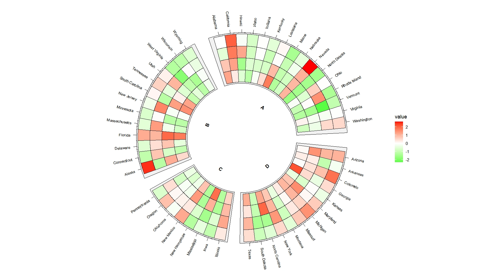


We should add **mark** variable in mappig:

```r
ggcirclize(data = mat.long,mg.t = 2.5,mg.b = 2.5,
           mapping = aes(x = x,y = variable,fill = value,
                         sector = gp,end = 360)) +
  geom_tracktile2(aes(mark = sig),
                  add.yaxis = F,strip.label.pos = "bottom",scales = "free_x") +
  scale_fill_gradient2(low = "green",mid = "white",high = "red",midpoint = 0)
```
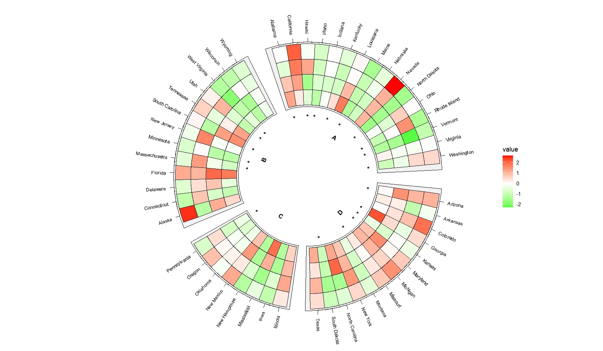

### matrix mark annotation

If you have a matrix mark annotation for each cell, you should set **mark.mat=TRUE** and supply
a long format mark annotation data.

---

Parepare data:

```r
set.seed(111)
mat_sig <- data.frame(USArrests)
mat_sig$gp <- mat$gp
mat_sig$x <- rownames(mat_sig)
mat_sig[,1:4] <- sample(c("","*"),200,replace = T)

# check
head(mat_sig,3)
#         Murder Assault UrbanPop Rape gp       x
# Alabama      *                     *  A Alabama
# Alaska               *        *    *  B  Alaska
# Arizona      *       *             *  D Arizona

mat_sig_long <- reshape2::melt(mat_sig,id.vars = c("x","gp"))

# check
head(mat_sig_long,3)
#         x gp variable value
# 1 Alabama  A   Murder     *
# 2  Alaska  B   Murder      
# 3 Arizona  D   Murder     *
```


If you don't set **mark.mat=TRUE**:

```r
ggcirclize(data = mat_sig_long,mg.t = 2.5,mg.b = 2.5,
           mapping = aes(x = x,y = variable,mark = value,
                         sector = gp,end = 360)) +
  geom_tracktile2(add.yaxis = F,strip.label.pos = "bottom",
                  scales = "free_x")
```
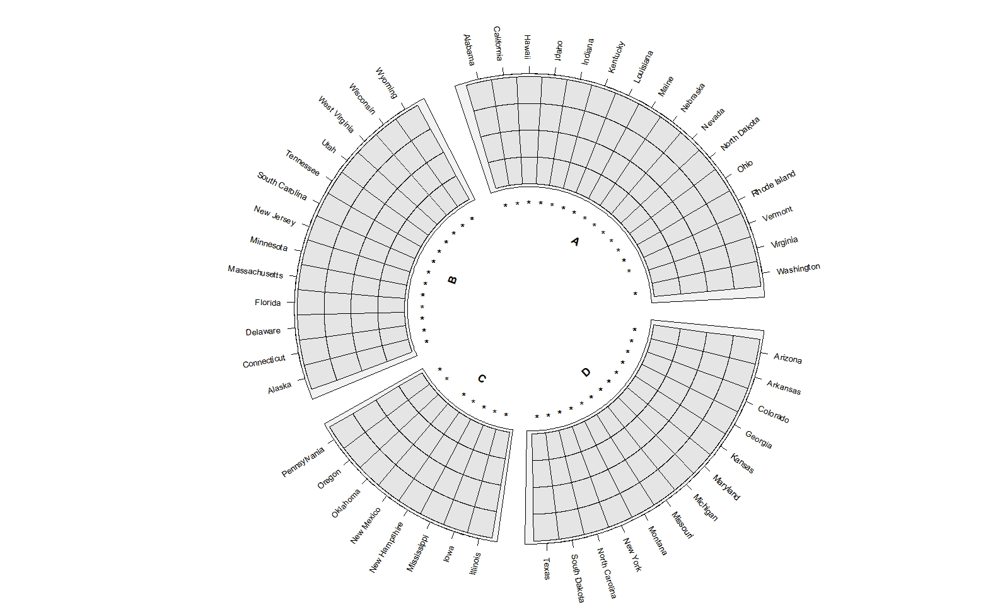


```r
ggcirclize(data = mat_sig_long,mg.t = 2.5,mg.b = 2.5,
           mapping = aes(x = x,y = variable,mark = value,
                         sector = gp,end = 360)) +
  geom_tracktile2(add.yaxis = F,strip.label.pos = "bottom",
                  scales = "free_x",
                  mark.mat = T)
```
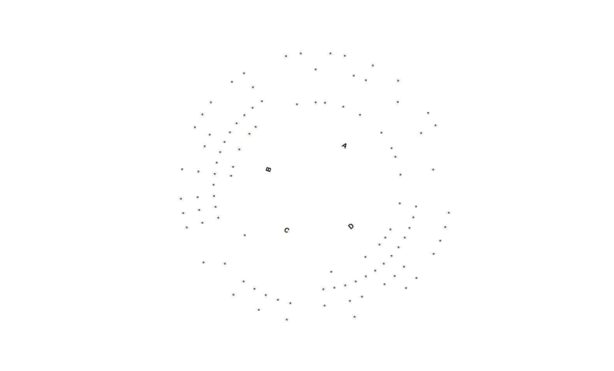

Combine heatmap and mark annotation layers:

```r
ggcirclize(data = mat_sig_long,mg.t = 2.5,mg.b = 2.5,
           mapping = aes(sector = gp,start = 90,end = 360)) +
  geom_tracktile2(data = mat.long,
                  aes(x = x,y = variable,fill = value),
                  add.yaxis = c(T,F,F,F),
                  yAxis.params = list(axis.type = "y",pos = "right"),
                  strip.label.pos = "bottom",
                  scales = "free_x") +
  geom_tracktile2(aes(x = x,y = variable,mark = value),
                  add.yaxis = F,strip.label.pos = "bottom",
                  scales = "free_x",
                  mark.mat = T) +
  scale_fill_gradient2(low = "green",mid = "white",high = "red",midpoint = 0)
```
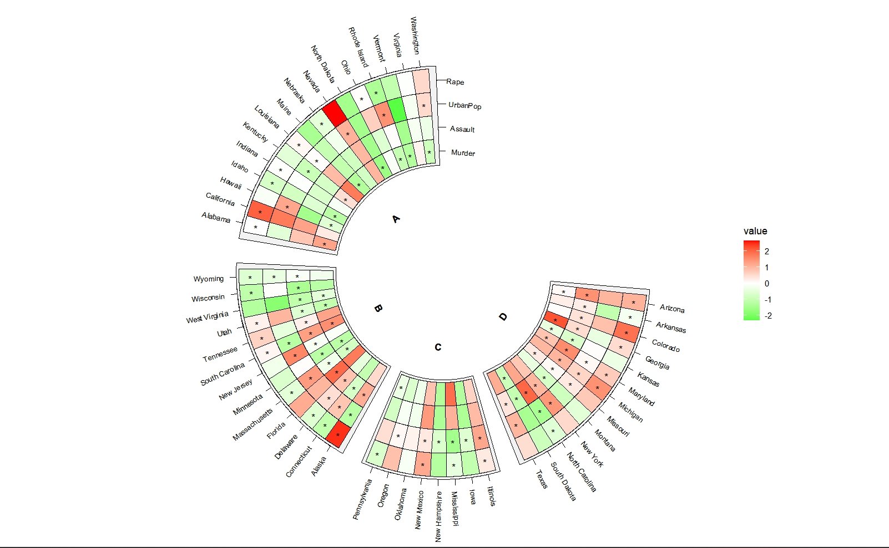


## geom_trackgenomictile2

### single mark annotation

Imagine we have **sig** column to annotate for each row:

```r
set.seed(111)
bed = generateRandomBed(nr = 100, nc = 4)
bed$sig <- sample(c("","*"),107,replace = T)

# check
head(bed,3)
#     chr     start       end     value1     value2      value3     value4 sig
# 1 chr1  11430681  19926061 -0.5968045 -0.9207672 -1.13299798 -0.6809522    
# 2 chr1  45779013 121260167  0.1820934  1.3590278  0.58149679  0.2405623   *
# 3 chr1 121534504 127361787  0.1808312  0.0956222 -0.05807752  0.3709858    

bed_long <- bedMatTolong(bed,retain.var = "sig")

head(bed_long,3)
#    chr     start       end x sig variable      value y
# 1 chr1  11430681  19926061 1       value1 -0.5968045 1
# 2 chr1  45779013 121260167 2   *   value1  0.1820934 1
# 3 chr1 121534504 127361787 3       value1  0.1808312 1
```


Add marks:

```r
ggcirclize(bed_long,aes(end = 360,r0 = 0.6,r1 = 0.9,
                        chr = chr,gstart = start,gend = end)) +
  geom_trackgenomictile2(aes(x = x,y = y,fill = value,mark = sig),
                         add_link = T,
                         chrom_data = chrom_hg19,strip.label = T) +
  scale_fill_gradient2(low = "green",mid = "white",high = "red",midpoint = 0)
```
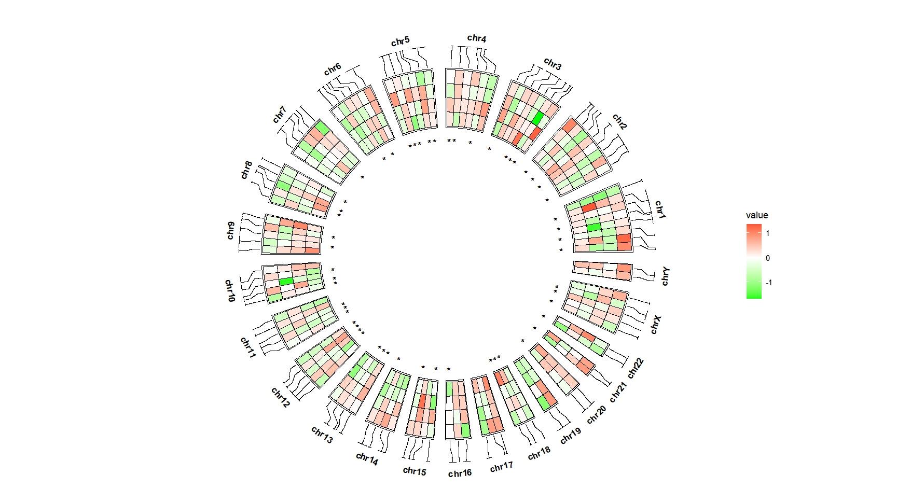

Adjust the mark annotation position:

```r
ggcirclize(bed_long,aes(end = 360,r0 = 0.6,r1 = 0.9,
                        chr = chr,gstart = start,gend = end)) +
  geom_trackgenomictile2(aes(x = x,y = y,fill = value,mark = sig),
                         add_link = T,
                         chrom_data = chrom_hg19,strip.label = T,
                         mark.shift = -0.05) +
  scale_fill_gradient2(low = "green",mid = "white",high = "red",midpoint = 0)
```
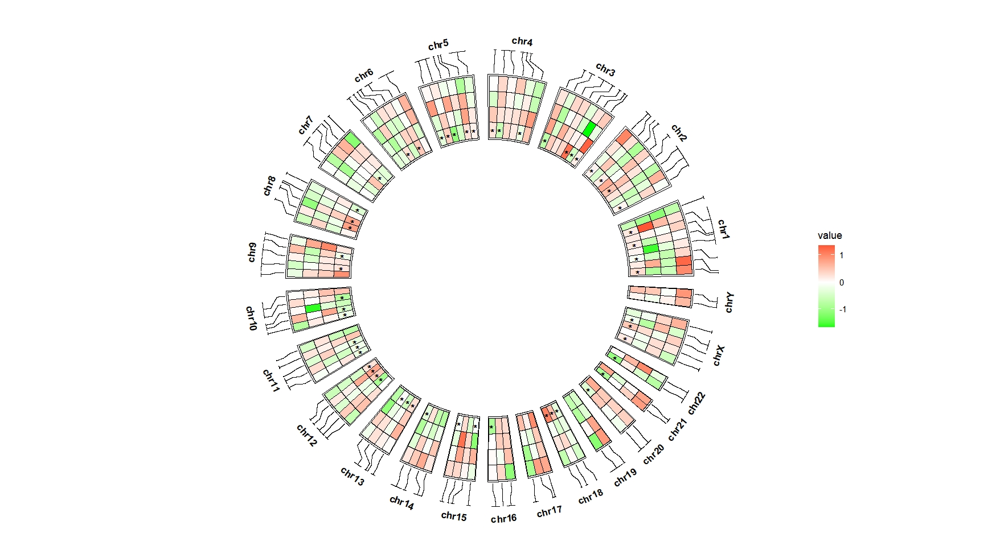

Put them on the top:

```r
ggcirclize(bed_long,aes(end = 360,r0 = 0.6,r1 = 0.9,
                        chr = chr,gstart = start,gend = end)) +
  geom_trackgenomictile2(aes(x = x,y = y,fill = value,mark = sig),
                         add_link = T,link_pos = "bottom",
                         chrom_data = chrom_hg19,strip.label = T,
                         mark.pos = "top") +
  scale_fill_gradient2(low = "green",mid = "white",high = "red",midpoint = 0)
```
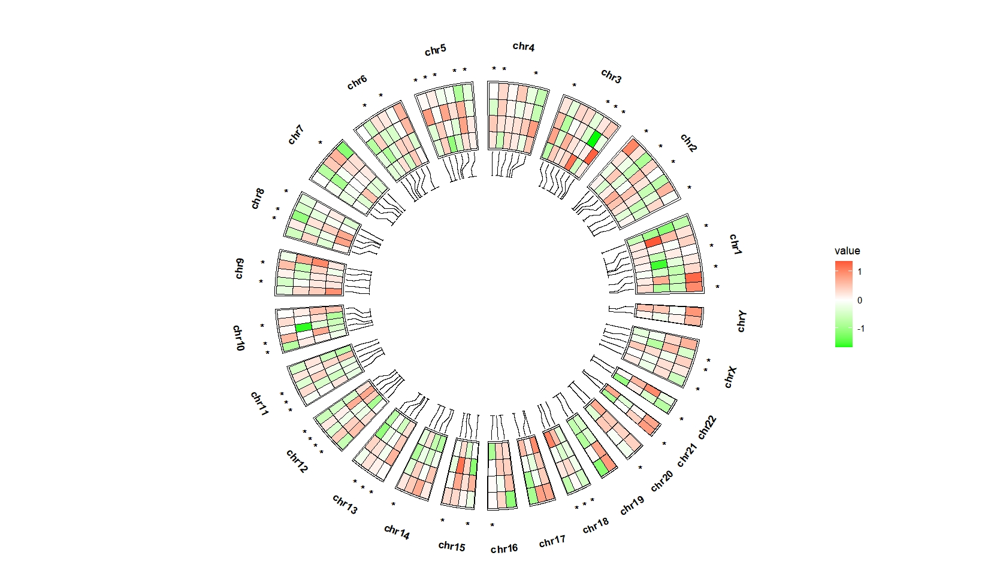

Assign other symbol:

```r
bed_long <- bed_long %>% 
  mutate(sig = ifelse(sig == "*","@",sig))

ggcirclize(bed_long,aes(end = 360,r0 = 0.6,r1 = 0.9,
                        chr = chr,gstart = start,gend = end)) +
  geom_trackgenomictile2(aes(x = x,y = y,fill = value,mark = sig),
                         add_link = T,link_pos = "bottom",
                         chrom_data = chrom_hg19,strip.label = T,
                         mark.pos = "top") +
  scale_fill_gradient2(low = "green",mid = "white",high = "red",midpoint = 0)
```
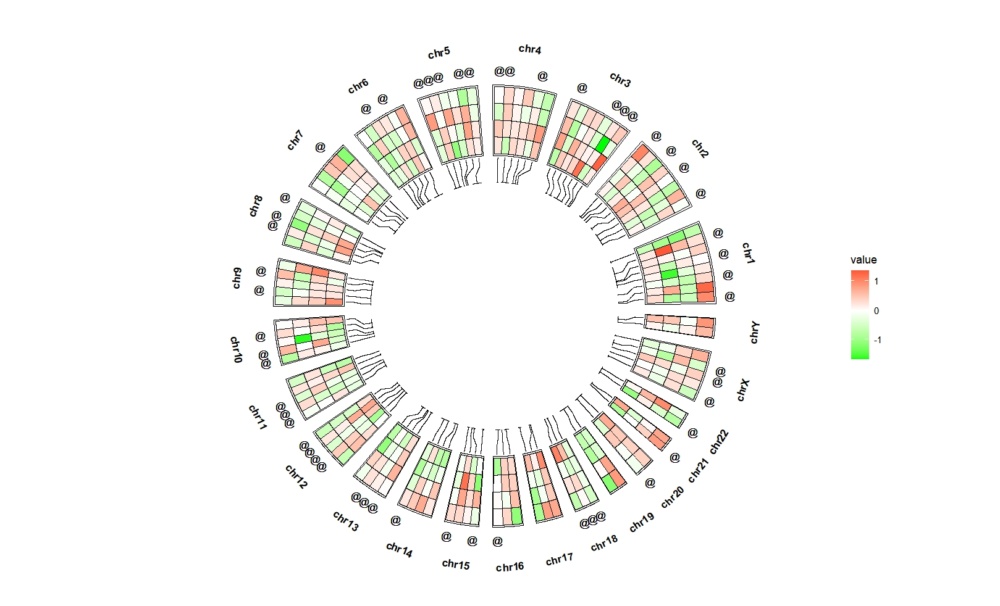


### matrix mark annotation


```r
set.seed(111)
bed_sig = generateRandomBed(nr = 100, nc = 4)
bed_sig[,4:7] <- sample(c("","*"),4*107,replace = T)

# check
head(bed_sig,3)
#    chr     start       end value1 value2 value3 value4
# 1 chr1  11430681  19926061                            
# 2 chr1  45779013 121260167      *      *      *      *
# 3 chr1 121534504 127361787             *              

bed_long_sig <- bedMatTolong(bed_sig)

# check
head(bed_long_sig,3)
#    chr     start       end x variable value y
# 1 chr1  11430681  19926061 1   value1       1
# 2 chr1  45779013 121260167 2   value1     * 1
# 3 chr1 121534504 127361787 3   value1       1
```


Plot:

```r
ggcirclize(bed_long_sig,aes(end = 360,r0 = 0.6,r1 = 0.9,
                            chr = chr,gstart = start,gend = end)) +
  geom_trackgenomictile2(aes(x = x,y = y,mark = value),
                         add_link = T,chrom_data = chrom_hg19,
                         strip.label = T,
                         mark.mat = T)
```
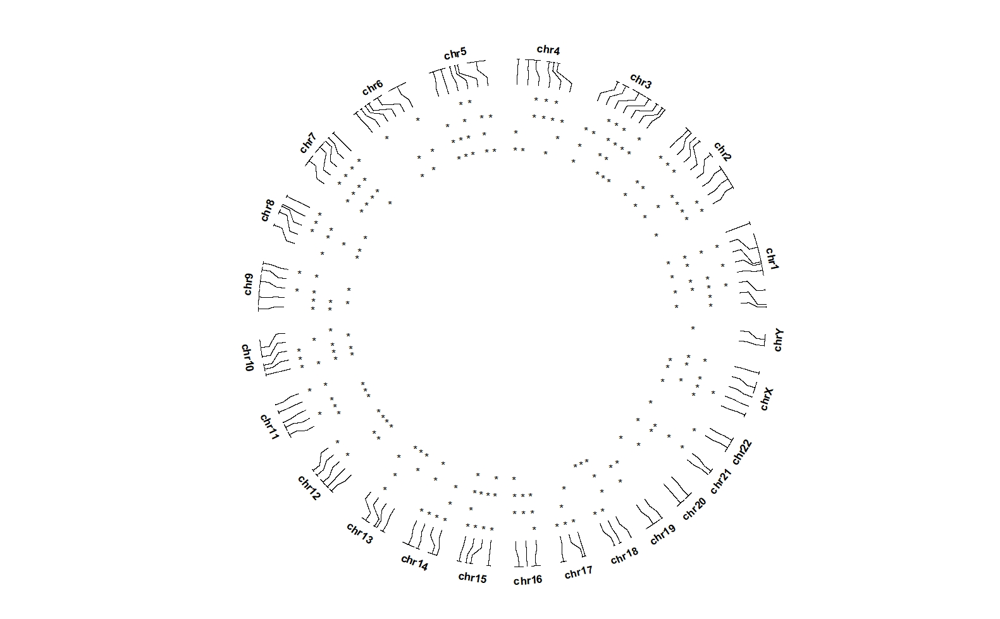

Combine with heatmap:

```r
ggcirclize(bed_long_sig,aes(end = 360,r0 = 0.6,r1 = 0.9,
                            chr = chr,gstart = start,gend = end)) +
  geom_trackgenomictile2(data = bed_long,
                         aes(x = x,y = y,fill = value),
                         add_link = T,chrom_data = chrom_hg19,strip.label = T) +
  scale_fill_gradient2(low = "green",mid = "white",high = "red",midpoint = 0) +
  geom_trackgenomictile2(aes(x = x,y = y,mark = value),
                         add_link = F,chrom_data = chrom_hg19,
                         strip.label = F,
                         mark.mat = T)
```
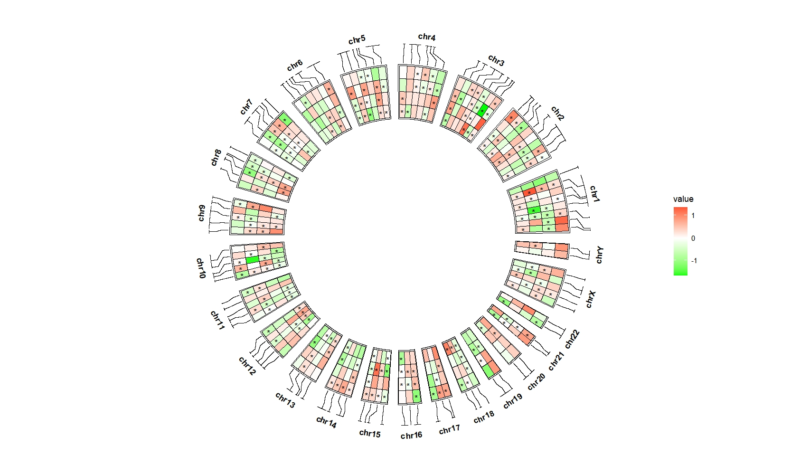


