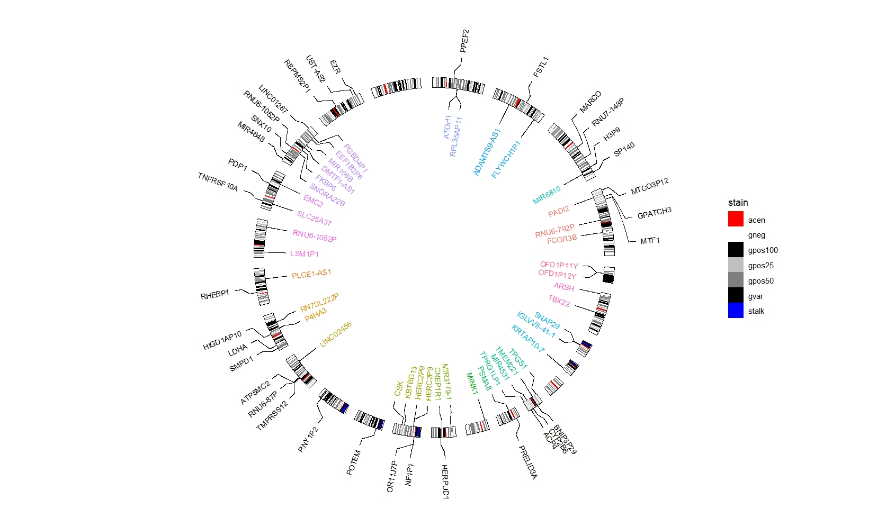

# Adding gene labels

Here shows an example to add gene names from gtf file on genome track. You only need to
extract the gene regions which inlude **seqname, start,end and geneName**. That's enough.

---

Process gtf file:

```r
library(rtracklayer)
library(tidyverse)
library(ggcirclize)

gtf <- import.gff("Homo_sapiens.GRCh38.110.chr.gtf.gz") %>% as.data.frame()

sample_genes <- sample(unique(gtf$gene_name),40,replace = F)

genes_region <- gtf %>% filter(gene_name %in% sample_genes & type == "gene") %>% 
  mutate(seqnames = paste0("chr",seqnames))

# check
head(genes_region[,1:7],3)
#   seqnames     start       end width strand         source type
# 1     chr1  17066761  17119451 52691      - ensembl_havana gene
# 2     chr1 111490317 111490423   107      -        ensembl gene
# 3     chr1 161623196 161631963  8768      - ensembl_havana gene

sample_genes2 <- sample(unique(gtf$gene_name),40,replace = F)

genes_region2 <- gtf %>% filter(gene_name %in% sample_genes2 & type == "gene") %>% 
  mutate(seqnames = paste0("chr",seqnames))
```


Plot:

```r
data("hg38_chrom_info")
cytoband_hg38 <- hg38_chrom_info$cytoband

ggcirclize(cytoband_hg38,
           aes(end = 360,genome = "hg38",
               chr = chr,gstart = start,gend = end)) +
  ggcirclize::geom_trackgenomicrect(aes(r0 = 0.8,r1 = 0.85,fill = stain),
                                    color = NA,add.xaxis = F,strip.label = F) +
  scale_fill_manual(values = c("gneg" = "white","gpos25" = "grey75","gpos50" = "grey50",
                               "gpos100" = "black","gvar" = "black","acen" = "red",
                               "stalk" = "blue")) +
  ggcirclize::geom_trackgenomiclabel2(data = genes_region,
                                      aes(r0 = 0.7,r1 = 0.7,label = gene_name,
                                          chr = seqnames,gstart = start,gend = end,
                                          color = seqnames),
                                      keep.all.chrom = T,
                                      strip.label = F) +
  ggcirclize::geom_trackgenomiclabel(data = genes_region2,
                                      aes(r0 = 0.95,r1 = 0.95,label = gene_name,
                                          chr = seqnames,gstart = start,gend = end),
                                     link_pos = "bottom",
                                      keep.all.chrom = T,
                                      strip.label = F)
```

