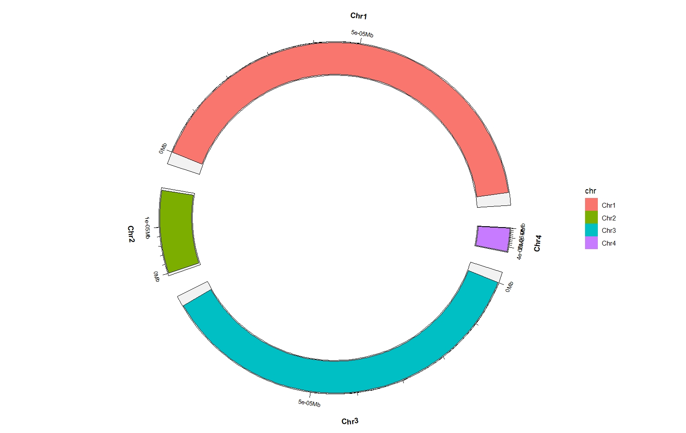

# Creating your own genome track

You can supply your own genome chromosome size data to create your own genome track besides the
model organisms. Here is a simple example.

---

```r
my_chr <- data.frame(chr = paste0("Chr",1:4),size = sample(seq(1,100,1),4,replace = T))
my_chr
#    chr size
# 1 Chr1   98
# 2 Chr2   18
# 3 Chr3   84
# 4 Chr4    5

chr_df <- data.frame(chr = my_chr$chr,start = 0,end = my_chr$size)
chr_df
#    chr start end
# 1 Chr1     0  98
# 2 Chr2     0  18
# 3 Chr3     0  84
# 4 Chr4     0   5

ggcirclize(chr_df,
           aes(end = 360,genome = "my_chr",
               chr = chr,gstart = start,gend = end)) +
  ggcirclize::geom_trackgenomicrect(aes(r0 = 0.8,r1 = 1,fill = chr))
```

