# Geom arc layers

Based the **arcGrobs** we have created, we can transform them into geom layers by using
**ggplot2** grammer for better visualisation. The following contents we will describe relative
geom arc layers.

The basic arguments for each layer includes: **start, end, r0, r1, clock.wise**. You can re-specify
them in each geom mapping parameters.

---

## geom_arcpoint

**geom_arcpoint** draws scatter point like **geom_point**.

---

Simple scatter point:

```r
ggcirclize(data = mtcars,
           mapping = aes(x = mpg,y = disp)) +
  geom_arcpoint()
```
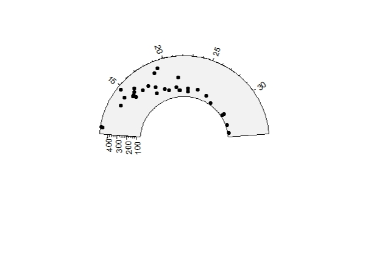

Mapping with colors:

```r
ggcirclize(data = mtcars,
           mapping = aes(x = mpg,y = disp,end = 270)) +
  geom_arcpoint(aes(color = factor(cyl)))
```
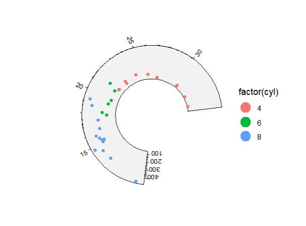

You can adjust the axis settings with **yAxis.params** and **xAxis.params**:

```r
ggcirclize(data = mtcars,
           mapping = aes(x = mpg,y = disp)) +
  geom_arcpoint(yAxis.params = list(yscale = c(100,800)),
                xAxis.params = list(xscale = c(-50,100)))
```
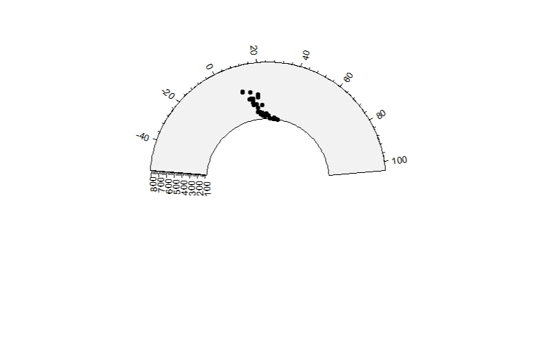


Mapping with size and color:

```r
ggcirclize(data = mtcars,
           mapping = aes(x = mpg,y = disp,
                         color = as.character(cyl),size = qsec)) +
  geom_arcpoint()
```
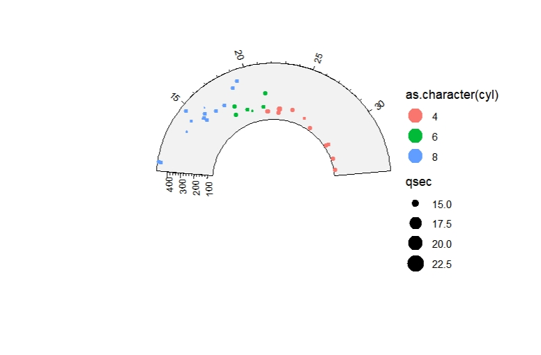


Mapping with gradient color:

```r
ggcirclize(data = mtcars,
           mapping = aes(x = mpg,y = disp,
                         color = qsec,size = qsec)) +
  geom_arcpoint(end = 270,r0 = 0.3,r1 = 0.8) +
  scale_color_gradient(low = "blue",high = "red")
```
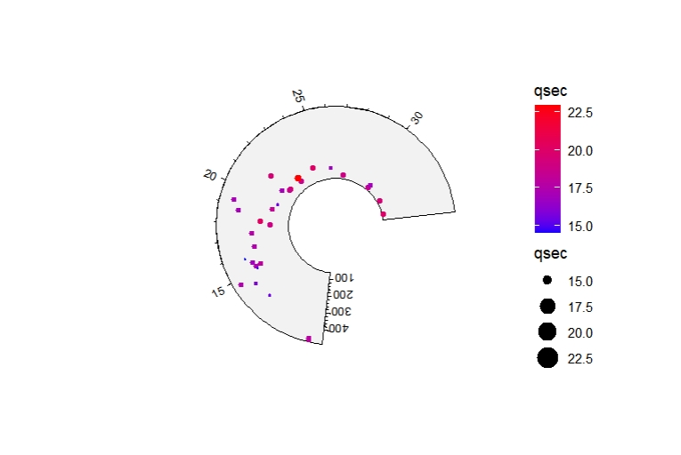


Control the background graphic settings:

```r
ggcirclize(data = mtcars,mapping = aes(x = mpg,y = disp)) +
  geom_arcpoint(sector.bg.fill = "orange",
                sector.bg.lty = "dashed",
                sector.bg.lwd = 2)
```
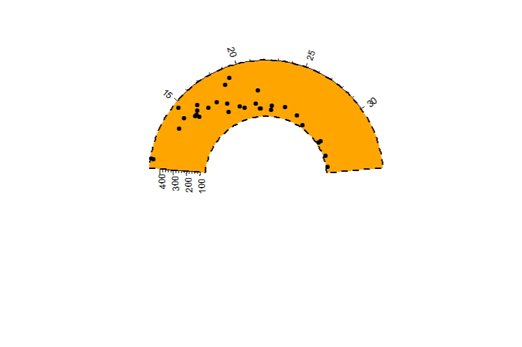


## geom_arcsegment

**geom_arcsegment** draws segment line like **geom_segment**.

---

```r
df <- data.frame(x = c(rep(0,4),0:4),x1 = c(rep(4,4),0:4),
                 y = c(0:4,rep(0,4)),y1 = c(0:4,rep(4,4)),
                 g = LETTERS[1:9])

ggcirclize(df) +
  geom_arcsegment(aes(xmin = x,xmax = x1,ymin = y,ymax = y1))
```
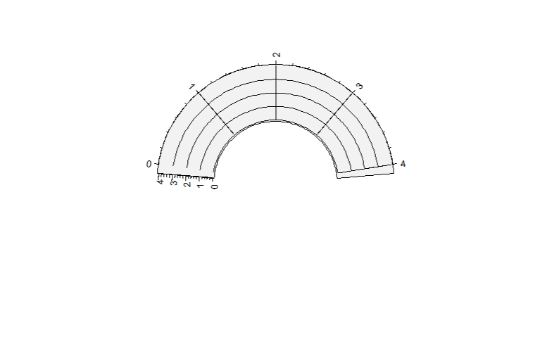

Add arrows:

```r
ggcirclize(df) +
  geom_arcsegment(aes(xmin = x,xmax = x1,ymin = y,ymax = y1,
                      color = g),linewidth = 3,
                  arrow = arrow(type = "closed"))
```
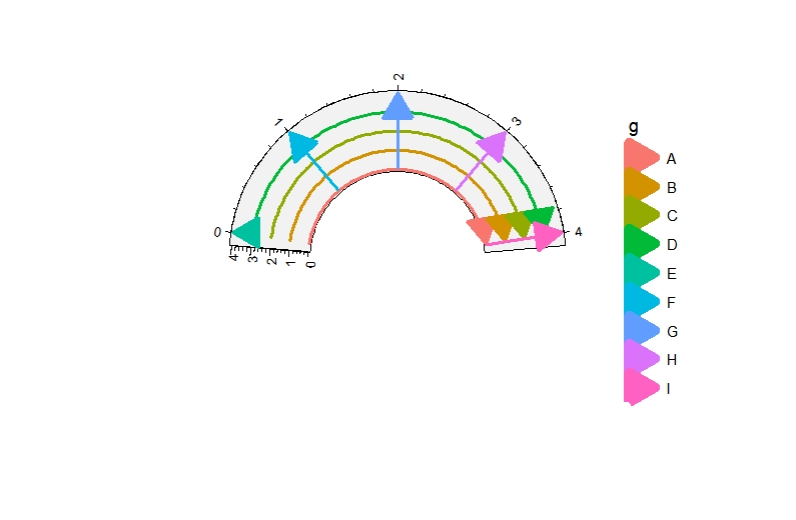

## geom_arcline

**geom_arcline** draws line like **geom_line**.

---

```r
ggcirclize(mtcars,aes(mpg,disp,color = factor(cyl))) +
  geom_arcline(linewidth = 5)
```
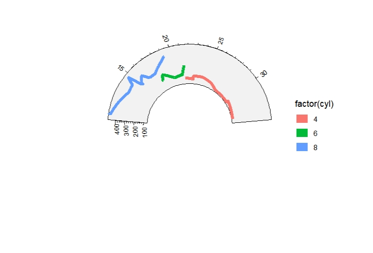

## geom_arcpath

**geom_arcpath** draws line like **geom_path**.

---

```r
df <- data.frame(x = 1:3, y = c(4, 1, 9))

ggplot(df, aes(x, y)) +
  geom_path(linewidth = 10)
```
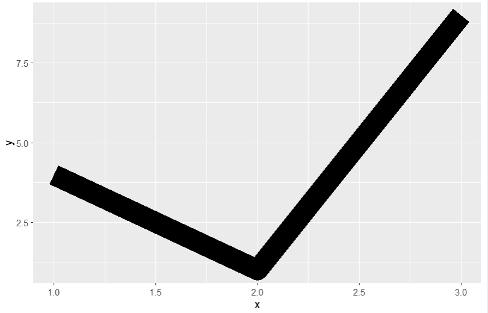

See what **geom_arcpath** output:

```r
ggcirclize(df, aes(x, y)) +
  geom_arcpath(linewidth = 10)
```
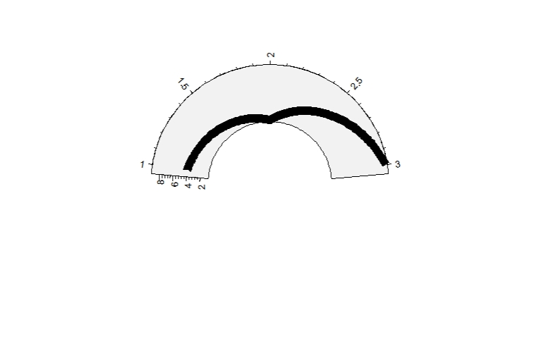


```r
x <- seq(0.01, .99, length.out = 100)
df <- data.frame(
  x = rep(x, 2),
  y = c(qlogis(x), 2 * qlogis(x)),
  group = rep(c("a","b"),
              each = 100)
)

ggplot(df, aes(x=x, y=y, group=group)) +
  geom_line(aes(colour = group), linetype = 2)
```
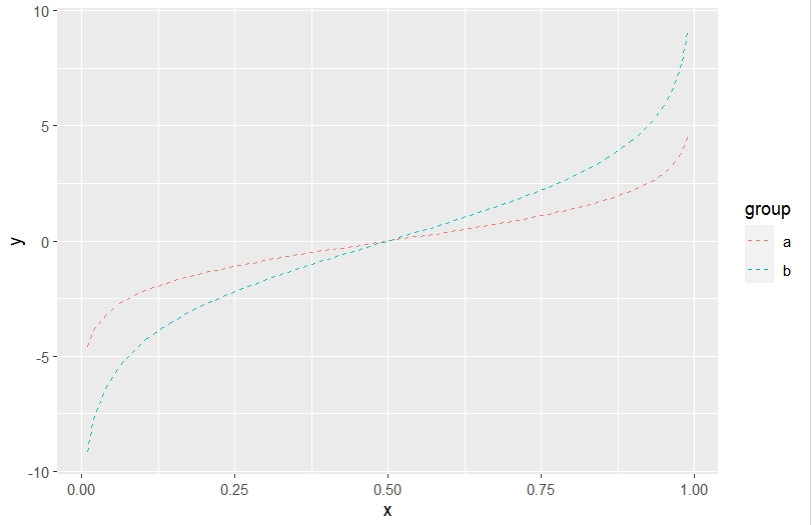


```r
ggcirclize(df, aes(x=x, y=y, group = group,color = group)) +
  geom_arcpath(linetype = 2)
```
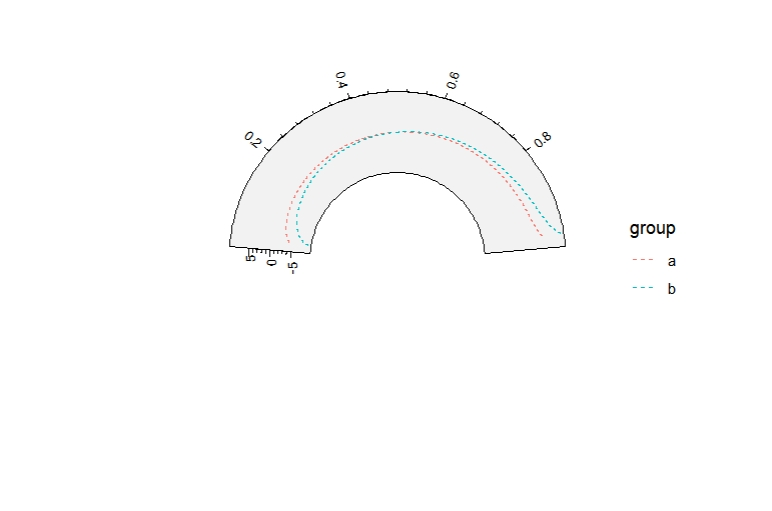


## geom_arcpolygon

**geom_arcpolygon** draws polygon like **geom_polygon**.

---

First we see output with ggplot:

```r
ids <- factor(c("1.1", "2.1", "1.2", "2.2", "1.3", "2.3"))

values <- data.frame(
  id = ids,
  value = c(3, 3.1, 3.1, 3.2, 3.15, 3.5)
)

positions <- data.frame(
  id = rep(ids, each = 4),
  x = c(2, 1, 1.1, 2.2, 1, 0, 0.3, 1.1, 2.2, 1.1, 1.2, 2.5, 1.1, 0.3,
        0.5, 1.2, 2.5, 1.2, 1.3, 2.7, 1.2, 0.5, 0.6, 1.3),
  y = c(-0.5, 0, 1, 0.5, 0, 0.5, 1.5, 1, 0.5, 1, 2.1, 1.7, 1, 1.5,
        2.2, 2.1, 1.7, 2.1, 3.2, 2.8, 2.1, 2.2, 3.3, 3.2)
)

# Currently we need to manually merge the two together
datapoly <- merge(values, positions, by = c("id"))

ggplot(datapoly, aes(x = x, y = y)) +
  geom_polygon(aes(fill = value, group = id))
```
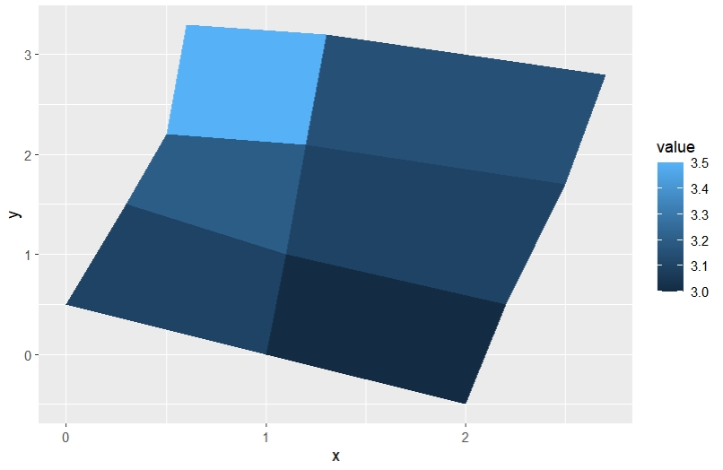

**geom_arcpolygon** outputs:

```r
ggcirclize(datapoly, aes(x = x, y = y)) +
  geom_arcpolygon(aes(fill = value, group = id))
```
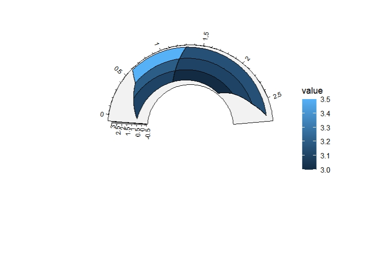

The **id** is used to distinguish the groups:

```r
df <- data.frame(x = c(0.1,0.2,0.3,0.4,0.5,0.4,0.7,0.6,0.7),
                 y = c(0.1,0.9,0.1,0.1,0.5,0.9,0.9,0.5,0.1),
                 id = c(rep(1,3),rep(2,6)))

ggcirclize(df, aes(x = x, y = y)) +
  geom_arcpolygon(aes(group = id))
```
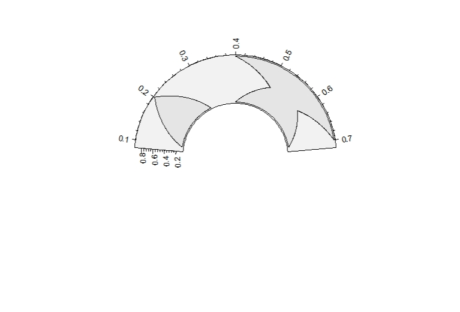

```r
d=data.frame(x=c(1,2,2, 3,4,4), y=c(1,1,2, 2,2,3),
             t=c('a', 'a', 'a',  'b', 'b', 'b'),
             r=c(1,2,3, 4,5,6))

ggcirclize(d, aes(x = x, y = y)) +
  geom_arcpolygon(aes(id = t))
```
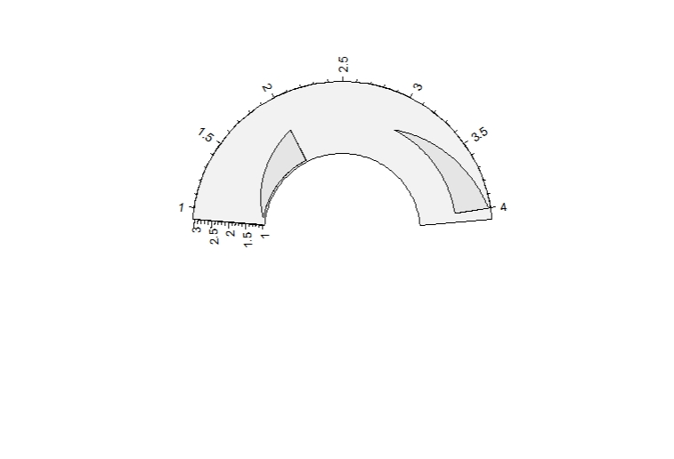


## geom_arcrect

**geom_arcrect** draws rectangle like **geom_rect**.

---


```r
df <- data.frame(
  x = rep(c(2, 5, 7, 9, 12), 2),
  y = rep(c(1, 2), each = 5),
  z = factor(rep(1:5, each = 2)),
  w = rep(diff(c(0, 4, 6, 8, 10, 14)), 2)
)

df <- df %>% mutate(xmin = x - w / 2, xmax = x + w / 2, ymin = y, ymax = y + 1)

ggplot(df, aes(xmin = xmin, xmax = xmax, ymin = ymin, ymax = ymax)) +
  geom_rect(aes(fill = z), colour = "grey50")
```
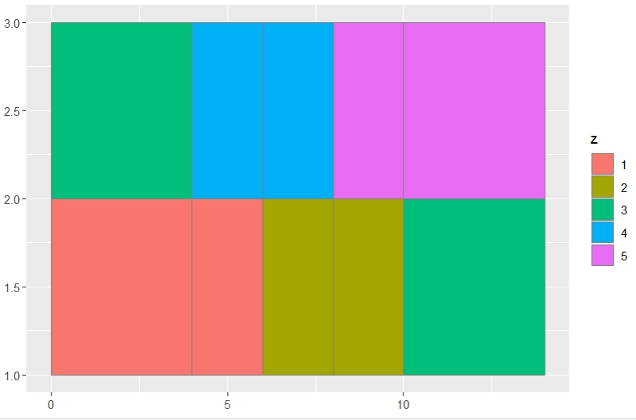


```r
ggcirclize(df,aes(xmin = xmin,xmax = xmax,ymin = ymin,ymax = ymax)) +
  geom_arcrect()
```
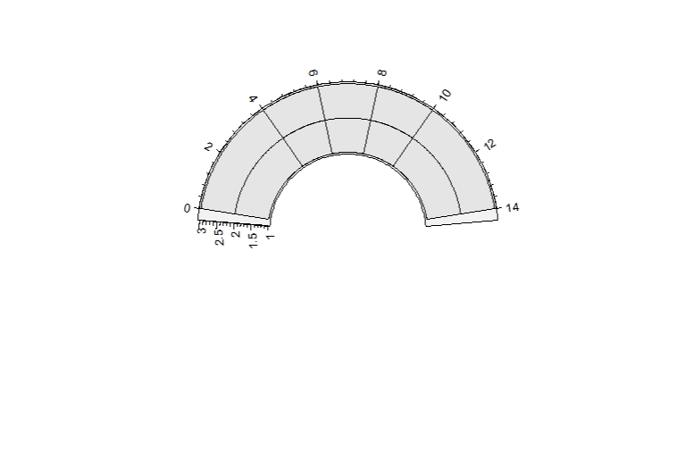

Mapping with color:

```r
ggcirclize(df,aes(xmin = xmin,xmax = xmax,ymin = ymin,ymax = ymax)) +
  geom_arcrect(aes(fill = z))

```
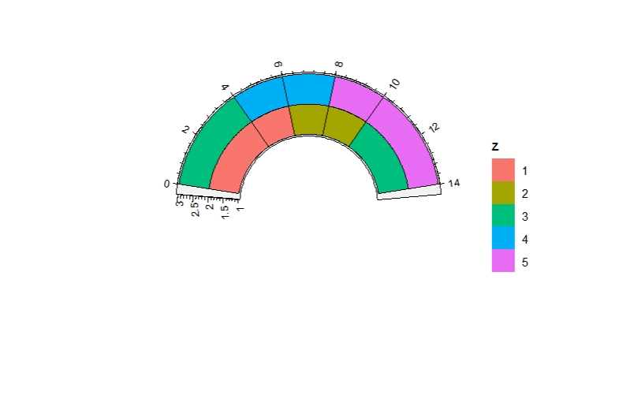

## geom_arctile

**geom_arctile** draws rectangle like **geom_tile**.

---


```r
data(USArrests)

mat <- scale(USArrests)
mat.long <- reshape2::melt(mat)

ggplot(mat.long,aes(x = Var1,y = Var2,fill = value)) +
  geom_tile() +
  scale_fill_gradient2(low = "green",mid = "black",high = "red",midpoint = 0) +
  theme(axis.text.x = element_text(angle = 90,hjust = 1,vjust = 0.5))
```
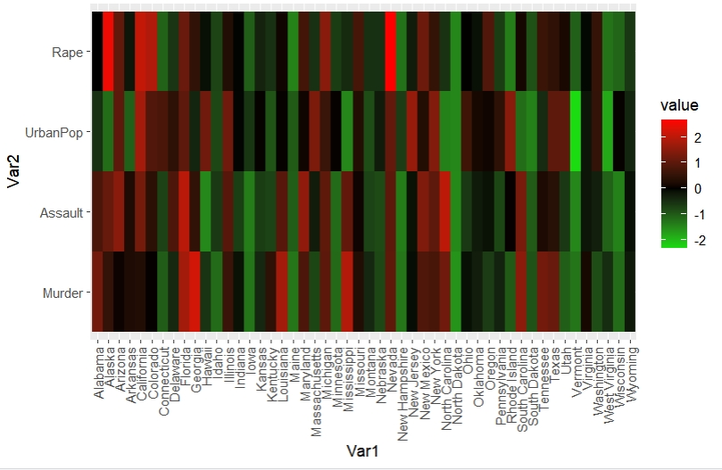

```r
ggcirclize(mat.long,aes(x = Var1,y = Var2,fill = value),mg.t = 2.5) +
  geom_arctile() +
  scale_fill_gradient2(low = "green",mid = "black",high = "red",midpoint = 0)
```
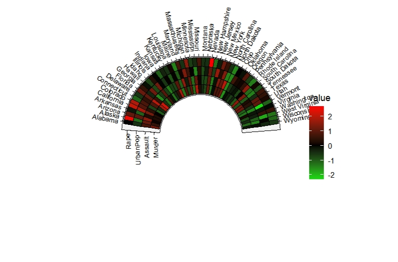


Adjust the width and height:

```r
ggcirclize(mat.long,aes(x = Var1,y = Var2,fill = value)) +
  geom_arctile(width = 0.5,height = 0.5) +
  scale_fill_gradient2(low = "green",mid = "black",high = "red",midpoint = 0)
```
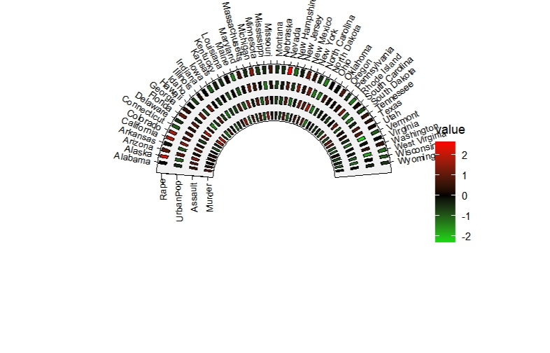

## geom_arcbar

**geom_arcbar** draws barplot like **geom_bar**.

---

```r
ggplot(mpg, aes(class)) +
  geom_bar()
```
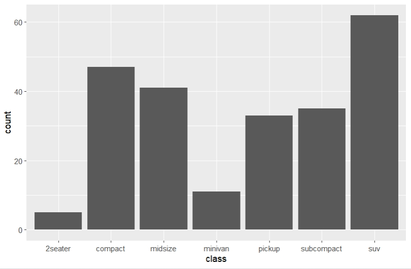


```r
ggcirclize(mpg,aes(x = class)) +
  geom_arcbar(width = 0.5)
```
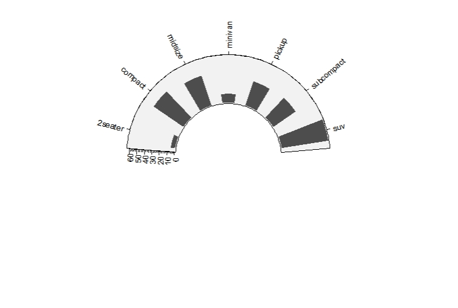

```r
ggcirclize(mpg,aes(x = class,fill = drv)) +
  geom_arcbar()
```
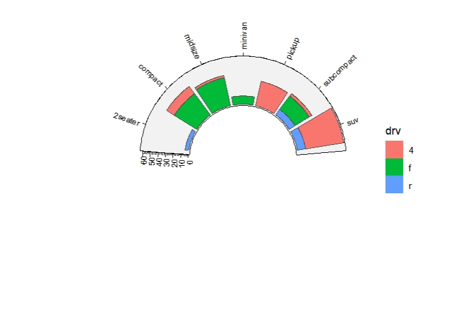


```r
ggplot(mpg, aes(class,fill = drv)) +
  geom_bar(position = position_dodge2())
```
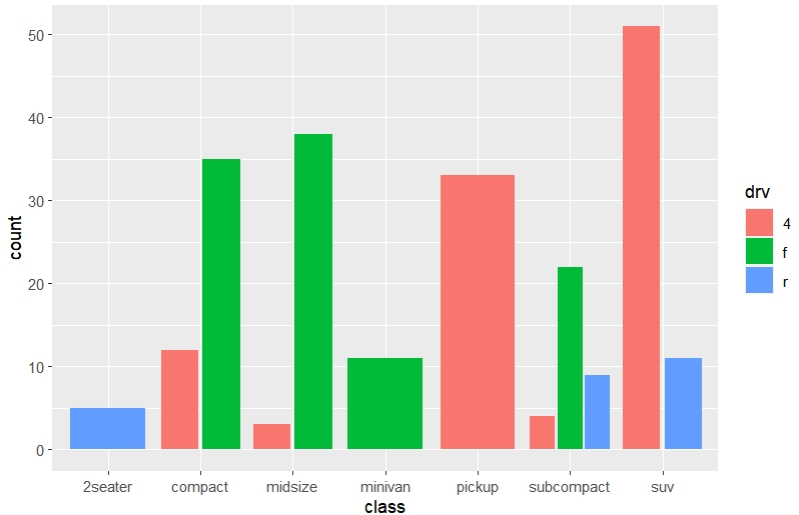

```r
ggcirclize(mpg,aes(x = class,fill = drv)) +
  geom_arcbar(position = position_dodge2())
```
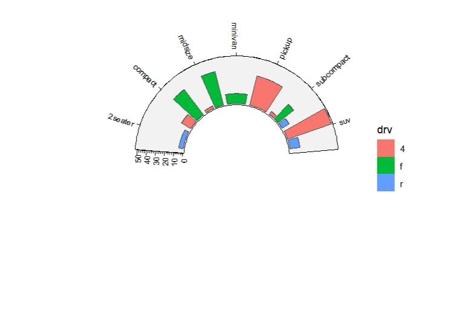


## geom_arccol

**geom_arccol** draws barplot like **geom_col**.

---


```r
df2 <- data.frame(supp=rep(c("VC", "OJ"), each=3),
                  dose=rep(c("D0.5", "D1", "D2"),2),
                  len=c(6.8, 15, 33, 4.2, 10, 29.5))

ggplot(df2, aes(x = dose, y = len)) +
  geom_col(aes(fill = supp), position = position_stack())
```
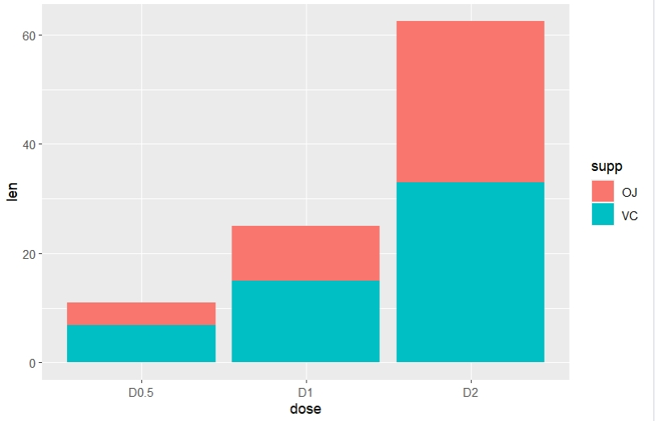

```r
ggcirclize(df2,aes(x = dose, y = len)) +
  geom_arccol(aes(fill = supp), position = position_stack())
```
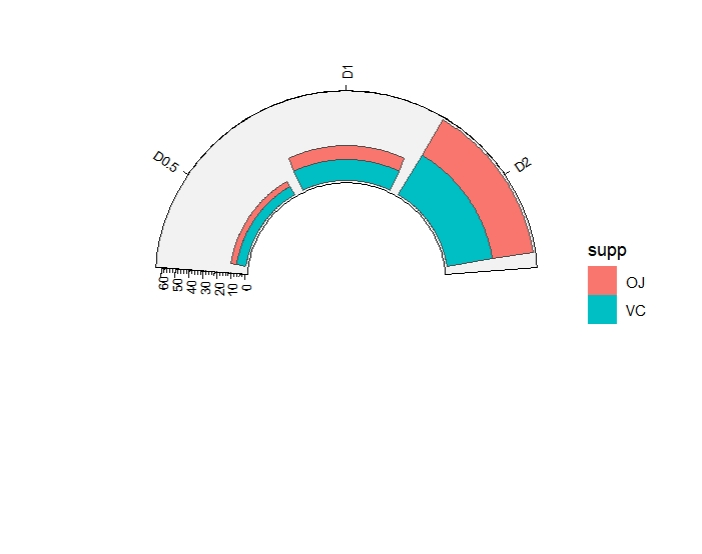


```r
ggplot(df2, aes(x = dose, y = len)) +
  geom_col(aes(fill = supp), position = position_dodge2())
```
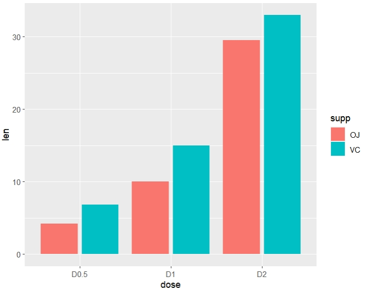

```r
ggcirclize(df2,aes(x = dose, y = len)) +
  geom_arccol(aes(fill = supp), position = position_dodge2())
```
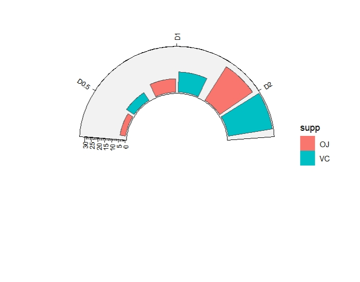


## geom_arcribbon

**geom_arcribbon** draws a y interval like **geom_ribbon**.

---


```r
huron <- data.frame(year = 1875:1972, level = as.vector(LakeHuron))
huron$g <- sample(letters[1:3],98,replace = T)

ggplot(huron, aes(year)) +
  geom_ribbon(aes(ymin = level - 1, ymax = level + 1), fill = "grey70")
```
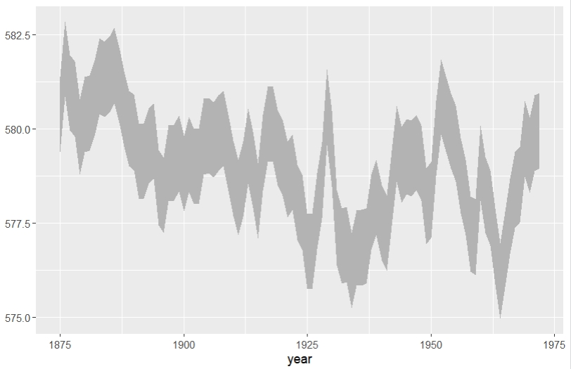


```r
ggcirclize(huron, aes(x = year)) +
  geom_arcribbon(aes(ymin = level - 1, ymax = level + 1), fill = "grey70")
```
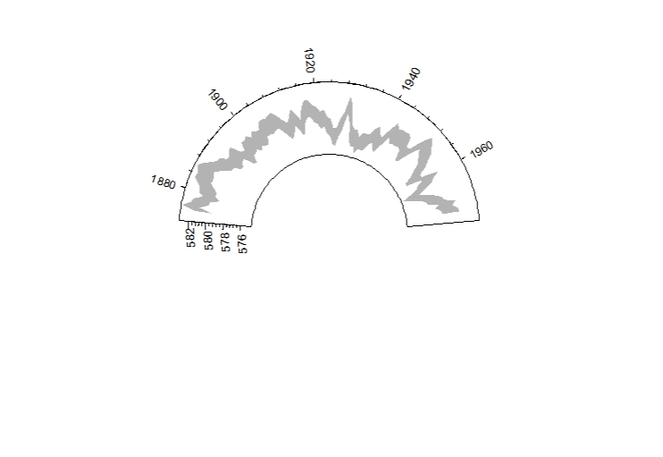

## geom_arcviolin

**geom_arcviolin** draws violin plot like **geom_violin**.

---

```r
ggplot(mtcars, aes(factor(cyl), mpg)) +
  geom_violin()
```
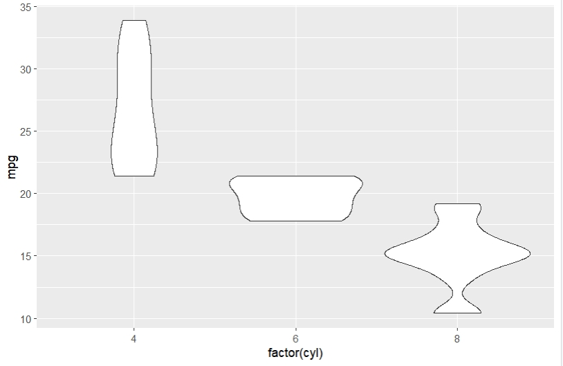

```r
ggcirclize(mtcars, aes(factor(cyl), mpg)) +
  geom_arcviolin()
```
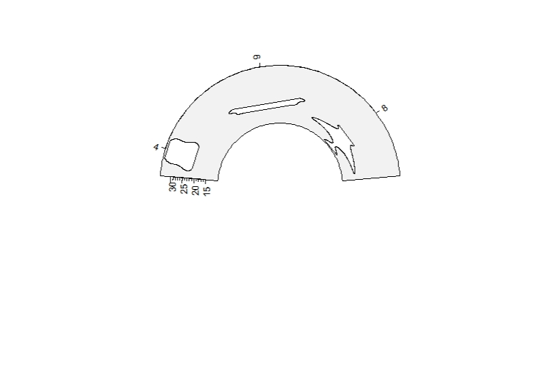

Horizontal violin:

```r
ggcirclize(mtcars, aes(x = mpg,y = factor(cyl))) +
  geom_arcviolin()
```
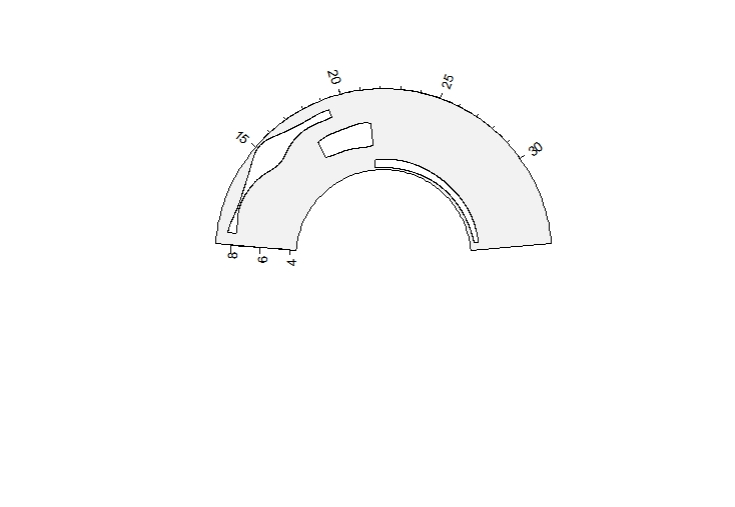
Turn off **trim**:

```r
ggcirclize(mtcars, aes(factor(cyl), mpg)) +
  geom_arcviolin(trim = FALSE)
```
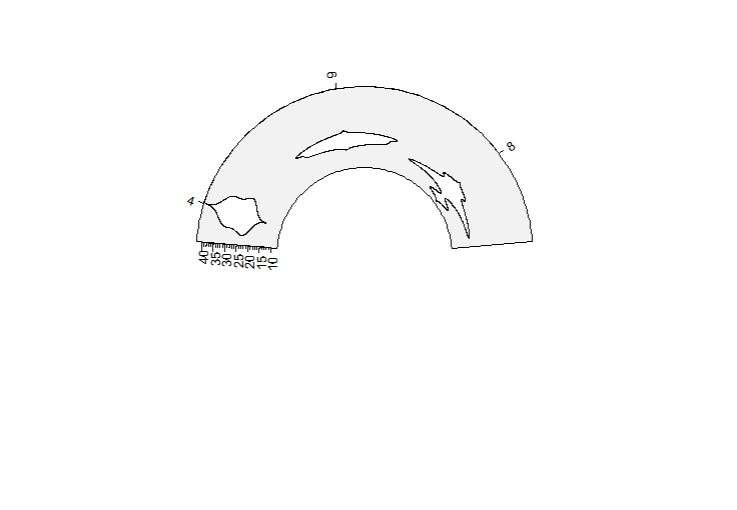

Mapping with color:

```r
ggcirclize(mtcars, aes(factor(cyl), mpg)) +
  geom_arcviolin(aes(fill = factor(cyl)))
```
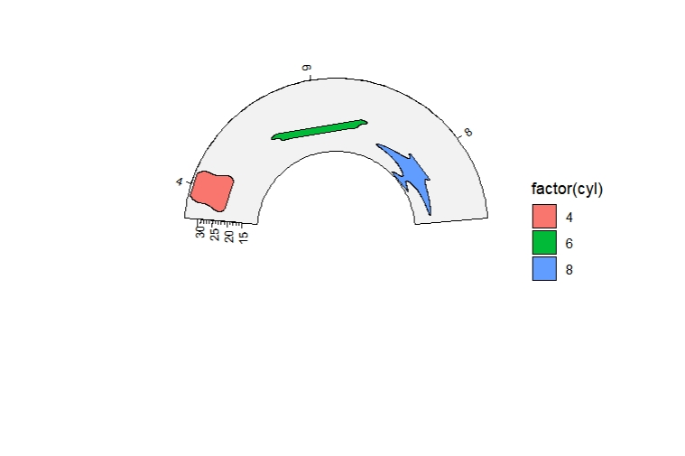

Multiple groups:

```r
ggcirclize(mtcars, aes(factor(cyl), mpg)) +
  geom_arcviolin(aes(fill = factor(am)))
```
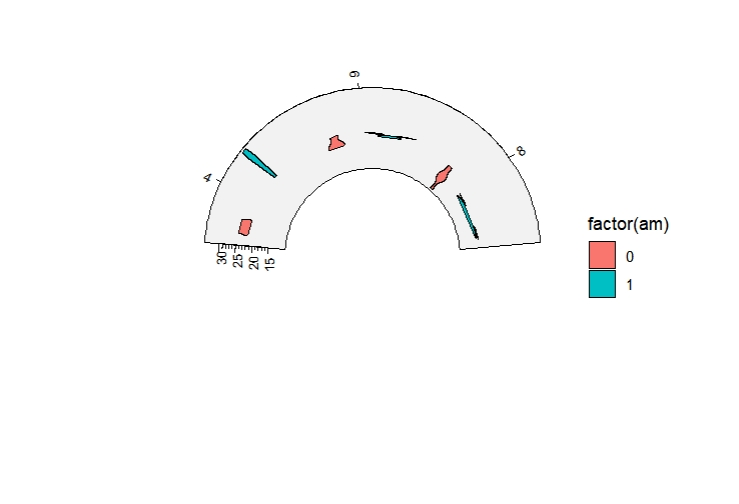

Draw quantiles:

```r
ggcirclize(mtcars, aes(factor(cyl), mpg)) +
  geom_arcviolin(draw_quantiles = c(0.25, 0.5, 0.75),
                 polar.every = T)
```
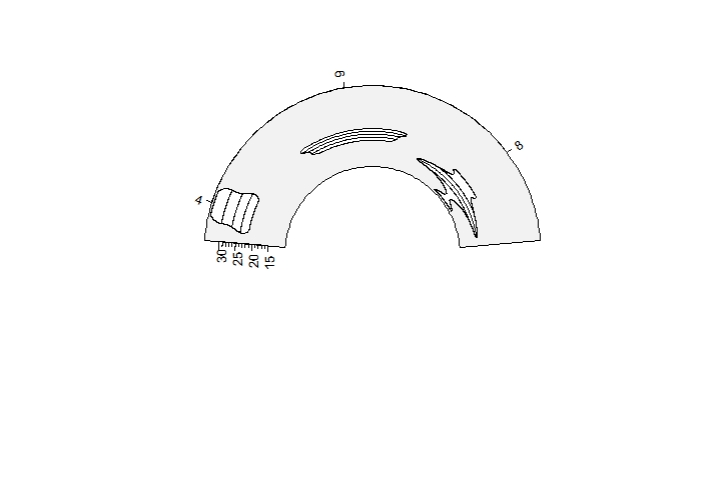
Multiple violins:

```r
dbox <- data.frame(x = rep(LETTERS[1:26],50),
                   y = rnorm(50*26))

ggcirclize(dbox, aes(x, y,start = 0,end = 360)) +
  geom_arcviolin(aes(r0 = 0.55,r1 = 0.75),
                 draw_quantiles = c(0.25, 0.5, 0.75),
                 show.legend = F)
```
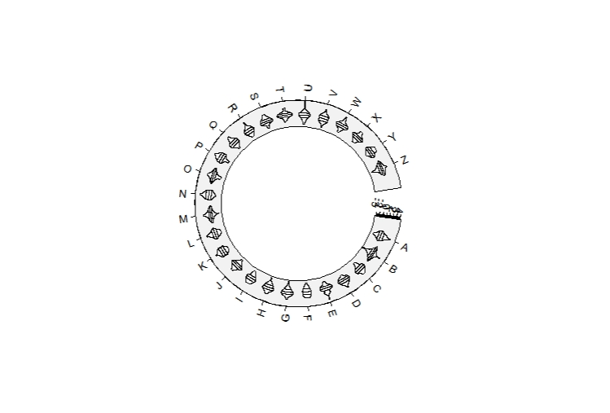

## geom_arcboxplot

**geom_arcboxplot** draws boxplot like **geom_boxplot**.

---


```r
ggplot(mpg, aes(class, hwy)) +
  geom_boxplot()
```
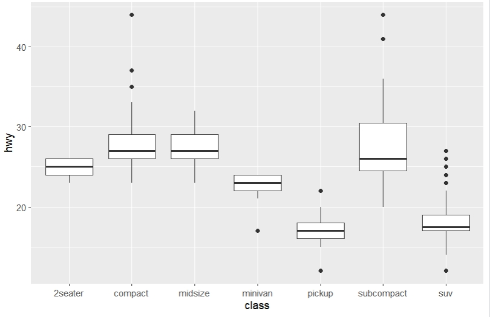


```r
ggcirclize(mpg, aes(class, hwy)) +
  geom_arcboxplot()
```
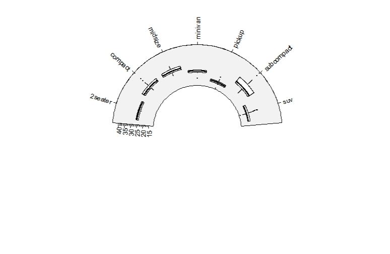

Change the outlier point graphic settings:

```r
ggcirclize(mpg, aes(class, hwy)) +
  geom_arcboxplot(outlier.size = 5,outlier.colour = "red")
```
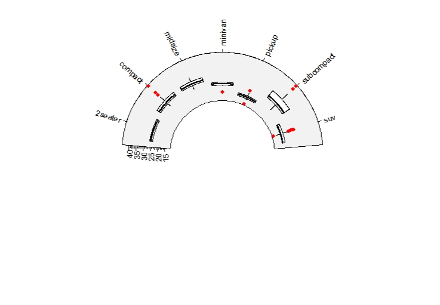

Horizontal boxplot:

```r
ggcirclize(mpg, aes(x = hwy, y = class)) +
  geom_arcboxplot()
```
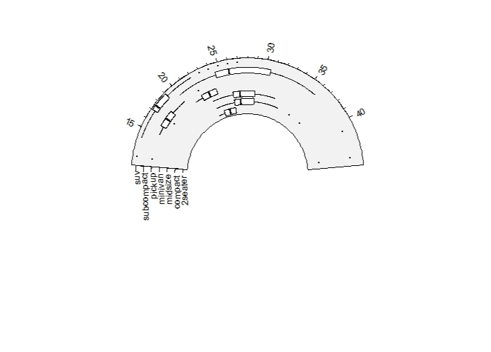

Add notch:

```r
ggplot(mpg, aes(class, hwy)) +
  geom_boxplot(notch = TRUE)
```
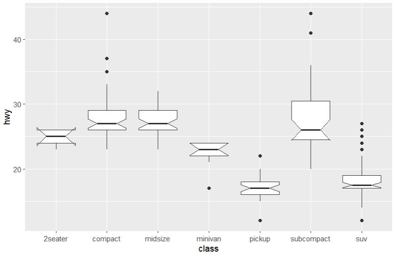


```r
ggcirclize(mpg, aes(class, hwy)) +
  geom_arcboxplot(notch = TRUE)
```
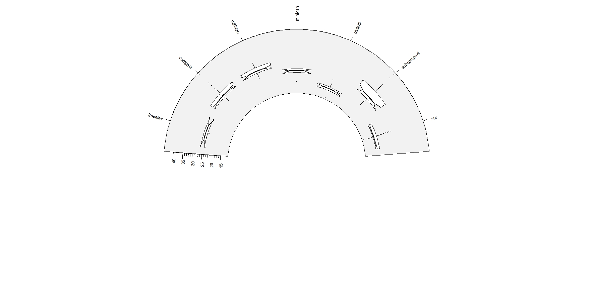


```r
ggcirclize(mpg, aes(class, hwy)) +
  geom_arcboxplot(varwidth = TRUE)
```
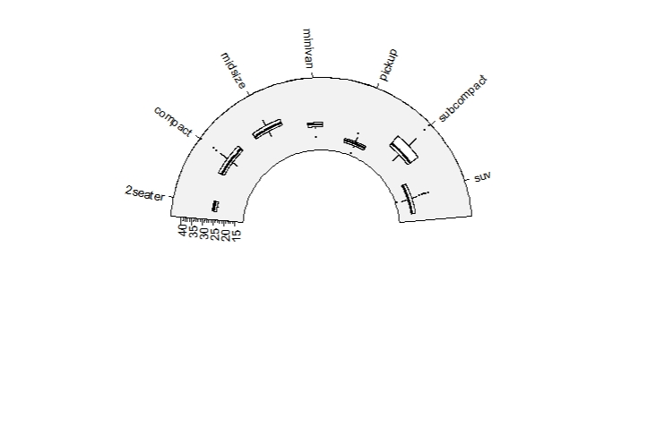

Multiple groups:

```r
ggcirclize(mpg, aes(class, hwy)) +
  geom_arcboxplot(aes(colour = drv))
```
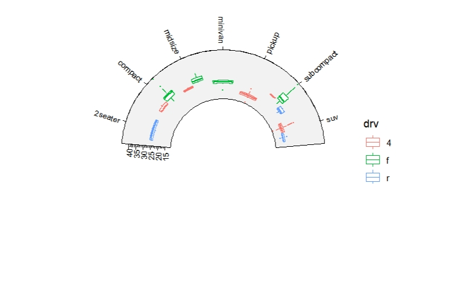

## geom_arcarea

**geom_arcarea** draws a y interval like **geom_area**.

---

```r
set.seed(1234)
df <- data.frame(
  sex=factor(rep(c("F", "M"), each=200)),
  weight=round(c(rnorm(200, mean=55, sd=5),
                 rnorm(200, mean=65, sd=5)))
)

ggplot(df, aes(x=weight)) +
  geom_area(stat = "bin")
```


```r
ggcirclize(df, aes(x=weight)) +
  geom_arcarea(stat = "bin")
```

Multiple groups:

```r
ggplot(df, aes(x=weight, fill=sex)) +
  geom_area(stat ="bin")
```


```r
ggcirclize(df, aes(x=weight, fill=sex)) +
  geom_arcarea(stat = "bin")
```


## geom_arcdensity

**geom_arcdensity** draws kernel density estimate like **geom_density**.

---


```r
ggplot(diamonds, aes(carat)) +
  geom_density()
```


```r
ggcirclize(diamonds, aes(carat)) +
  geom_arcdensity()
```


```r
ggplot(diamonds, aes(y = carat)) +
  geom_density()
```


```r
ggcirclize(diamonds, aes(y = carat)) +
  geom_arcdensity()
```


Mapping with color:

```r
ggcirclize(diamonds, aes(depth, fill = cut, colour = cut)) +
  geom_arcdensity(alpha = 0.1)
```


Different position mode:

```r
ggplot(diamonds, aes(carat, fill = cut)) +
  geom_density(position = "stack")
```


```r
ggcirclize(diamonds, aes(x = carat, fill = cut)) +
  geom_arcdensity(position = "stack")
```


```r
ggcirclize(diamonds, aes(carat, after_stat(count), fill = cut)) +
  geom_arcdensity(position = "fill")
```


## geom_archistogram

**geom_archistogram** draws frequency polygons like **geom_histogram**.

---

```r
ggplot(diamonds, aes(carat)) +
  geom_histogram()
```


```r
ggcirclize(diamonds, aes(carat)) +
  geom_archistogram()
```


Change the **binwidth**:

```r
ggcirclize(diamonds, aes(carat)) +
  geom_archistogram(binwidth = 0.01)
```


## geom_arctext

**geom_arctext** draws arc text in unit circle.

---

```r
df <- data.frame(x = 1:20,y = 1,y1 = 1:20,id = sample(LETTERS[1:4],20,replace = T),
                 label = rownames(USArrests)[1:20])

ggcirclize(df, aes(x, y, label = label)) +
  geom_arctext(aes(r0 = 1,end = 360))
```


```r
ggcirclize(df, aes(x, y, label = label)) +
  geom_arctext(aes(r0 = 1,end = 360,color = id))
```


Change **curved.label=FALSE**:

```r
ggcirclize(df, aes(x, y, label = label)) +
  geom_arctext(aes(r0 = 1,end = 360,color = id),
               curved.label = F)
```


