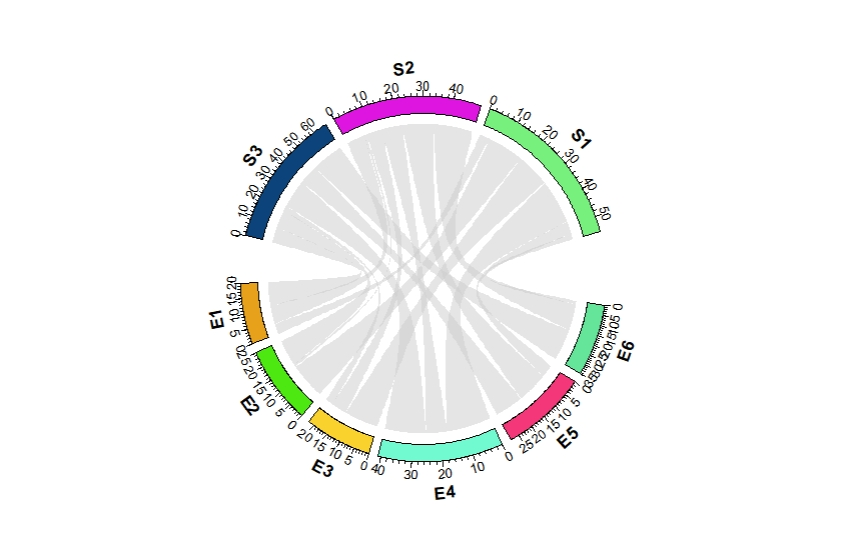
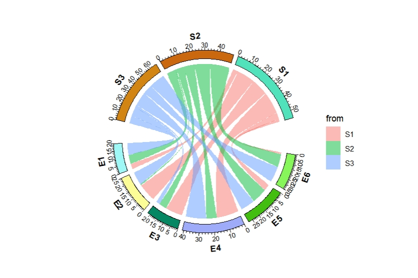
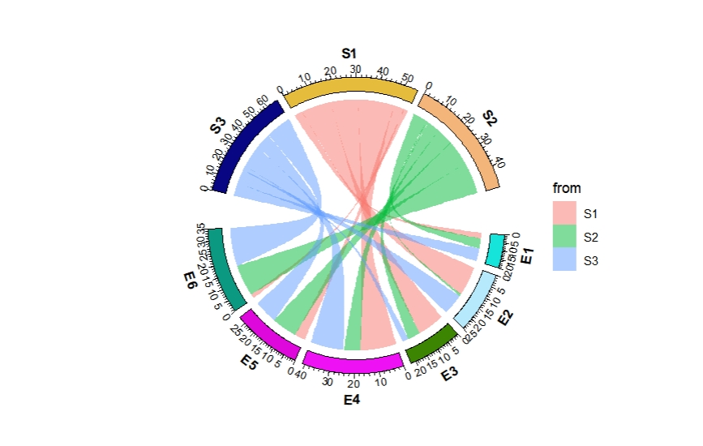
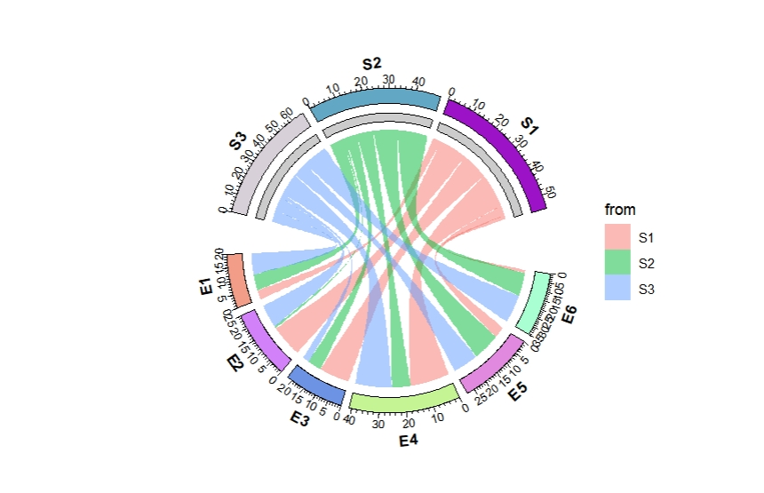
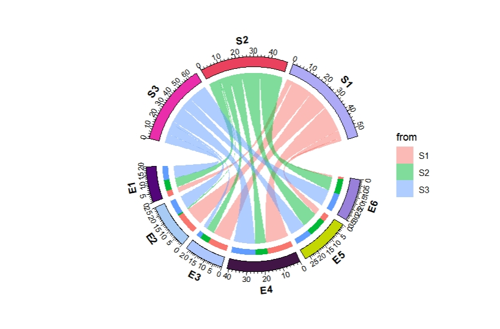
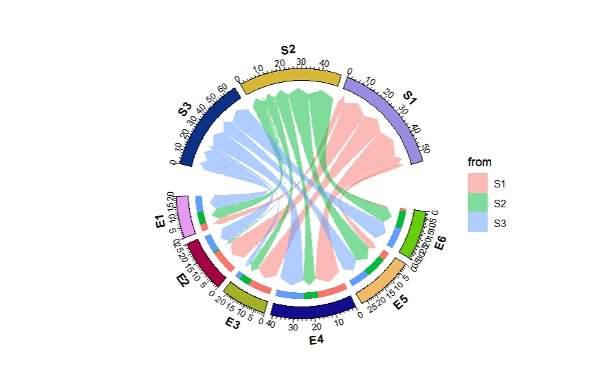
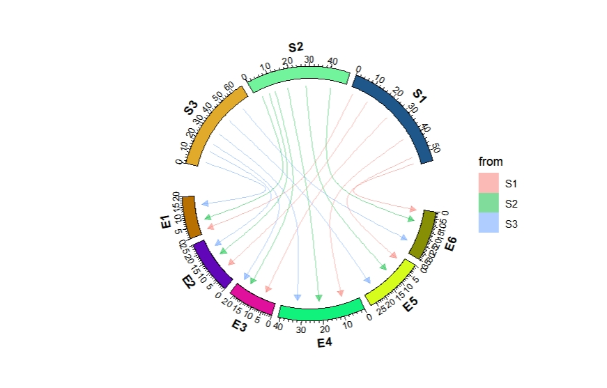
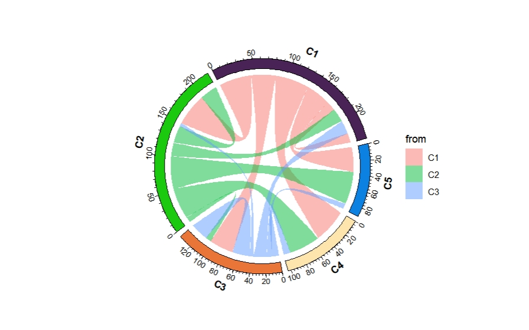
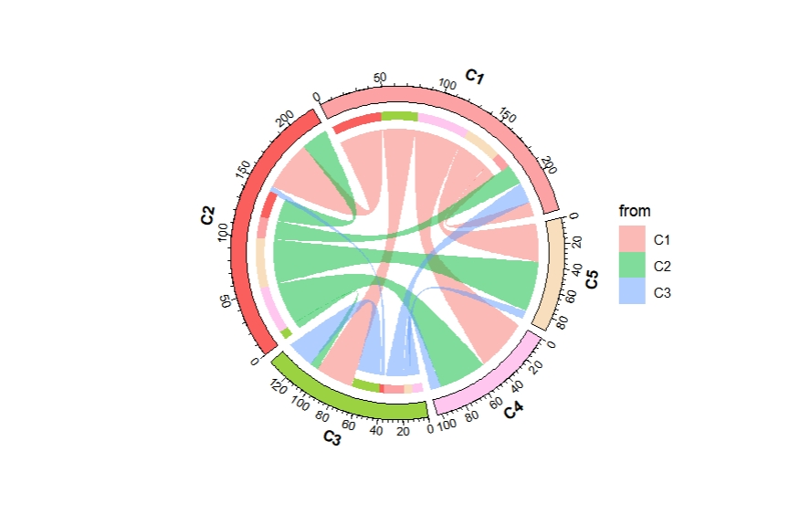
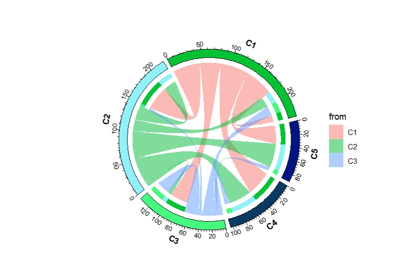

# Geom chordDiagram

**geom_chordDiagram** is used to make chord diagram to show relations of multiple data.

---

Parepare data:

```r
library(ggcirclize)
library(ggplot2)

set.seed(999)
mat = matrix(sample(18, 18), 3, 6)
rownames(mat) = paste0("S", 1:3)
colnames(mat) = paste0("E", 1:6)
mat
#    E1 E2 E3 E4 E5 E6
# S1  4 14 13 17  5  2
# S2  7  1  6  8 12 15
# S3  9 10  3 16 11 18

df = data.frame(from = rep(rownames(mat), times = ncol(mat)),
                to = rep(colnames(mat), each = nrow(mat)),
                value = as.vector(mat),
                stringsAsFactors = FALSE)
head(df,3)
#   from to value
# 1   S1 E1     4
# 2   S2 E1     7
# 3   S3 E1     9
```


```r
ggcirclize(df,aes(end = 360,r = 0.8,
                  from = from,to = to,value = value)) +
  geom_chordDiagram()
```


```r
ggcirclize(df,aes(end = 360,r = 0.8,
                  from = from,to = to,value = value)) +
  geom_chordDiagram(aes(fill = from))
```


Change the orders:

```r
ggcirclize(df,aes(end = 360,r = 0.8,
                  from = from,to = to,value = value)) +
  geom_chordDiagram(aes(fill = from),
                    sector.order = c("S2","S1","S3",paste0("E",6:1)))
```


Highlight the **from** direction:

```r
ggcirclize(df,aes(end = 360,r = 0.8,
                  from = from,to = to,value = value)) +
  geom_chordDiagram(aes(fill = from),
                    directional = 1)
```



Highlight the **to** direction:

```r
ggcirclize(df,aes(end = 360,r = 0.8,
                  from = from,to = to,value = value)) +
  geom_chordDiagram(aes(fill = from),
                    directional = -1)
```


Add arrows:

```r
ggcirclize(df,aes(end = 360,r = 0.8,
                  from = from,to = to,value = value)) +
  geom_chordDiagram(aes(fill = from),
                    directional = -1,
                    start.arrow = T,end.arrow = T,arrow.len = 0.06)
```


Add curve lines:

```r
ggcirclize(df,aes(end = 360,r = 0.8,
                  from = from,to = to,value = value)) +
  geom_chordDiagram(aes(color = from,fill = from),
                    link2line = T,
                    curve.arrow = arrow(type = "closed",length = unit(0.2,"cm")))
```


If the names overlap for **from** and **to** variable:

```r
set.seed(111)
matx = matrix(sample(seq(1,50,1),15,replace = T), 3)
colnames(matx) <- paste0("C",1:5)
rownames(matx) <- paste0("C",1:3)
matx
#    C1 C2 C3 C4 C5
# C1 14 47 35 49 36
# C2 20 25  8 45 47
# C3 19  5 26 10  8

df <- reshape2::melt(matx)
colnames(df) <- c("from","to","value")

# check
head(df,3)
#   from to value
# 1   C1 C1    14
# 2   C2 C1    20
# 3   C3 C1    19
```


```r
ggcirclize(df,aes(end = 360,r = 0.8,
                  from = from,to = to,value = value)) +
  geom_chordDiagram(aes(fill = from))
```



```r
ggcirclize(df,aes(end = 360,r = 0.8,
                  from = from,to = to,value = value)) +
  geom_chordDiagram(aes(fill = from),directional = 1)
```



```r
ggcirclize(df,aes(end = 360,r = 0.8,
                  from = from,to = to,value = value)) +
  geom_chordDiagram(aes(fill = from),directional = -1)
```



