# Geom genomic track layers

There are also some geom layers to visualize genomic data on genome. There have been human(hg38,hg19) and mouse(mm39,mm10,mm9) cytoband data and chromosome length data in ggcirclize package.

Most of the genomic track layers need **chr,gstart,gend** basic mapping variables. Besides you need
supply **chrom_data** parameters to define the chromosome length.

## Load genome data

First we load hg19 cytoband and chromosome size:

```r
data("hg19_chrom_info")
chrom_hg19 <- hg19_chrom_info$chromsize

# check
head(chrom_hg19,3)
#     V1        V2
# 1 chr1 249250621
# 2 chr2 243199373
# 3 chr3 198022430

cytoband_hg19 <- hg19_chrom_info$cytoband

# check
head(cytoband_hg19,3)
#    chr   start     end   band  stain
# 1 chr1       0 2300000 p36.33   gneg
# 2 chr1 2300000 5400000 p36.32 gpos25
# 3 chr1 5400000 7200000 p36.31   gneg
```


Generate test data:

```r
bed = generateRandomBed(nr = 300)

# check
head(bed,3)
#    chr    start      end      value1
# 1 chr1   241643   651934  0.65579256
# 2 chr1 11498530 20934324 -1.14565565
# 3 chr1 22192283 23811229  0.09296219
```


## geom_trackgenomicpoint


```r
ggcirclize(bed,aes(end = 360,
                   chr = chr,gstart = start,gend = end,
                   value = value1)) +
  geom_trackgenomicpoint(chrom_data = chrom_hg19)
```
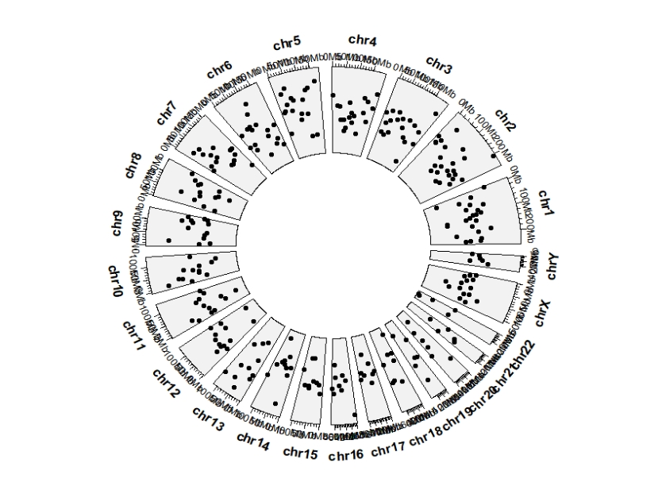

Mapping with color:

```r
ggcirclize(bed,aes(end = 360,
                   chr = chr,gstart = start,gend = end,
                   color = chr,
                   value = value1)) +
  geom_trackgenomicpoint(chrom_data = chrom_hg19)
```
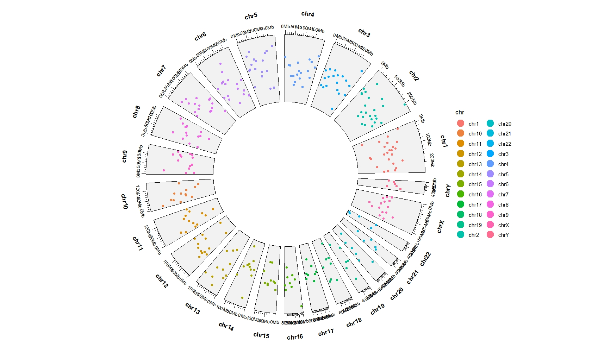

**space=fixed** can make the size of each sector be same:

```r
ggcirclize(bed,aes(end = 360,
                   chr = chr,gstart = start,gend = end,
                   color = chr,
                   value = value1)) +
  geom_trackgenomicpoint(chrom_data = chrom_hg19,
                         space = "fixed")
```
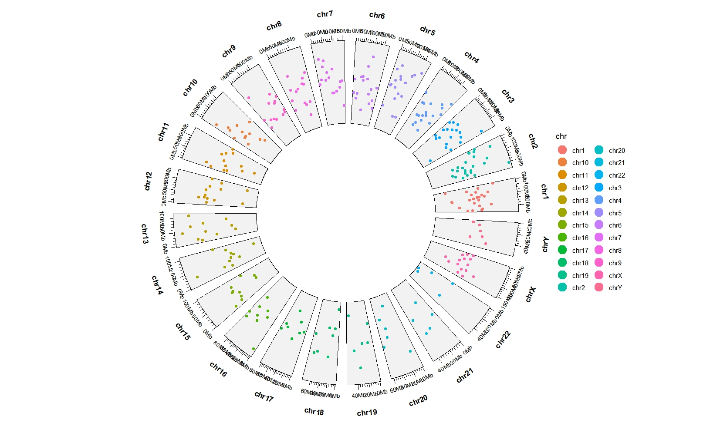

## geom_trackgenomicrect


```r
bed = generateRandomBed(nr = 300)
bed <- subset(bed,chr %in% c("chr1","chr2","chr3","chr4"))
bed$ymin <- sample(seq(0,1,0.1),nrow(bed),replace = T)
bed$ymax <- bed$ymin + 0.2
bed$group <- sample(LETTERS[1:4],nrow(bed),replace = T)

# check
head(bed)
#    chr    start      end     value1 ymin ymax group
# 1 chr1   114048  7101411 -0.2895206  0.1  0.3     D
# 2 chr1  8732752 11662832 -1.0575720  0.5  0.7     A
# 3 chr1 13705322 16977193  0.5415639  0.2  0.4     A
# 4 chr1 21827870 26896494 -0.7159598  0.8  1.0     B
# 5 chr1 28397265 30759921 -0.1669718  1.0  1.2     A
# 6 chr1 36176151 52241396  0.2176396  0.4  0.6     B

ggcirclize(bed,
           aes(end = 360,
               chr = chr,gstart = start,gend = end)) +
  geom_trackgenomicrect(aes(ymin = ymin,ymax = ymax),
                        chrom_data = chrom_hg19)
```
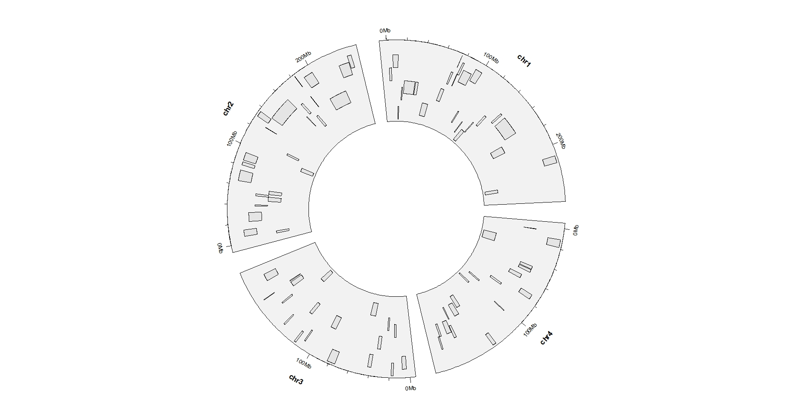


```r
ggcirclize(bed,
           aes(end = 360,
               chr = chr,gstart = start,gend = end)) +
  geom_trackgenomicrect(aes(ymin = ymin,ymax = ymax,fill = group),
                        chrom_data = chrom_hg19)
```
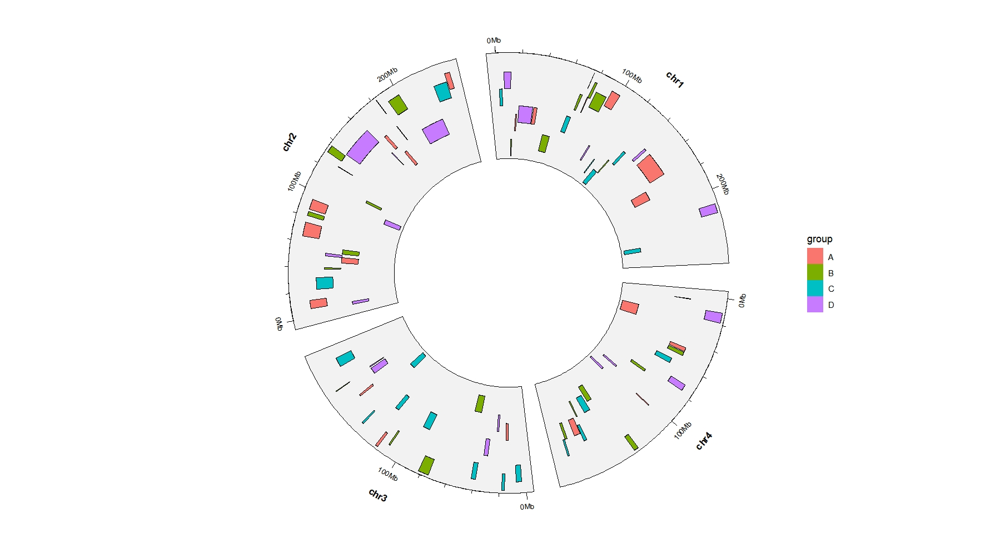

Add chromosome cytoband:

```r
bed = generateRandomBed(nr = 300)

ggcirclize(mapping = aes(start = 0,end = 360)) +
  geom_trackgenomicrect(data = cytoband_hg19,
                        aes(r0 = 0.9,r1 = 0.95,
                            chr = chr,gstart = start,gend = end,
                            fill = stain),
                        color = NA,chrom_data = chrom_hg19) +
  scale_fill_manual(values = c("gneg" = "white","gpos25" = "grey75","gpos50" = "grey50",
                               "gpos100" = "black","gvar" = "black","acen" = "red",
                               "stalk" = "blue")) +
  geom_trackgenomicpoint(data = bed,
                         aes(r0 = 0.5,r1 = 0.9,clock.wise = F,
                             chr = chr,gstart = start,gend = end,
                             value = value1,color = chr),
                         add.xaxis = F,strip.label = F,
                         chrom_data = chrom_hg19)
```
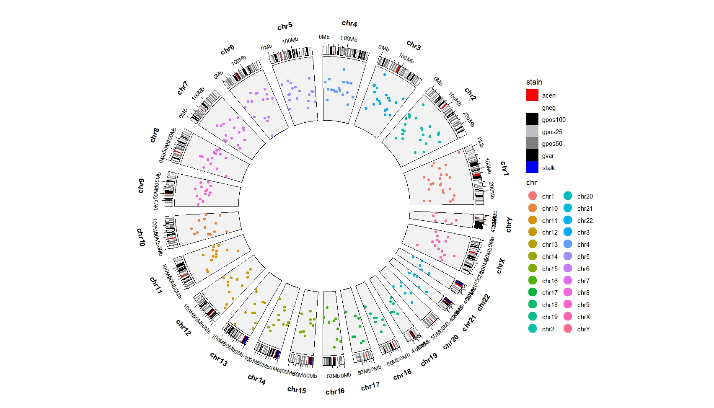

## geom_trackgenomictile


```r
bed = generateRandomBed(nr = 100, nc = 4)

# check
head(bed,3)
#    chr    start      end     value1    value2      value3     value4
# 1 chr1  4833203 25608564  0.4822349 0.2058859  0.01484909 -0.5005523
# 2 chr1 48610396 76802798  0.7022751 0.4851126 -1.38951435  0.6165077
# 3 chr1 79055730 87730120 -0.3187775 0.4399068  0.51394522  0.2435110

bed_long <- bedMatTolong(bed)

head(bed_long,3)
#    chr    start      end x variable      value y
# 1 chr1  4833203 25608564 1   value1  0.4822349 1
# 2 chr1 48610396 76802798 2   value1  0.7022751 1
# 3 chr1 79055730 87730120 3   value1 -0.3187775 1
```


```r
ggcirclize(bed_long,aes(end = 360,r0 = 0.5,r1 = 0.8,
                        chr = chr,gstart = start,gend = end)) +
  geom_trackgenomictile(aes(x = x,y = y,fill = value),
                        chrom_data = chrom_hg19,strip.label = T) +
  scale_fill_gradient2(low = "green",mid = "white",high = "red",midpoint = 0)
```
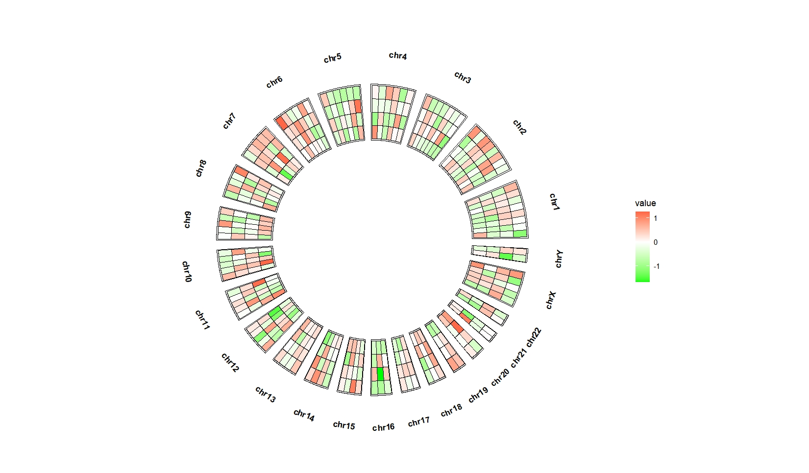


**add_link** can draw connection with the origin chromosome region:

```r
ggcirclize(bed_long,aes(end = 360,r0 = 0.5,r1 = 0.7,
                        chr = chr,gstart = start,gend = end)) +
  geom_trackgenomictile(aes(x = x,y = y,fill = value),
                        chrom_data = chrom_hg19,strip.label = T,
                        add_link = T,
                        link_pos = "top") +
  scale_fill_gradient2(low = "green",mid = "white",high = "red",midpoint = 0)
```
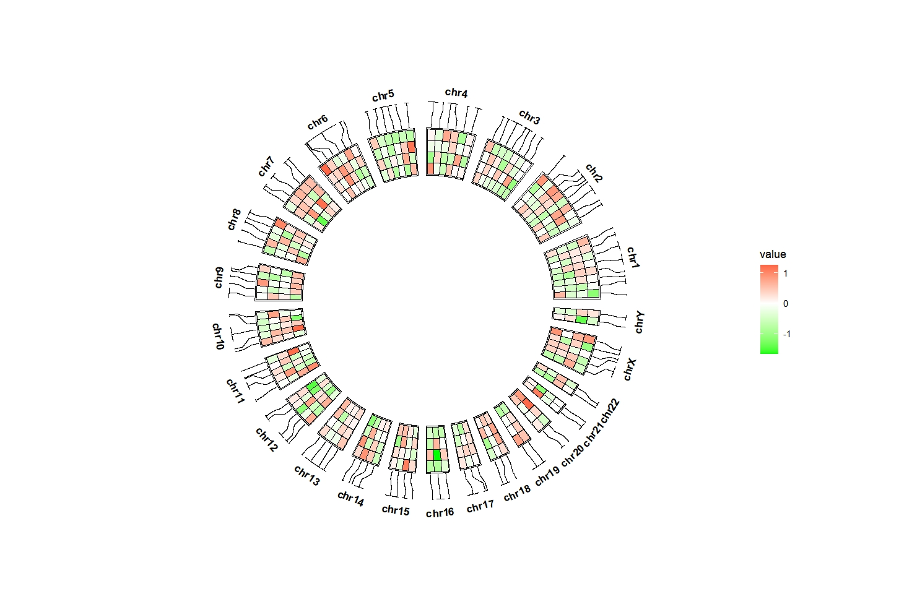

Change link line color:

```r
ggcirclize(bed_long,aes(end = 360,r0 = 0.5,r1 = 0.7,
                        chr = chr,gstart = start,gend = end)) +
  geom_trackgenomictile(aes(x = x,y = y,fill = value),
                        chrom_data = chrom_hg19,strip.label = T,
                        add_link = T,
                        link_pos = "bottom",
                        link_col = circlize::rand_color(24)) +
  scale_fill_gradient2(low = "green",mid = "white",high = "red",midpoint = 0)
```
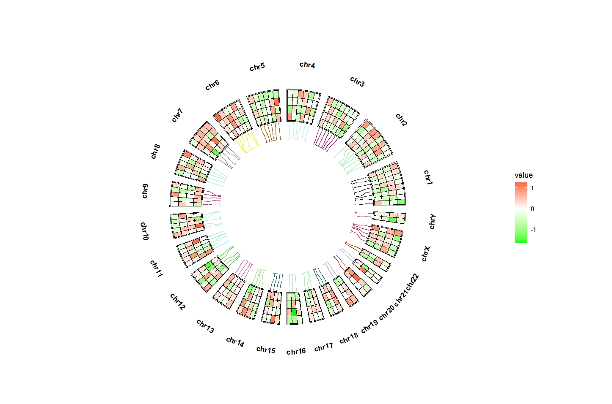


Add cytoband plot:

```r
library(ggnewscale)

ggcirclize(bed_long,aes(end = 360,r0 = 0.4,r1 = 0.68,
                        chr = chr,gstart = start,gend = end)) +
  geom_trackgenomictile(aes(x = x,y = y,fill = value),
                        chrom_data = chrom_hg19,strip.label = F,
                        add_link = T,
                        link_pos = "top",
                        link_col = circlize::rand_color(24)) +
  scale_fill_gradient2(low = "green",mid = "white",high = "red",midpoint = 0) +
  # ============================================================================
  new_scale_fill() +
  geom_trackgenomicrect(data = cytoband_hg19,
                        aes(r0 = 0.8,r1 = 0.85,fill = stain),
                        color = NA,chrom_data = chrom_hg19) +
  scale_fill_manual(values = c("gneg" = "white","gpos25" = "grey75","gpos50" = "grey50",
                               "gpos100" = "black","gvar" = "black","acen" = "red",
                               "stalk" = "blue"))
```
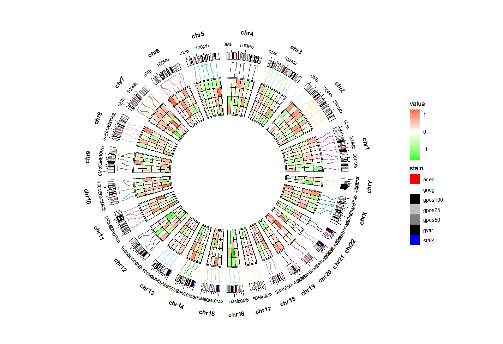

Change the position:
```r
ggcirclize(bed_long,aes(end = 360,r0 = 0.6,r1 = 0.9,
                        chr = chr,gstart = start,gend = end)) +
  geom_trackgenomictile(aes(x = x,y = y,fill = value),
                        chrom_data = chrom_hg19,strip.label = T,
                        add_link = T,
                        link_pos = "bottom",
                        link_col = circlize::rand_color(24)) +
  scale_fill_gradient2(low = "green",mid = "white",high = "red",midpoint = 0) +
  # ============================================================================
  new_scale_fill() +
  geom_trackgenomicrect(data = cytoband_hg19,
                        strip.label = F,
                        add.xaxis = F,
                        # xAxis.params = list(pos = "bottom"),
                        aes(r0 = 0.43,r1 = 0.48,fill = stain),
                        color = NA,chrom_data = chrom_hg19) +
  scale_fill_manual(values = c("gneg" = "white","gpos25" = "grey75","gpos50" = "grey50",
                               "gpos100" = "black","gvar" = "black","acen" = "red",
                               "stalk" = "blue"))
```
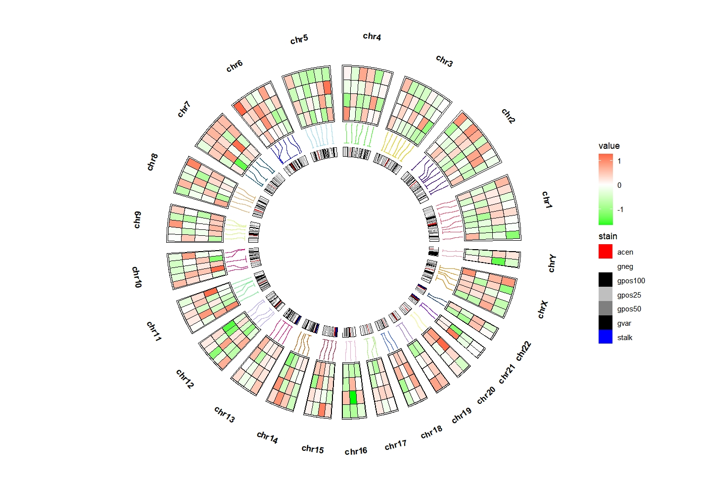


## geom_trackgenomicarea


```r
bed = generateRandomBed(nr = 300)

ggcirclize(bed,aes(end = 360,fill = chr,
                   chr = chr,gstart = start,gend = end,
                   value = value1)) +
  geom_trackgenomicarea(chrom_data = chrom_hg19)
```
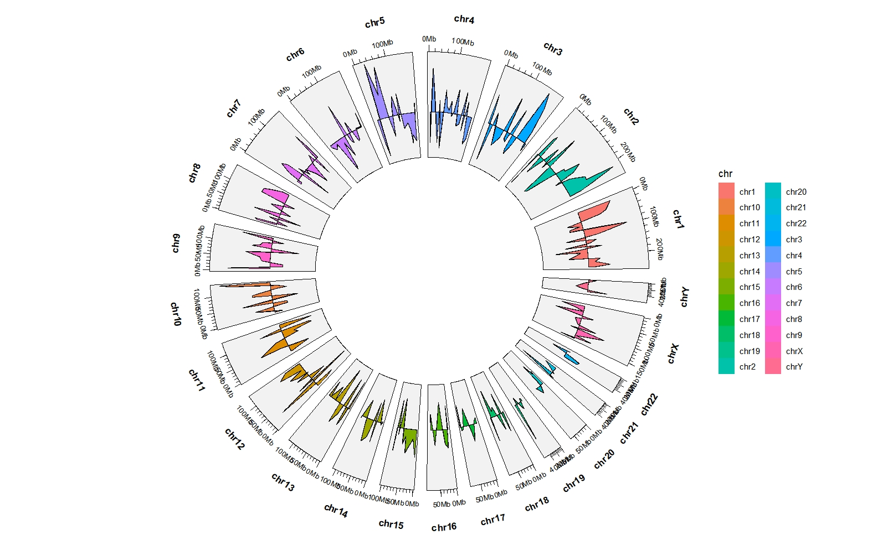

## geom_trackgenomicline


```r
bed = generateRandomBed(nr = 300)

ggcirclize(bed,aes(end = 360,color = chr,
                   chr = chr,gstart = start,gend = end,
                   value = value1)) +
  geom_trackgenomicline(chrom_data = chrom_hg19)
```
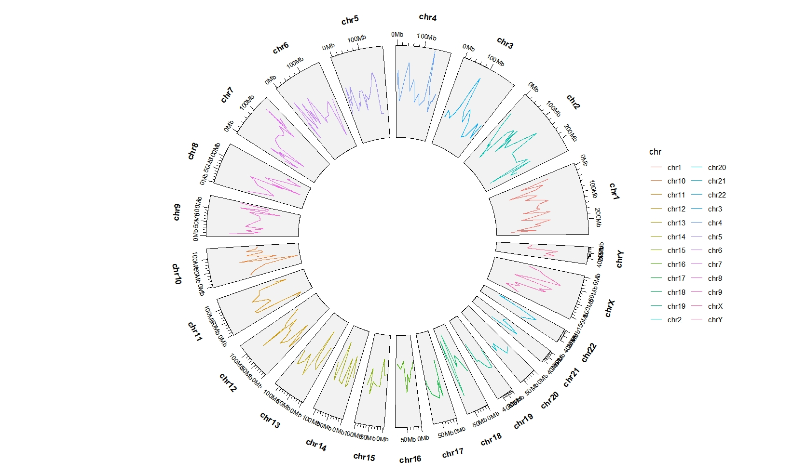

## geom_trackgenomicdensity

```r
load(system.file(package = "circlize", "extdata", "DMR.RData"))

ggcirclize(DMR_hyper,aes(end = 360,
                         chr = chr,gstart = start,gend = end)) +
  geom_trackgenomicdensity(chrom_data = chrom_hg19)
```
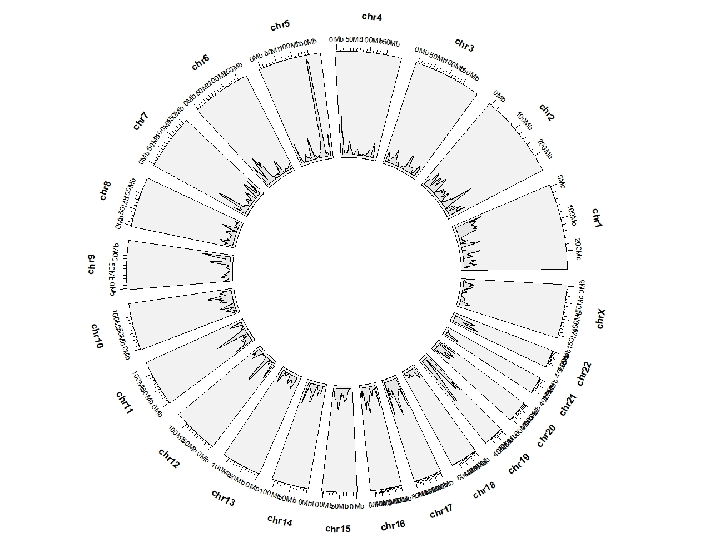

```r
ggcirclize(DMR_hyper,aes(end = 360,
                         chr = chr,gstart = start,gend = end)) +
  geom_trackgenomicdensity(chrom_data = chrom_hg19,fill = "pink",color = NA)
```
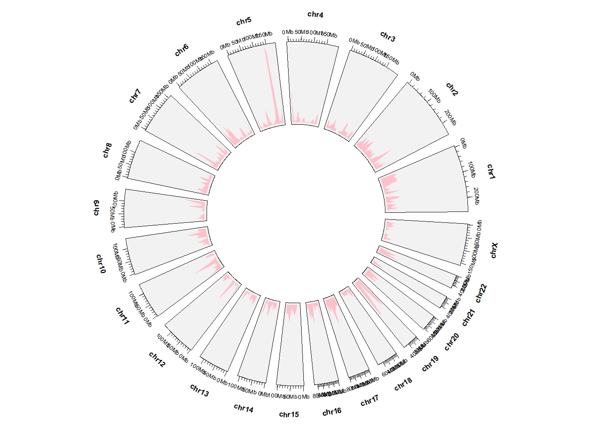

Draw partial chromosomes:

```r
ggcirclize(DMR_hyper %>% filter(chr %in% c(paste0("chr",1:6),"chr20","chrX")),
           aes(end = 360,
               chr = chr,gstart = start,gend = end)) +
  geom_trackgenomicdensity(chrom_data = chrom_hg19,fill = "pink",color = NA)
```
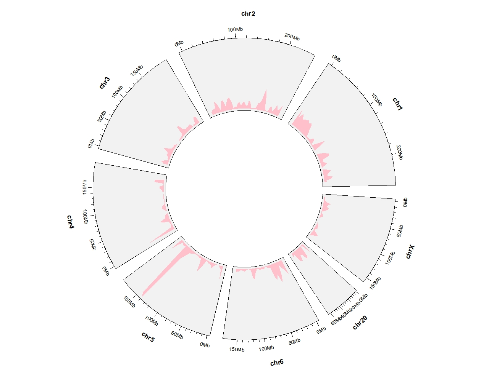

Keep all chromosomes:

```r
ggcirclize(DMR_hyper %>% filter(chr %in% c(paste0("chr",1:6),"chr20","chrX")),
           aes(end = 360,
               chr = chr,gstart = start,gend = end)) +
  geom_trackgenomicdensity(chrom_data = chrom_hg19,fill = "pink",color = NA,
                           keep.all.chrom = T)
```
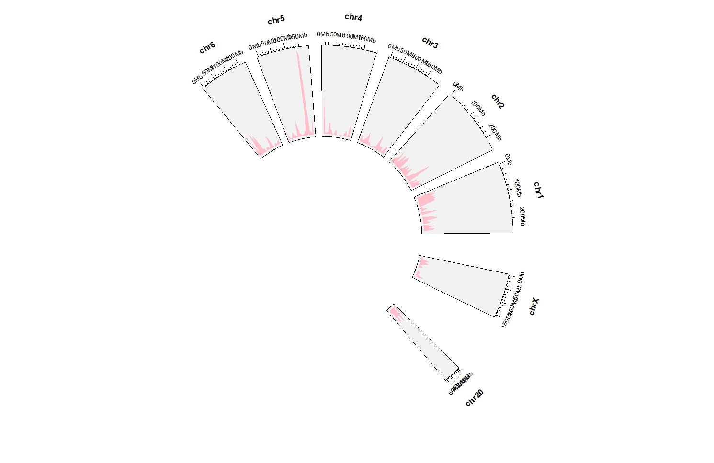

## geom_trackgenomicrainfall

```r
load(system.file(package = "circlize", "extdata", "DMR.RData"))

cb <- rbind(DMR_hyper,DMR_hypo)
cb$group <- c(rep("DMR_hyper",nrow(DMR_hyper)),
              rep("DMR_hypo",nrow(DMR_hypo)))

ggcirclize(cb,
           aes(end = 360,color = group,
               chr = chr,gstart = start,gend = end)) +
  geom_trackgenomicrainfall(chrom_data = chrom_hg19,size = 1) +
  scale_color_manual(values = c(DMR_hyper = "red",DMR_hypo = "blue"))
```
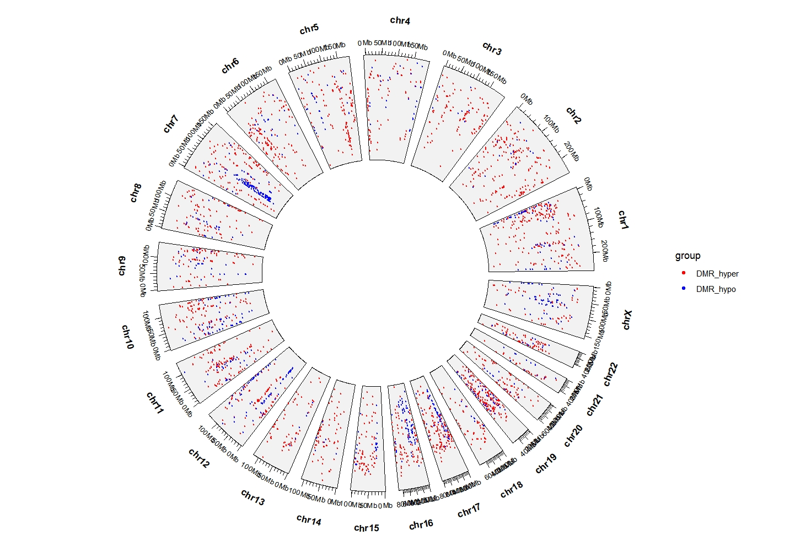


## geom_trackgenomiclink

**geom_trackgenomiclink** need "chr0", "gstart0", "gend0", "chr1", "gstart1" and "gend1" mapping variables.

---

```r
set.seed(123)
bed1 = generateRandomBed(nr = 100)
bed1 = bed1[sample(nrow(bed1), 20), ]
bed2 = generateRandomBed(nr = 100)
bed2 = bed2[sample(nrow(bed2), 20), ]

bed_link <- cbind(bed1[,1:3],bed2[,1:3])
colnames(bed_link) <- c("chr1","start1","end1","chr2","start2","end2")
bed_link$value <- rnorm(nrow(bed_link))
bed_link$group <- sample(LETTERS[1:6],nrow(bed_link),replace = T)

bed_c <- rbind(bed1,bed2)

# check
head(bed_link,3)
#     chr1    start1      end1  chr2    start2      end2      value group
# 41  chr6 102324459 147617643 chr16  59796357  69153026 -0.2506477     A
# 89 chr17  65167455  77619820  chrX  46532875  81569809  1.5202752     B
# 63 chr11  13366995  32331617  chr5 172937687 180577320 -2.0932565     B
```


Plot:

```r
ggcirclize(bed_link,aes(end = 360,
                        chr0 = chr1,gstart0 = start1,
                        chr1 = chr2,gstart1 = start2)) +
  geom_trackgenomiclink(aes(r = 1),chrom_data = chrom_hg19)
```
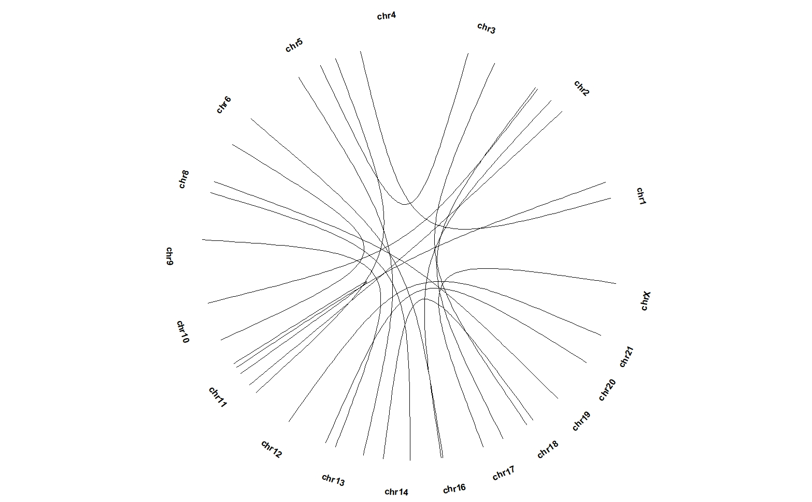

```r
ggcirclize(bed_link,aes(end = 360,
                        chr0 = chr1,gend0 = end1,
                        chr1 = chr2,gend1 = end2)) +
  geom_trackgenomiclink(aes(r = 1),chrom_data = chrom_hg19)
```
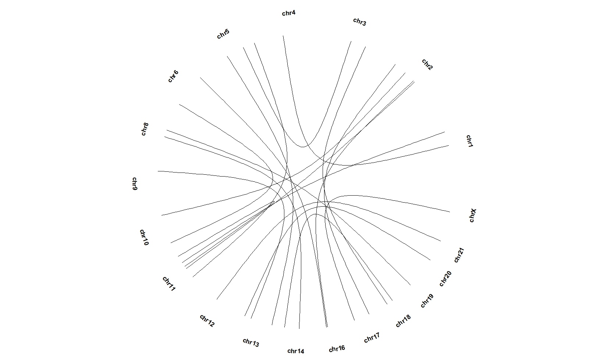

Add arrows:

```r
ggcirclize(bed_link,aes(end = 360,color = group,fill = group,
                        chr0 = chr1,gstart0 = start1,
                        chr1 = chr2,gstart1 = start2)) +
  geom_trackgenomiclink(aes(r = 1),chrom_data = chrom_hg19,
                        curve.arrow = arrow(type = "closed",end = "both"))
```
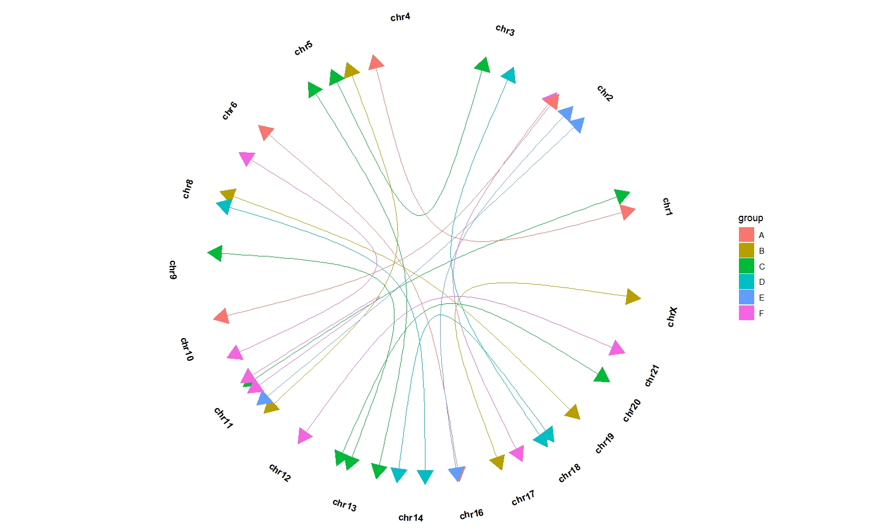


```r
ggcirclize(bed_link,aes(end = 360,
                        chr0 = chr1,gstart0 = start1,gend0 = end1,
                        chr1 = chr2,gstart1 = start2,gend1 = end2)) +
  geom_trackgenomiclink(aes(r = 1),chrom_data = chrom_hg19)
```
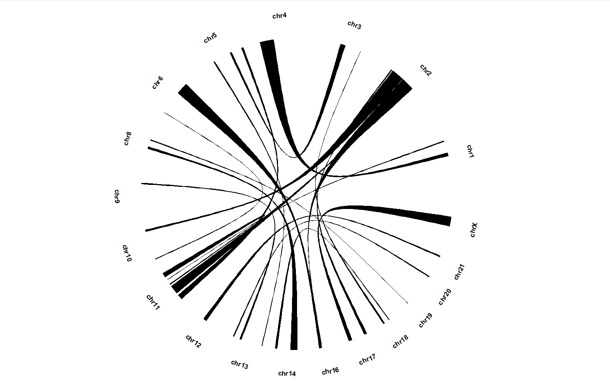


Mapping with color:

```r
ggcirclize(bed_link,aes(end = 360,
                        chr0 = chr1,gstart0 = start1,gend0 = end1,
                        chr1 = chr2,gstart1 = start2,gend1 = end2)) +
  geom_trackgenomiclink(aes(r = 1,fill = group),
                        chrom_data = chrom_hg19,
                        keep.all.chrom = T)
```
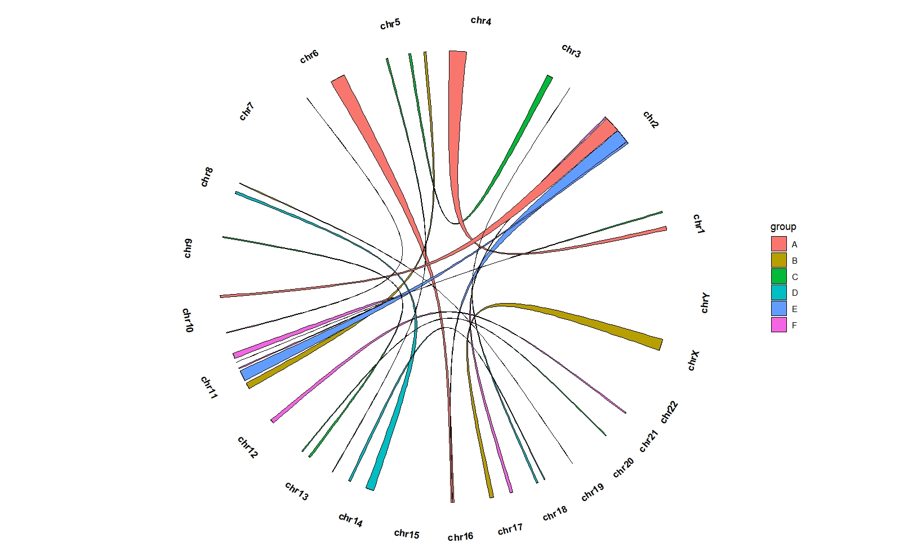

```r
ggcirclize(bed_link,aes(end = 360,
                        chr0 = chr1,gstart0 = start1,gend0 = end1,
                        chr1 = chr2,gstart1 = start2,gend1 = end2)) +
  geom_trackgenomiclink(aes(r = 1,fill = value),
                        chrom_data = chrom_hg19,
                        keep.all.chrom = T,
                        start.arrow = T,end.arrow = T)
```
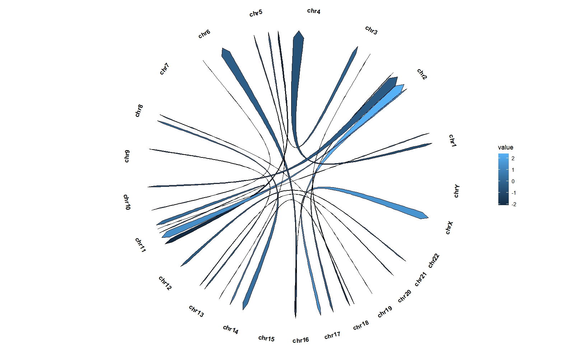

```r
ggcirclize(bed_link,aes(end = 360,
                        chr0 = chr1,gstart0 = start1,gend0 = end1,
                        chr1 = chr2,gstart1 = start2,gend1 = end2)) +
  geom_trackgenomiclink(aes(r = 1),fill = "grey90",
                        chrom_data = chrom_hg19,
                        keep.all.chrom = T,
                        start.arrow = T,end.arrow = T,
                        linetype = "dashed",linewidth = 1.5)
```
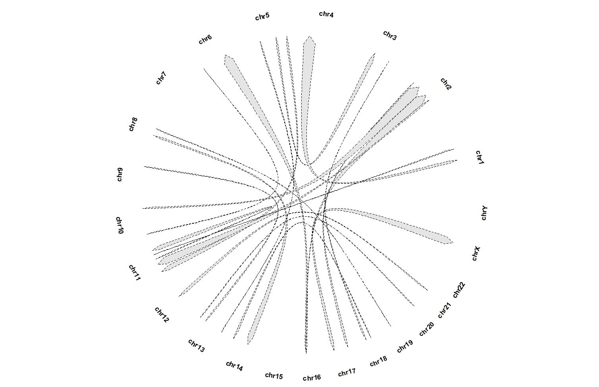

Combine multiple layers:

```r
ggcirclize(bed_link,aes(end = 360)) +
  geom_trackgenomiclink(aes(chr0 = chr1,gstart0 = start1,gend0 = end1,
                            chr1 = chr2,gstart1 = start2,gend1 = end2,
                            r = 0.5),
                        strip.label = F,
                        keep.all.chrom = T,
                        chrom_data = chrom_hg19) +
  geom_trackgenomicrect(data = bed_c,
                        aes(start = 0,r0 = 0.55,r1 = 0.75,
                            chr = chr, gstart = start, gend = end),
                        fill = "orange",strip.label = F,add.xaxis = F,
                        keep.all.chrom = T,
                        chrom_data = chrom_hg19) +
  geom_trackgenomicpoint(data = bed_c,
                         aes(start = 0,r0 = 0.75,r1 = 0.95,
                             chr = chr, gstart = start, gend = end,value = value1),
                         keep.all.chrom = T,
                         chrom_data = chrom_hg19)
```
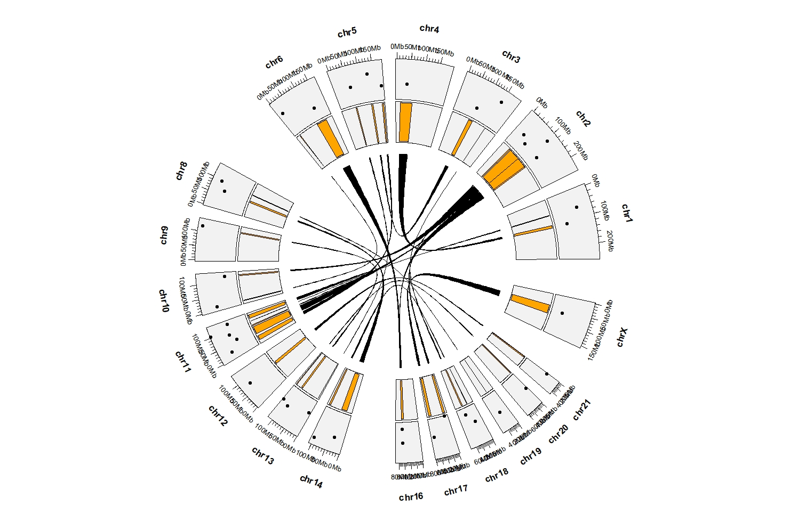

## geom_trackgenomiclabel

```r
set.seed(111)
bed = generateRandomBed(nr = 50, fun = function(k) sample(letters, k, replace = TRUE))
bed$label <- sample(paste0("gene ",1:55),55,replace = F)

ggcirclize(bed,aes(end = 360,r0 = 0.7,r1 = 0.7,
                   chr = chr,gstart = start,gend = end,
                   label = label)) +
  geom_trackgenomiclabel(chrom_data = chrom_hg19)
```
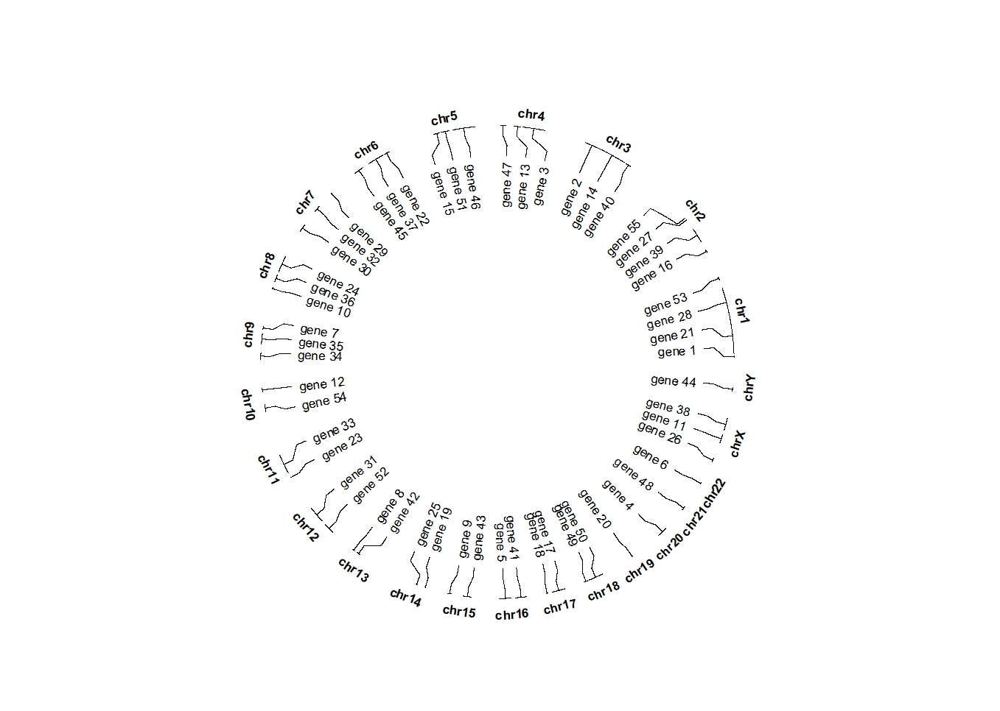

Change the connection position:

```r
ggcirclize(bed,aes(end = 360,r0 = 0.7,r1 = 0.7,
                   chr = chr,gstart = start,gend = end,
                   label = label)) +
  geom_trackgenomiclabel(chrom_data = chrom_hg19,
                         link_pos = "bottom",
                         strip.label.pos = "bottom")
```
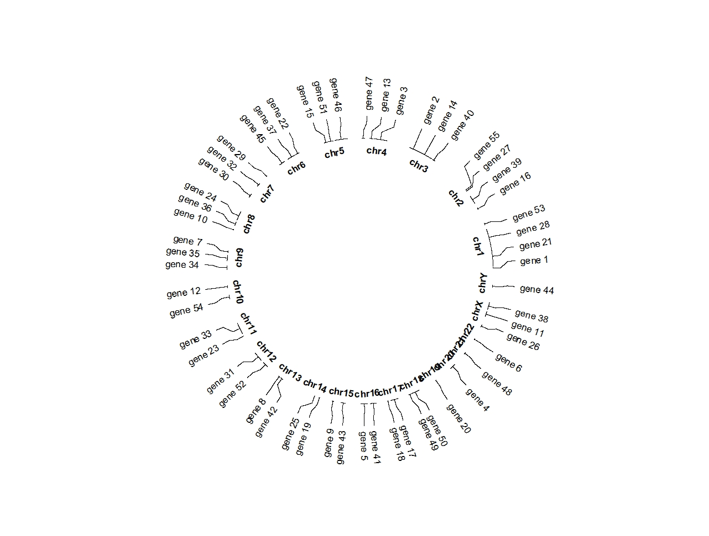

Change connection color:

```r
ggcirclize(bed,aes(end = 360,r0 = 0.9,r1 = 0.9,
                   chr = chr,gstart = start,gend = end,
                   label = label)) +
  geom_trackgenomiclabel(chrom_data = chrom_hg19,
                         link_col = circlize::rand_color(24),
                         label.col = circlize::rand_color(24))
```
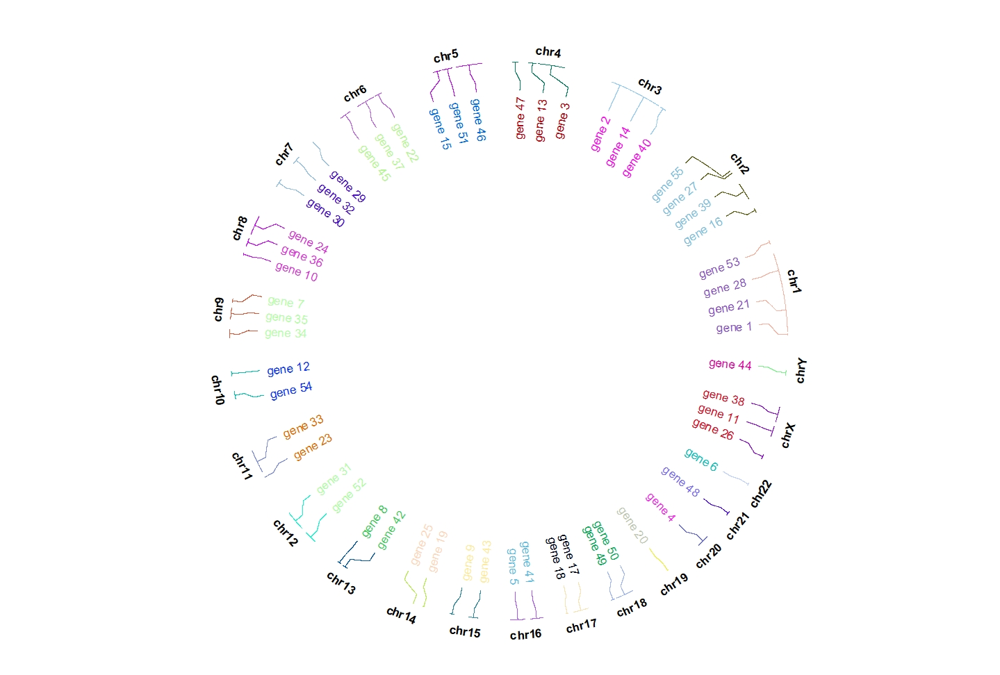

## geom_trackgenomiclabel2

**geom_trackgenomiclabel2** will use enough space to adjust the labels rather than put them into each
sector.

---

```r
set.seed(111)
bed = generateRandomBed(nr = 50, fun = function(k) sample(letters, k, replace = TRUE))
bed$label <- sample(paste0("gene ",1:55),55,replace = F)

ggcirclize(bed,aes(end = 360,
                   chr = chr,gstart = start,gend = end,
                   label = label)) +
  geom_trackgenomiclabel2(aes(r0 = 0.7,r1 = 0.7),chrom_data = chrom_hg19)
```
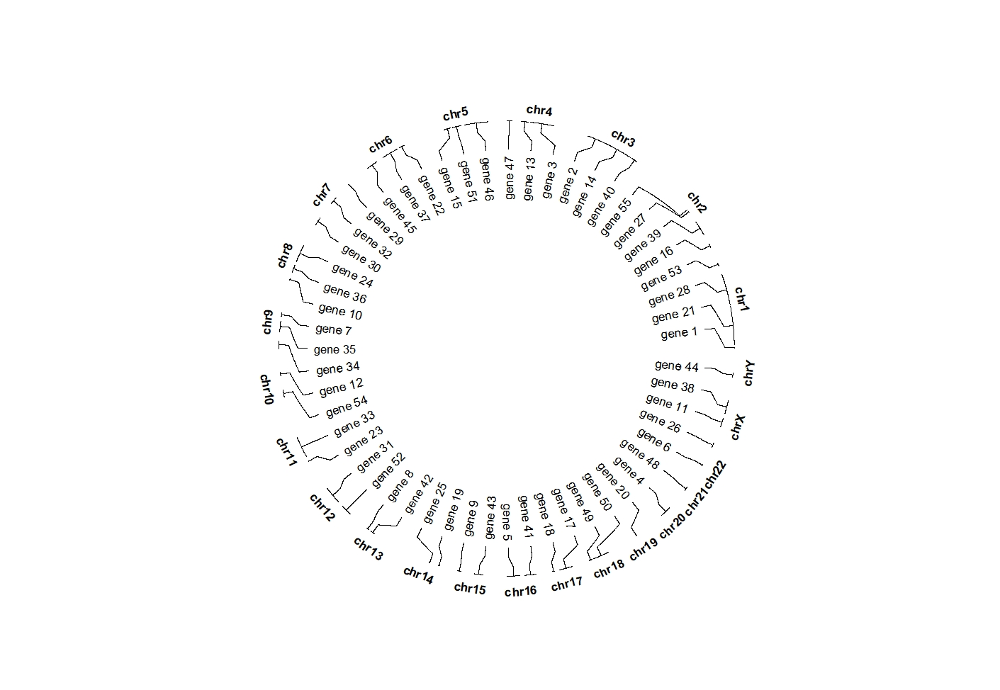

```r
ggcirclize(bed,aes(end = 360,
                   chr = chr,gstart = start,gend = end,
                   label = label)) +
  geom_trackgenomiclabel2(aes(r0 = 0.7,r1 = 0.7),chrom_data = chrom_hg19,
                          link_pos = "bottom",
                          strip.label.pos = "bottom")
```
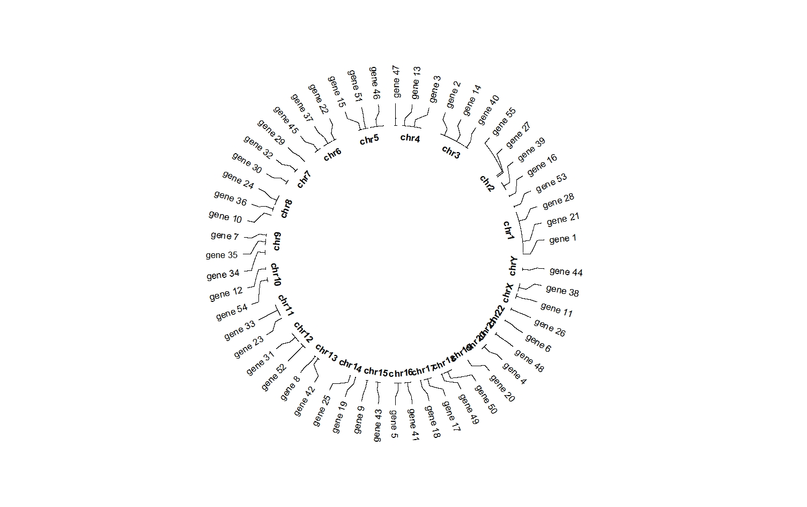

```r
ggcirclize(bed,aes(end = 360,
                   chr = chr,gstart = start,gend = end,
                   label = label,color = chr)) +
  geom_trackgenomiclabel2(aes(r0 = 0.7,r1 = 0.7),
                          chrom_data = chrom_hg19)
```
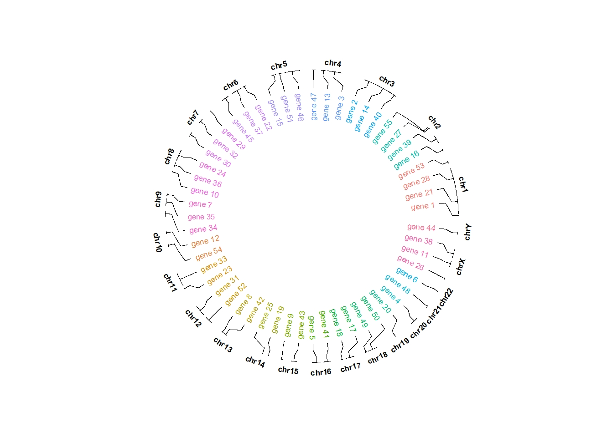


```r
ggcirclize(bed,aes(end = 360,
                   chr = chr,gstart = start,gend = end,
                   label = label)) +
  geom_trackgenomiclabel2(aes(r0 = 0.5,r1 = 0.5),chrom_data = chrom_hg19,
                          strip.label = F) +
  geom_trackgenomiclabel(aes(r0 = 0.8,r1 = 0.8),
                         link_pos = "bottom",strip.label = F,
                         chrom_data = chrom_hg19)
```
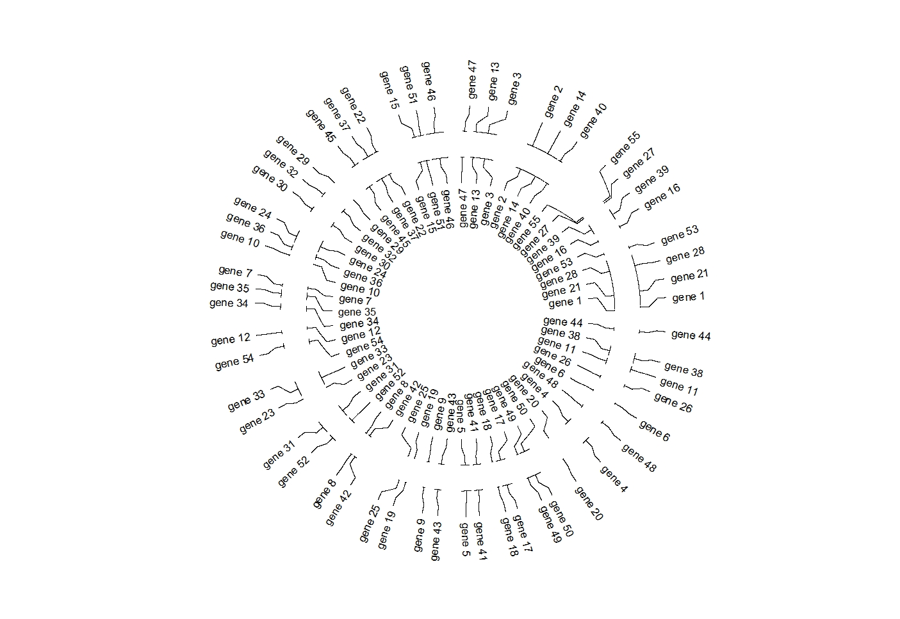
