# Geom track layers

To visualize data with various categories, ggplot2 can use **facet_wrap** and **facet_grid** to put
different group data into different sub-panels. We can use different sectors to group by the data.

**geom_track*** layers works like **facet_wrap**. It puts different category data in each sector. We
should give a mapping variable **sector** to define which column will be used.

---

## geom_trackpoint

```r
ggplot(mtcars,aes(x = mpg,y = disp,color = factor(cyl))) +
  geom_point() +
  facet_wrap(~cyl)
```
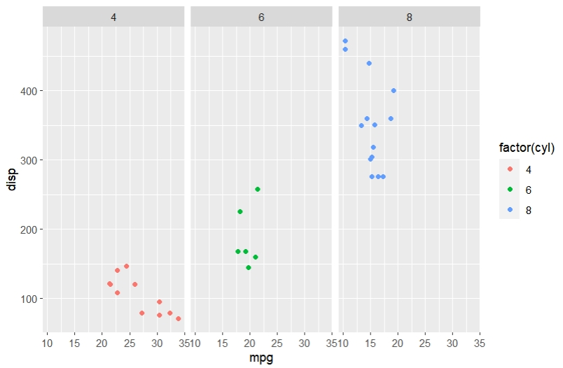


```r
ggcirclize(data = mtcars,
           mapping = aes(x = mpg,y = disp,sector = cyl,end = 360,
                         color = factor(cyl))) +
  geom_trackpoint()
```
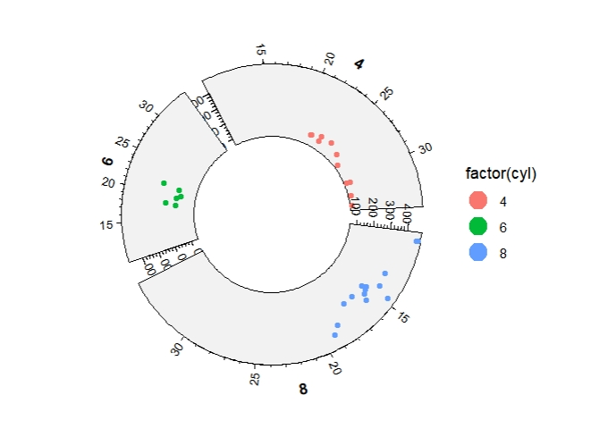

```r
ggcirclize(data = mtcars,
           mapping = aes(x = mpg,y = disp,sector = cyl,end = 360,
                         color = factor(cyl))) +
  geom_trackpoint(xAxis.params = list(pos = "bottom"))
```
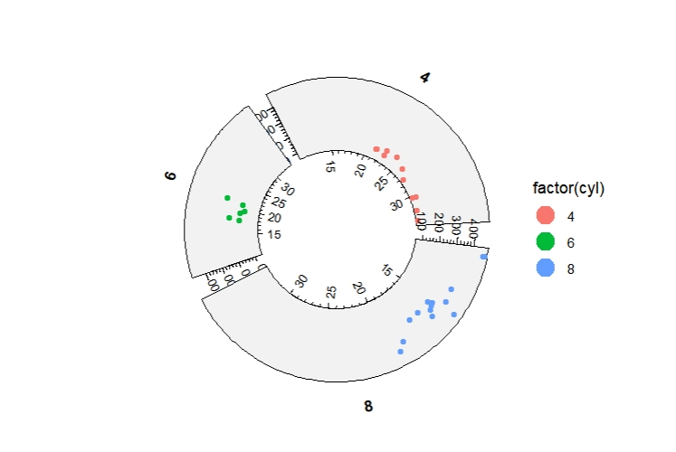

**sector.gap** change the gap between sectors:

```r
ggcirclize(data = mtcars,
           mapping = aes(x = mpg,y = disp,sector = cyl,end = 360,
                         color = factor(cyl))) +
  geom_trackpoint(sector.gap = 20,strip.label.pos = "bottom")
```
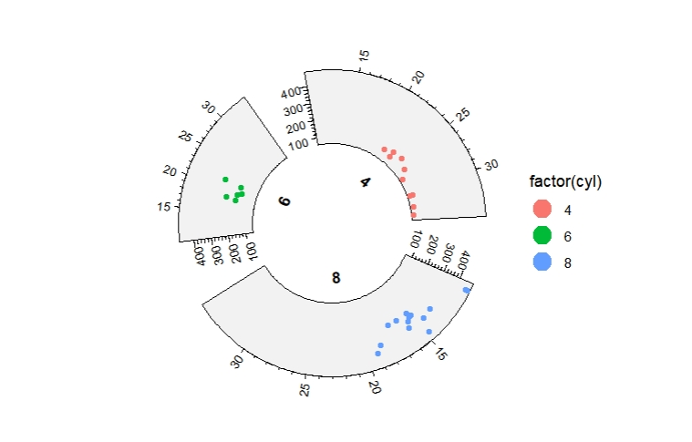

You can set **scales** with **fixed/free/free_x/free_y** to adjust x and y scale range for each sector:

```r
ggcirclize(data = mtcars,
           mapping = aes(x = mpg,y = disp,sector = cyl,
                         color = factor(cyl),
                         start = 0,end = 360)) +
  geom_trackpoint(sector.gap = 20,scales = "free_y")
```
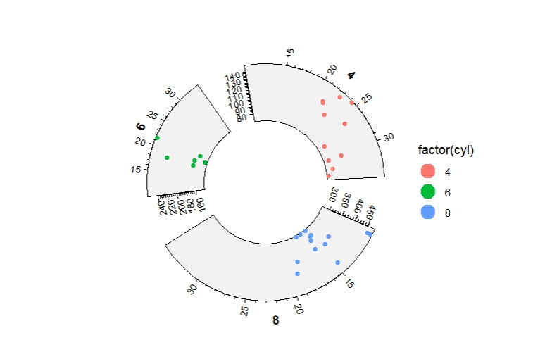

```r
ggcirclize(data = mtcars,
           mapping = aes(x = mpg,y = disp,sector = cyl,
                         color = factor(cyl),
                         start = 0,end = 360)) +
  geom_trackpoint(sector.gap = 20,scales = "free")
```
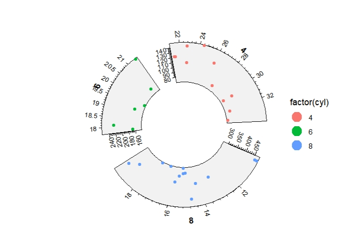


```r
set.seed(111)
mat <- matrix(sample(seq(0,20,length = 400),400,replace = T),ncol = 20)
rownames(mat) <- paste0("gene",1:20)
colnames(mat) <- paste0("samp",1:20)
mat_long <- reshape2::melt(mat)
mat_long$gp <- rep(LETTERS[1:4],50)

ggcirclize(data = mat_long,
           mapping = aes(x = Var1,y = Var2,size = value,color = value,
                         sector = gp,end = 360)) +
  geom_trackpoint(strip.label.pos = "bottom",sector.gap = 20,scales = "fixed")
```

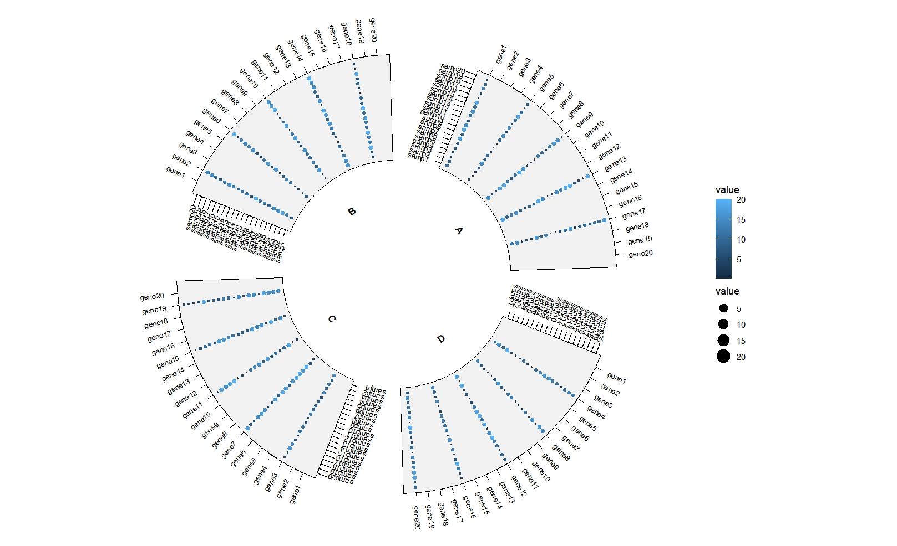


```r
ggcirclize(data = mat_long,
           mapping = aes(x = Var1,y = Var2,size = value,color = value,
                         sector = gp,end = 360)) +
  geom_trackpoint(strip.label.pos = "bottom",sector.gap = 20,scales = "free_x")
```
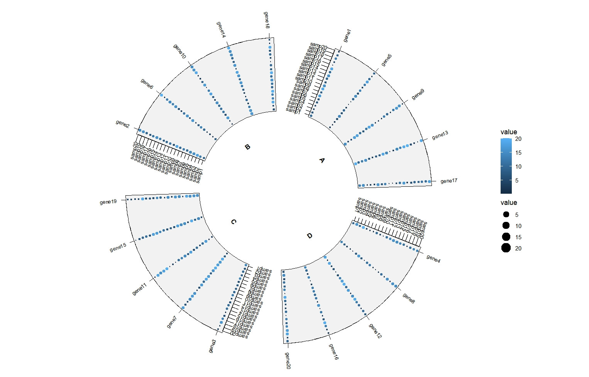


## geom_tracktile

```r
mat <- scale(USArrests)
mat.long <- reshape2::melt(mat)
# mat.long$gp <- rep(LETTERS[1:4],each = 50)
mat.long$gp <- sample(LETTERS[1:4],200,replace = T)
# mat.long$Var1 <- sample(colnames(mat),200,replace = T)

ggplot(mat.long,aes(x = Var1,y = Var2,fill = value)) +
  geom_tile() +
  scale_fill_gradient2(low = "green",mid = "black",high = "red",midpoint = 0) +
  theme(axis.text.x = element_text(angle = 90,hjust = 1,vjust = 0.5)) +
  facet_wrap(~gp,scales = "fixed")
```
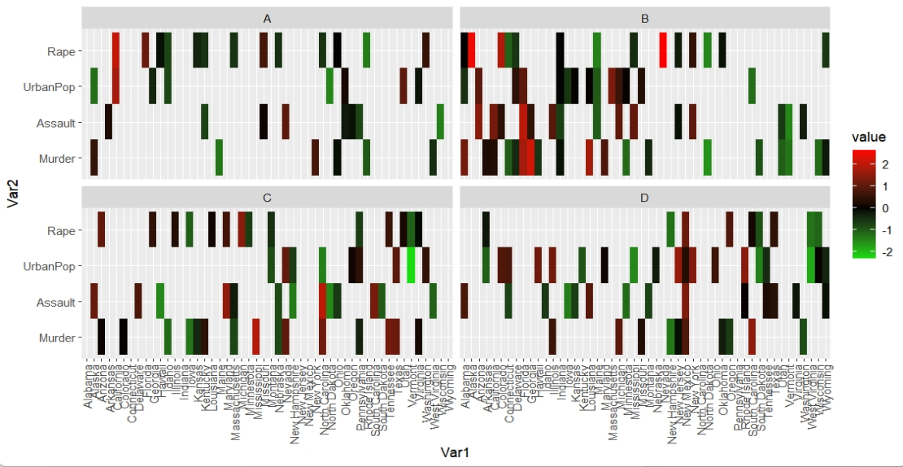

```r
ggcirclize(data = mat.long,mg.t = 2.5,mg.b = 2.5,
           mapping = aes(x = Var1,y = Var2,fill = value,
                         sector = gp,end = 360)) +
  geom_tracktile(add.yaxis = T,strip.label.pos = "bottom",
                 scales = "fixed") +
  scale_fill_gradient2(low = "green",mid = "black",high = "red",midpoint = 0)
```
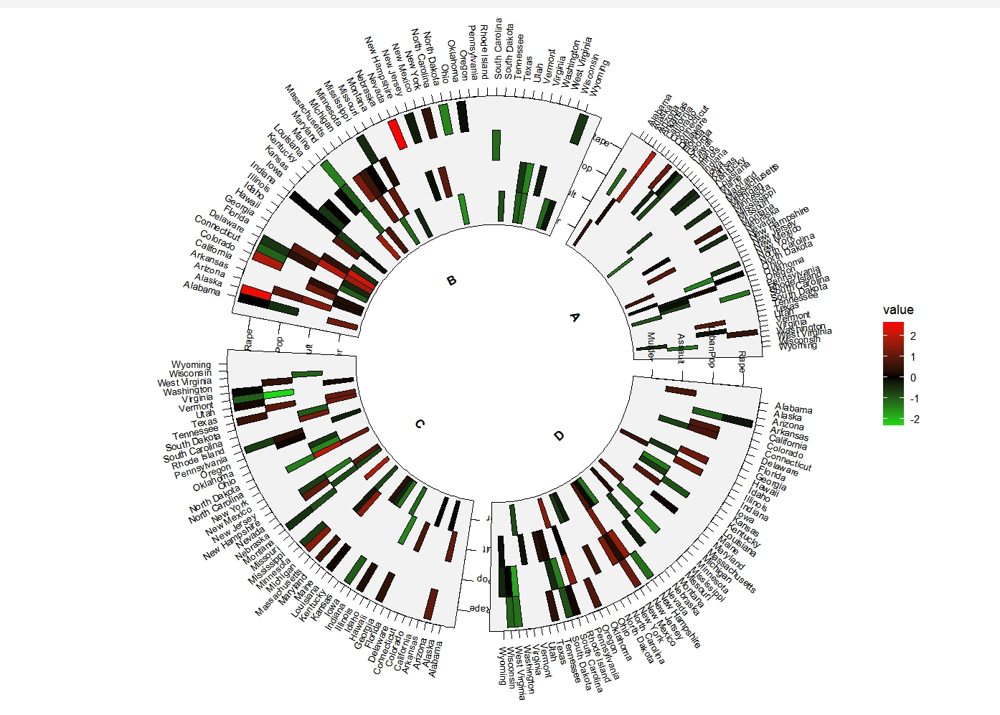

## geom_trackbar


```r
ggcirclize(mpg,aes(x = class,fill = drv,sector = drv)) +
  geom_trackbar(strip.label.pos = "bottom",sector.gap = 20,
                scales = "free_y")
```
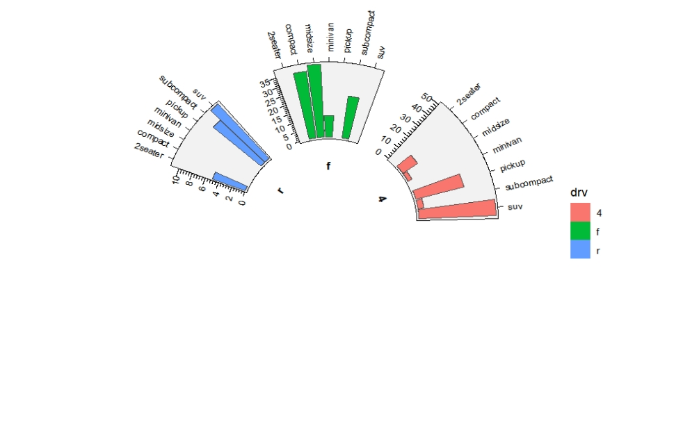

```r
ggcirclize(mpg,aes(x = class,fill = drv,sector = drv)) +
  geom_trackbar(strip.label.pos = "bottom",
                scales = "free_x")
```
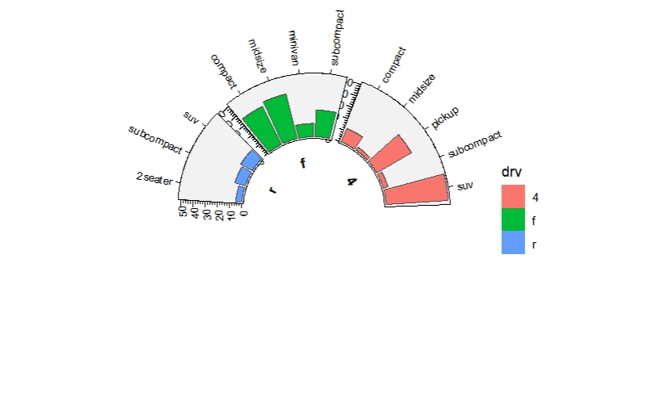


## geom_trackcol


```r
df <- data.frame(x = LETTERS[1:20],y = abs(rnorm(20)),
                 gp = sample(letters[1:4],20,replace = T))

ggcirclize(df,aes(x = x,y = y,fill = x,sector = gp)) +
  geom_trackcol(aes(end = 360),strip.label.pos = "bottom",
                 sector.gap = 20,width = 0.5,add.bg = F,
                 scales = "free_x")
```
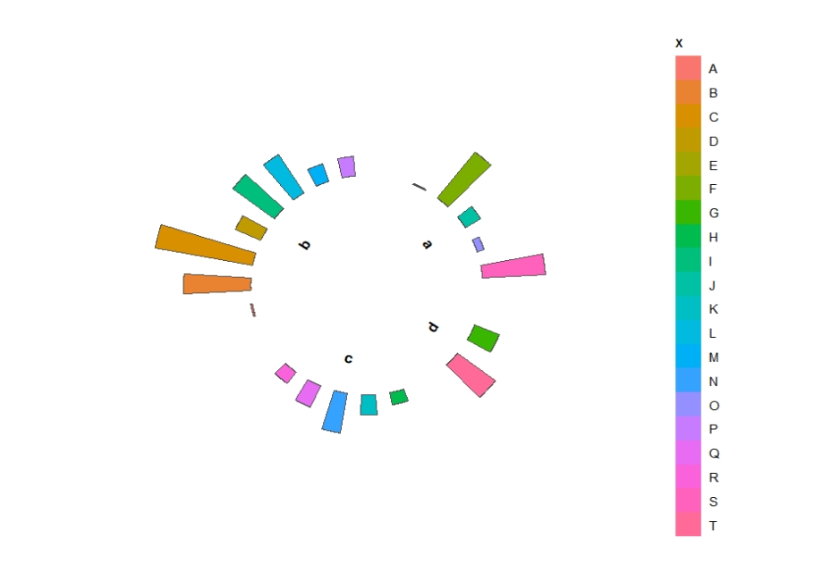

## geom_trackdensity

```r
ggcirclize(diamonds,aes(x = depth,fill = cut,sector = cut)) +
  geom_trackdensity(aes(end = 360),strip.label.pos = "bottom")
```
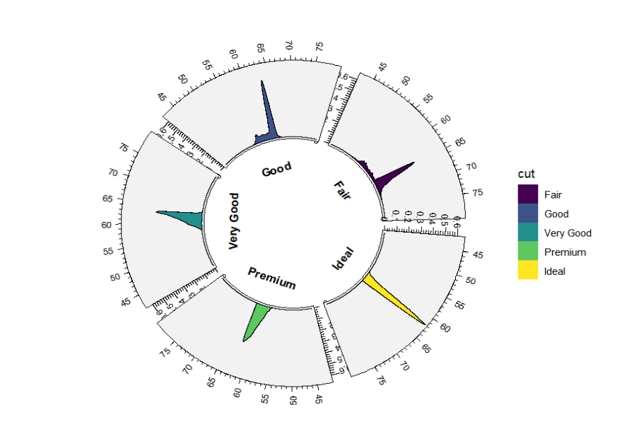

```r
ggcirclize(diamonds,aes(x = depth,fill = cut,sector = cut)) +
  geom_trackdensity(aes(end = 360),strip.label.pos = "bottom",
                    scales = "free_y")
```
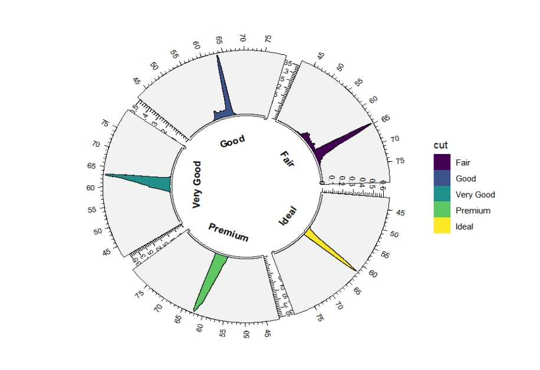
## geom_trackarea

```r
ggcirclize(df, aes(x = weight, fill = sex,sector = sex)) +
  geom_trackarea(stat ="bin")
```
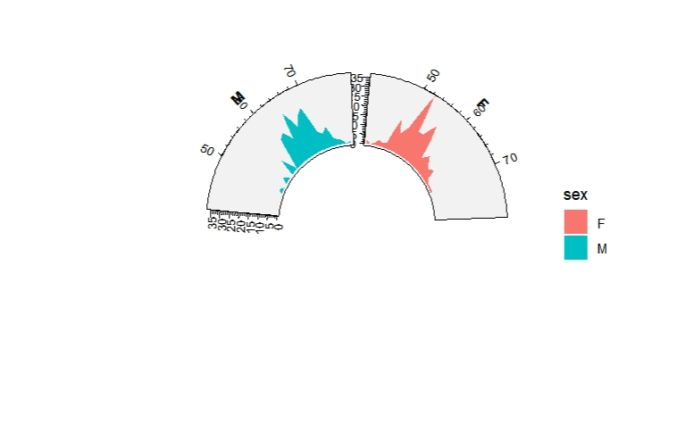

## geom_trackhist

```r
ggcirclize(diamonds,aes(x = depth,fill = color,sector = color)) +
  geom_trackhist(aes(end = 360),strip.label.pos = "bottom",
                 sector.gap = 20,
                 scales = "free_y")
```
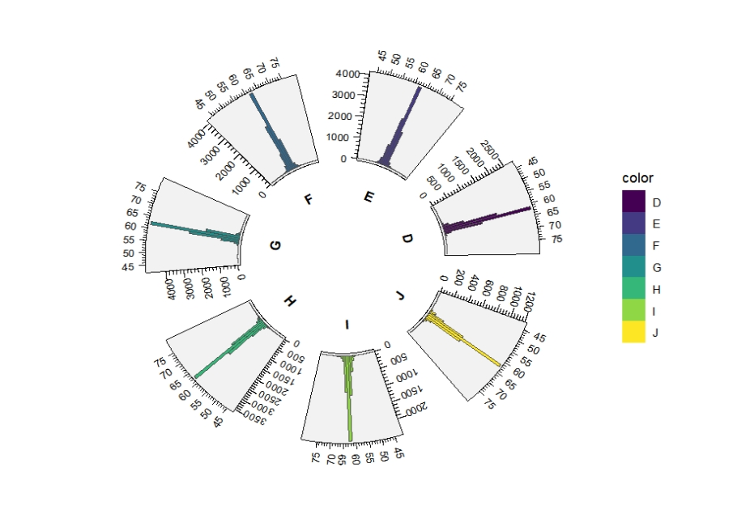


## geom_trackviolin

```r
ggcirclize(dbox, aes(x, y,start = 0,end = 360,sector = gp)) +
  geom_trackviolin(aes(fill = gp),scales = "free")
```
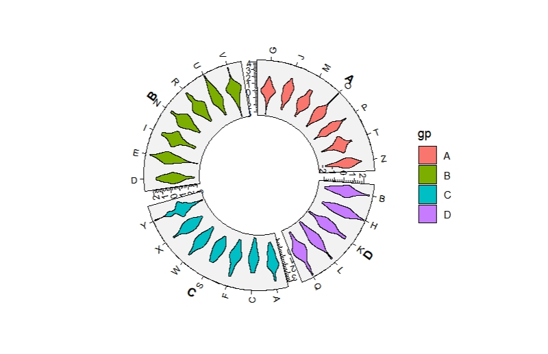

## geom_trackboxplot


```r
set.seed(111)
dbox <- data.frame(x = rep(LETTERS[1:26],50),
                   y = rnorm(50*26),
                   gp = sample(LETTERS[1:4],26,replace = T))

ggcirclize(dbox, aes(x, y,start = 0,end = 360,sector = gp)) +
  geom_trackboxplot(aes(fill = gp),scales = "free")
```

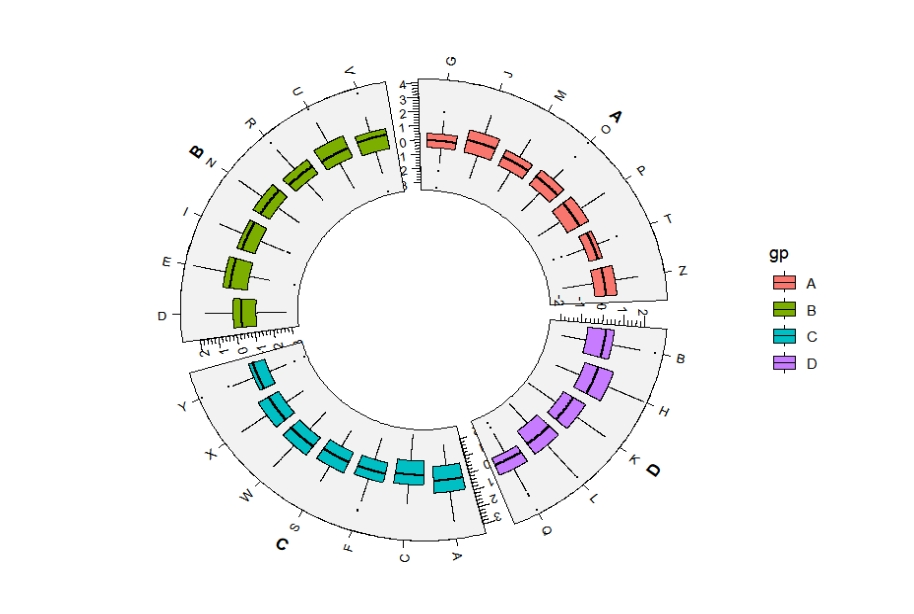
