# Low level arcGrobs

Most **geom** layers are based on low level arcGrobs in **ggcirclize**. This chapter we will
describe the usage of these **arcGrobs** to better understand how the circular plot be created.

## arcSectorGrob

**arcSectorGrob** draws arc rectangle in unit circle.

---

**start,end** control the sector size of the rectangle:

```r
library(ggcirclize)
library(ggplot2)
library(grid)

newpage()
grid.draw(arcSectorGrob(start = 0,end = 180))
```

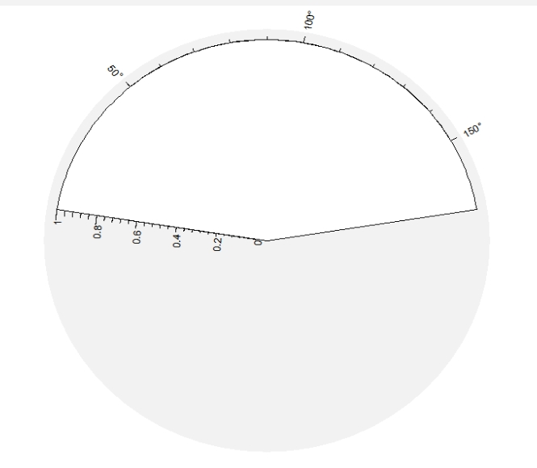

**r0,r1** control the radius of the rectangle:

```r
newpage()
grid.draw(arcSectorGrob(start = 0,end = 180,
                        r0 = 0.5,r1 = 0.8))
```

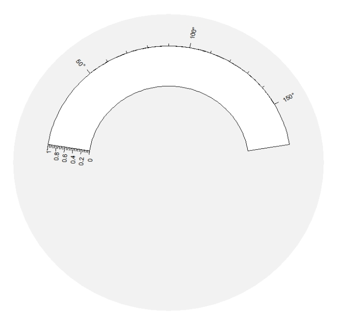

**extend.xscale** and **extend.yscale** control the extension of the xscale and yscale:

```r
newpage()
grid.draw(arcSectorGrob(start = 0,end = 270,
                        r0 = 0.3,r1 = 0.8,
                        extend.xscale = 0,extend.yscale = 0))
```

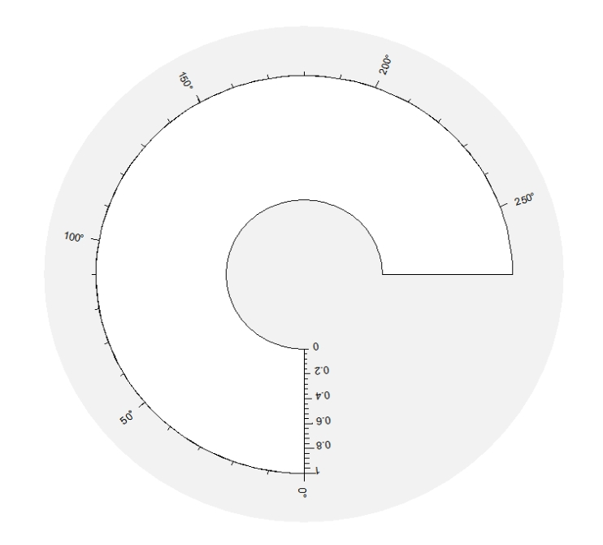

**sector.gp** controls the graphics of rectangle:

```r
newpage()
grid.draw(arcSectorGrob(start = 0,end = 270,
                        r0 = 0.3,r1 = 0.8,
                        add.xaxis = F,
                        add.yaxis = F,
                        extend.xscale = 0,extend.yscale = 0,
                        sector.gp = gpar(fill = "orange",col = NA)))
```


Other parameter settings about axis can be passed in **arcxAxisGrob.params** and **arcyAxisGrob.params**
arguments:

```r
newpage()
grid.draw(arcSectorGrob(start = 0,end = 270,
                        r0 = 0.5,r1 = 1,
                        extend.xscale = 0,
                        arcxAxisGrob.params = list(pos = "bottom",
                                                   xscale = c(0,100),
                                                   x.label.gp = gpar(fontzie = 1)),
                        arcyAxisGrob.params = list(yscale = c(0,10))
))
```

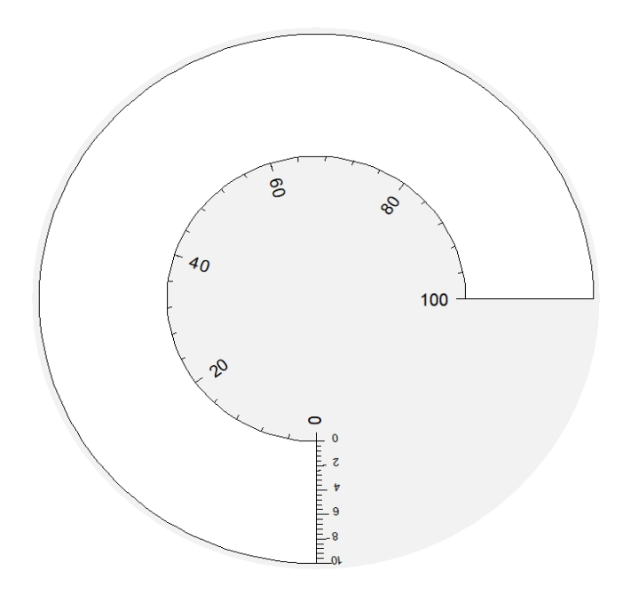


## arcAxisGrob

**arcAxisGrob** draws arc axis in unit circle which includes **xaxis** and **yaxis**.

---

You should define the **axis.type** to tell which axis to be drawn and **pos** to tell where
the axis position to be drawn:

```r
newpage()
grid.draw(arcAxisGrob(start = 0,end = 350,
                      r0 = 0.5,r1 = 0.8,
                      extend.xscale = 0,
                      axis.type = "x",pos = "top"))
```
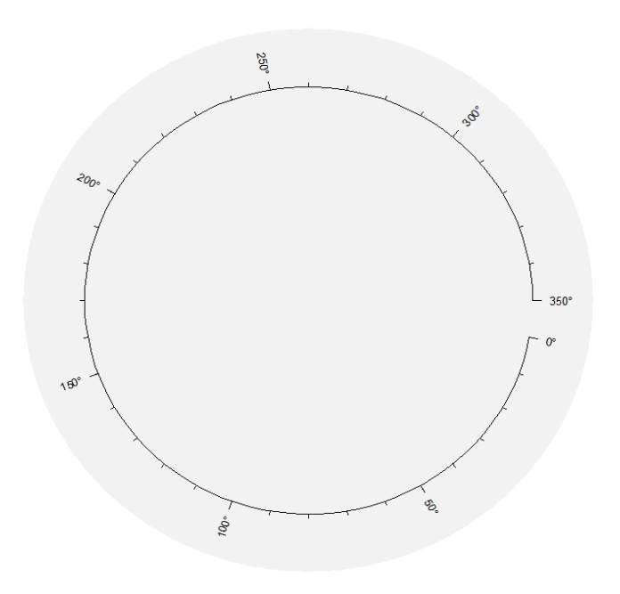


**breaks.n** controls the numbers main ticks. **nice.facing** controls the axis labels rotation and
the plot will be drawn on clockwise if **clock.wise == TRUE**:

```r
newpage()
grid.draw(arcAxisGrob(start = 0,end = 350,
                      r0 = 0.5,r1 = 0.8,
                      extend.xscale = 0,
                      breaks.n = 15,
                      axis.type = "x",pos = "top",
                      nice.facing = T,
                      clock.wise = T))
```

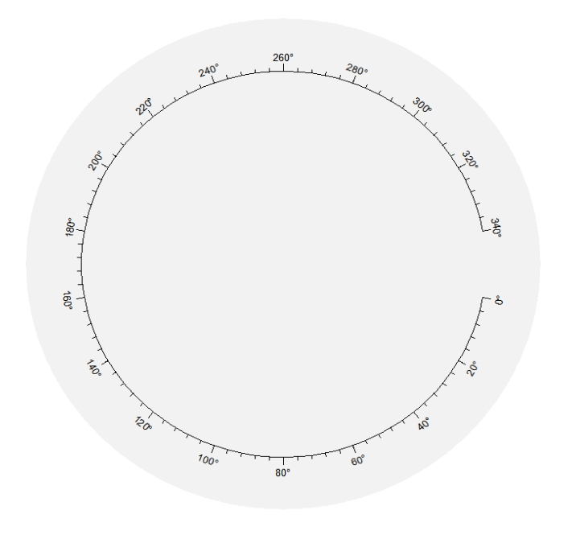
You can specify the **xscale** to define the xaxis range:

```r
newpage()
grid.draw(arcAxisGrob(start = 0,end = 350,
                      r0 = 0.5,r1 = 0.8,
                      extend.xscale = 0,
                      axis.type = "x",pos = "top",
                      xscale = c(1,100),
                      breaks.n = 20))
```


Change the tick labels by using **breaks.label**:

```r
newpage()
grid.draw(arcAxisGrob(start = 0,end = 350,
                      r0 = 0.5,r1 = 0.8,
                      extend.xscale = 0,
                      axis.type = "x",pos = "top",
                      xscale = c(1,100),
                      breaks.n = 20,
                      breaks.label = LETTERS[1:20]))
```
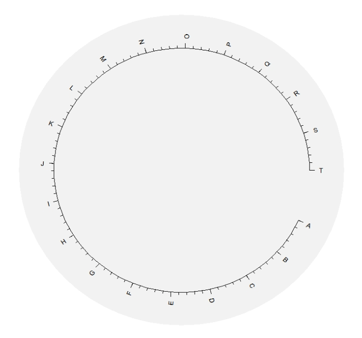

**minor.ticks.n** controls the minor ticks number:

```r
newpage()
grid.draw(arcAxisGrob(start = 0,end = 350,
                      r0 = 0.5,r1 = 0.8,
                      extend.xscale = 0,
                      axis.type = "x",pos = "top",
                      xscale = c(1,100),
                      breaks.n = 20,
                      breaks.label = LETTERS[1:20],
                      minor.ticks.n = 0))
```
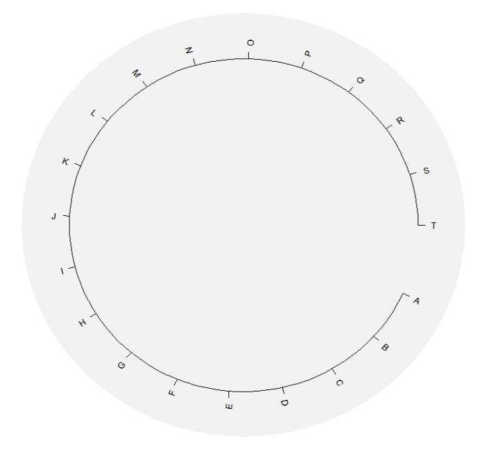

Change the position of axis:

```r
newpage()
grid.draw(arcAxisGrob(start = 0,end = 350,
                      r0 = 0.5,r1 = 0.8,
                      extend.xscale = 0,
                      axis.type = "x",pos = "bottom"))
```
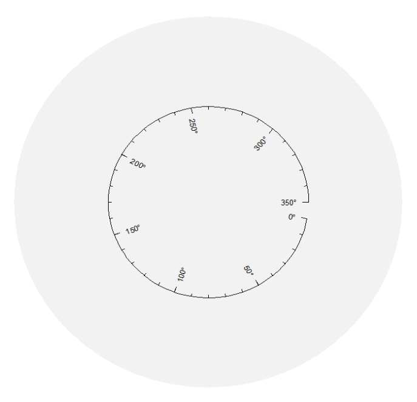

Similar settings to the y axis:

```r
newpage()
grid.draw(arcSectorGrob(start = 0,end = 180,
                        r0 = 0.2,r1 = 0.8,
                        extend.xscale = 0,
                        add.xaxis = F,add.yaxis = F))
grid.draw(arcAxisGrob(start = 0,end = 180,
                      r0 = 0.2,r1 = 0.8,
                      extend.xscale = 0,
                      axis.type = "y",pos = "left"))
grid.draw(arcAxisGrob(start = 0,end = 180,
                      r0 = 0.2,r1 = 0.8,
                      extend.xscale = 0,
                      axis.type = "y",pos = "right",
                      yscale = c(0,100),
                      breaks.n = 5))
```
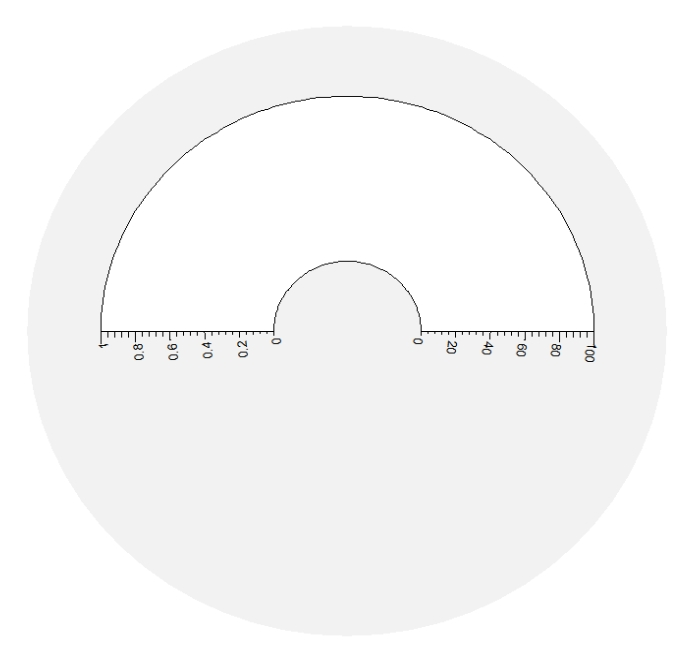


Use the **breaks** and **xscale** to map correct axis position to the scale range:

```r
newpage()
grid.draw(arcAxisGrob(start = 13,end = 177,
                      r0 = 0.5,r1 = 0.8,
                      extend.xscale = 0,
                      breaks.n = 10,
                      axis.type = "x",pos = "top",
                      nice.facing = T))
grid.draw(arcAxisGrob(start = 13,end = 177,
                      r0 = 0.6,r1 = 0.6,
                      extend.xscale = 0,
                      breaks = c(23,44,61,110,125,134,151),
                      xscale = c(13,177),
                      nice.facing = T,
                      axis.type = "x",pos = "top"))
grid.draw(arcAxisGrob(start = 13,end = 177,
                      r0 = 0.4,r1 = 0.4,
                      extend.xscale = 0,
                      breaks = seq(40,160,20),
                      xscale = c(13,177),
                      nice.facing = T,
                      axis.type = "x",pos = "top"))
```
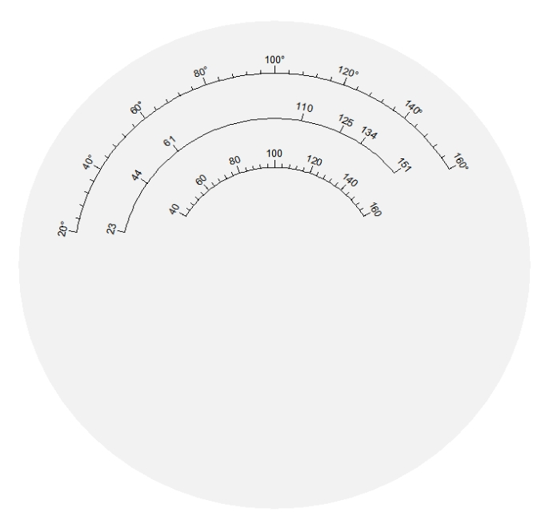


The same situation for y axis:

```r
newpage()
grid.draw(arcSectorGrob(start = 30,end = 150,
                        r0 = 0.2,r1 = 1,
                        extend.yscale = 0,
                        add.xaxis = F,add.yaxis = F))
grid.draw(arcAxisGrob(start = 30,end = 150,
                      r0 = 0.2,r1 = 1,
                      extend.yscale = 0,
                      yscale = c(13,83),
                      axis.type = "y",pos = "left"))
grid.draw(arcAxisGrob(start = 30,end = 150,
                      r0 = 0.2,r1 = 1,
                      extend.yscale = 0,
                      yscale = c(13,83),
                      breaks = c(20,40,50,70),
                      axis.type = "y",pos = "right"))

grid.draw(arcSectorGrob(start = 30,end = 150,
                        r0 = 0.2,r1 = 1,
                        extend.yscale = 0,
                        clock.wise = T,
                        add.xaxis = F,add.yaxis = F))
grid.draw(arcAxisGrob(start = 30,end = 150,
                      r0 = 0.2,r1 = 1,
                      extend.yscale = 0,
                      yscale = c(13,83),
                      clock.wise = T,
                      axis.type = "y",pos = "left"))
grid.draw(arcAxisGrob(start = 30,end = 150,
                      r0 = 0.2,r1 = 1,
                      extend.yscale = 0,
                      yscale = c(13,83),
                      clock.wise = T,
                      breaks = seq(20,80,20),
                      axis.type = "y",pos = "right"))
```
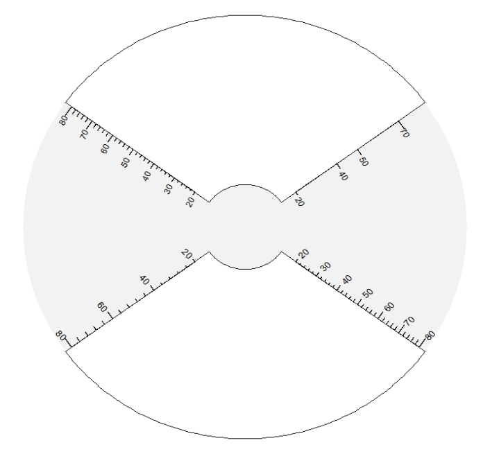


## arcPointGrob

**arcPointGrob** draws arc scatter point in unit circle.

---

```r
newpage()
grid.draw(arcSectorGrob(start = 0,end = 180,
                        r0 = 0.5,r1 = 1,
                        arcxAxisGrob.params = list(xscale = range(mtcars$mpg)),
                        arcyAxisGrob.params = list(yscale = range(mtcars$disp))
                        ))
grid.draw(arcPointGrob(x = mtcars$mpg,y = mtcars$disp,
                       start = 0,end = 180,
                        r0 = 0.5,r1 = 1))
```
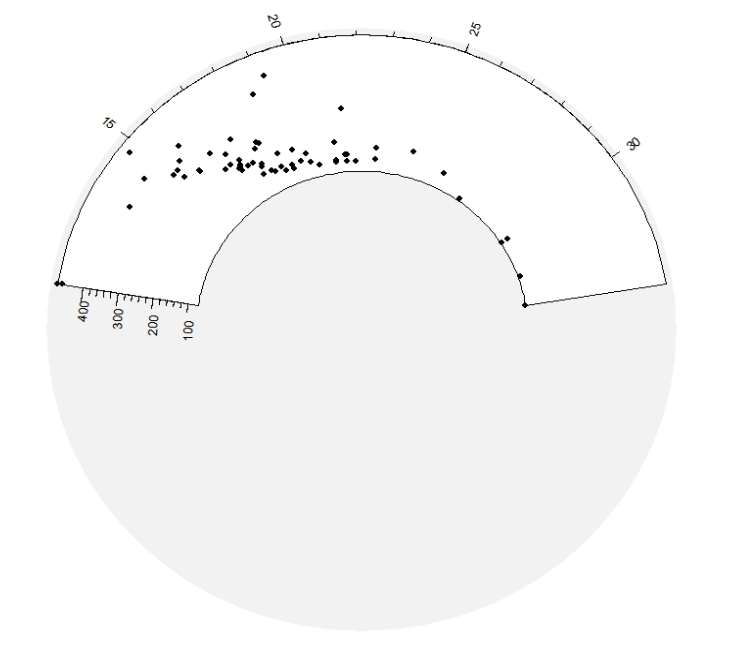

## arcSegmentsGrob

**arcSegmentsGrob** draws arc segment in unit circle.

---


```r
newpage()
grid.draw(arcSegmentsGrob(xmin = rep(1,10),xmax = rep(10,10),
                          ymin = 1:10,ymax = 1:10,
                          r0 = 0.5,r1 = 1,start = 0,end = 180))
```
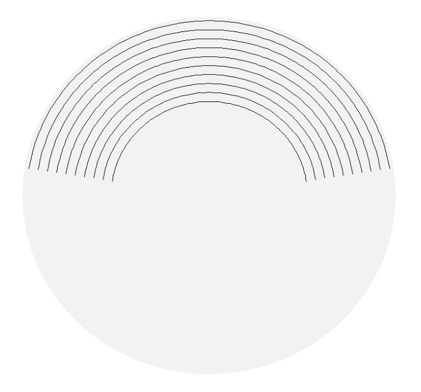
Oblique line in arc plot:

```r
newpage()
grid.draw(arcSegmentsGrob(xmin = c(1,1),xmax = c(5,5),
                          ymin = c(1,1),ymax = c(3,5),
                          r0 = 0.5,r1 = 1,start = 0,end = 180))
```
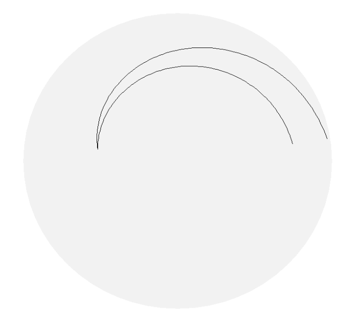

## arcLinesGrob

**arcLinesGrob** draws line in arc plot in unit circle.

---

```r
newpage()
grid.draw(arcLinesGrob(x = c(0,0.5,1),y = c(0.375,0,1),
                       start = 0,end = 180,r0 = 0.5,r1 = 1))
```
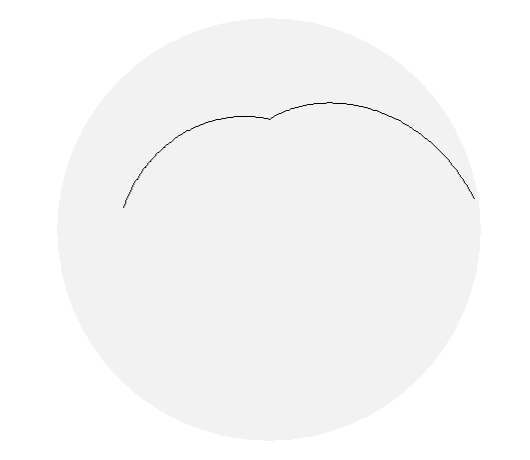

## arcRectGrob

**arcRectGrob** draws rectangle in unit circle.

---


```r
newpage()
grid.draw(arcSectorGrob(start = 0,end = 180,r0 = 0.2,r1 = 0.8))

grid.draw(arcRectGrob(xmin = c(1,10,20),xmax = c(9,15,35),
                      ymin = c(1,5,10),ymax = c(2,8,15),
                      start = 0,end = 180,r0 = 0.5,r1 = 0.8))
```
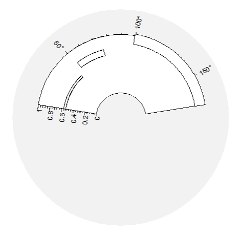

## arcPolygonGrob

**arcPolygonGrob** draws arc polygon in uint circle.

---

First we draw a triangle in rectangular coordinate system:

```r
x <- c(0.1,0.5,0.9)
y <- c(0.1,0.9,0.1)

grid.newpage()
grid.polygon(x = x,y = y)
```
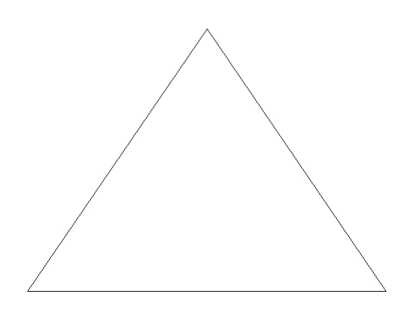

And we show it in arc plot:

```r
newpage()
grid.draw(arcPolygonGrob(x = x,y = y,
                         start = 0,end = 180,r0 = 0.5,r1 = 1))
```
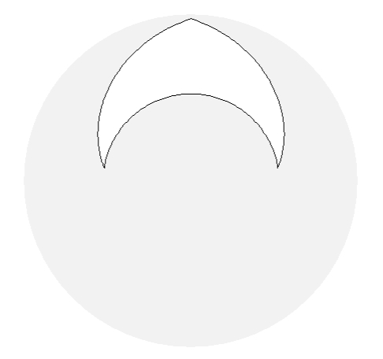


Draw multiple triangles:

```r
x1 <- seq(0,23,1)
y1 <- rep(y,8)

newpage()
grid.draw(arcPolygonGrob(x = x1,y = y1,
                         id = rep(1:8,each = 3),
                         start = 0,end = 360,r0 = 0.5,r1 = 1))
```

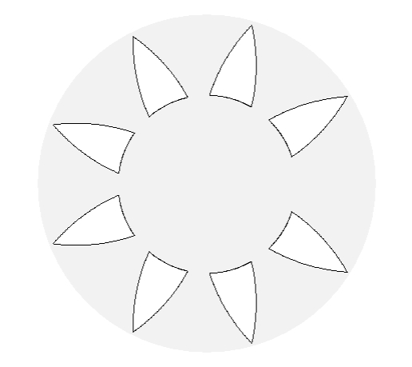


```r
```


Draw different shape polygons:

```r
newpage()
grid.draw(arcPolygonGrob(x = x,y = y,
                         start = 0,end = 180,r0 = 0.5,r1 = 1))

newpage()
grid.draw(arcPolygonGrob(x = c(0.1,0.2,0.3,0.4,0.5,0.4,0.7,0.6,0.7),
                         y = c(0.1,0.9,0.1,0.1,0.5,0.9,0.9,0.5,0.1),
                         id = c(rep("a",3),rep("b",6)),
                         polygon.gp = gpar(fill = c("pink","orange")),
                         start = 0,end = 180,r0 = 0.5,r1 = 1))
```

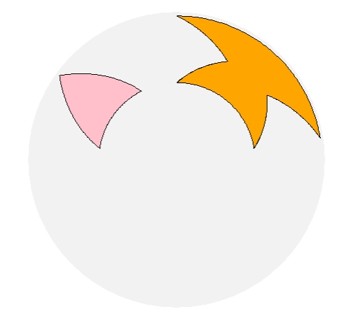
We show an example for ggplot2 output:

```r
ids <- factor(c("1.1", "2.1", "1.2", "2.2", "1.3", "2.3"))

values <- data.frame(
  id = ids,
  value = c(3, 3.1, 3.1, 3.2, 3.15, 3.5)
)

positions <- data.frame(
  id = rep(ids, each = 4),
  x = c(2, 1, 1.1, 2.2, 1, 0, 0.3, 1.1, 2.2, 1.1, 1.2, 2.5, 1.1, 0.3,
        0.5, 1.2, 2.5, 1.2, 1.3, 2.7, 1.2, 0.5, 0.6, 1.3),
  y = c(-0.5, 0, 1, 0.5, 0, 0.5, 1.5, 1, 0.5, 1, 2.1, 1.7, 1, 1.5,
        2.2, 2.1, 1.7, 2.1, 3.2, 2.8, 2.1, 2.2, 3.3, 3.2)
)

# Currently we need to manually merge the two together
datapoly <- merge(values, positions, by = c("id"))

p <- ggplot(datapoly, aes(x = x, y = y)) +
  geom_polygon(aes(fill = value, group = id))
p
```
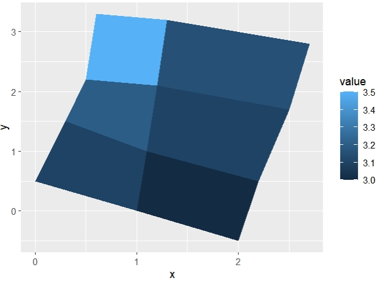


Re-write by using **arcPolygonGrob**:

```r
newpage()
grid.draw(arcPolygonGrob(x = datapoly$x,y = datapoly$y,id = datapoly$id,
                         start = 0,end = 180,r0 = 0.5,r1 = 1,
                         polygon.gp = gpar(fill = 1:6)))
```
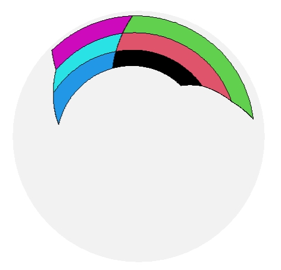


## arcLinksGrob

**arcLinksGrob** draws connection curves in unit circle.

---

It draws line connection when you supply single **start** and **end**. Band connection
will be drawn when supplied with two degrees:

```r
newpage()
grid.draw(arcLinksGrob(start = 0,end = 60,r = 1))
grid.draw(arcLinksGrob(start = 0,end = 300,r = 1))
grid.draw(arcLinksGrob(start = c(0,30),end = c(70,80),r = 1))
grid.draw(arcLinksGrob(start = c(350,360),end = c(260,270),r = 1))
```
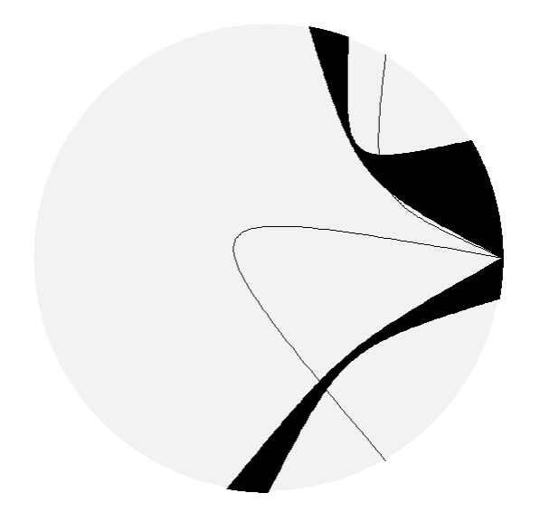


**curve.height** controls the line arc height:
```r
newpage()
grid.draw(arcLinksGrob(start = 0,end = 60,r = 1,curve.height = 1))
grid.draw(arcLinksGrob(start = 0,end = 60,r = 1,curve.height = 0.5))
```
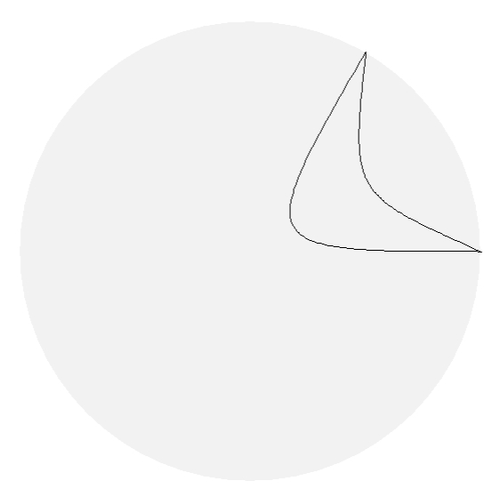


Add arrows:
```r
newpage()
grid.draw(arcLinksGrob(start = 0,end = 60,r = 1,curve.height = 1,
                       curve.arrow = arrow()))
grid.draw(arcLinksGrob(start = c(0,15),end = c(300,320),
                       r = 1,
                       start.arrow = T,end.arrow = T))
```
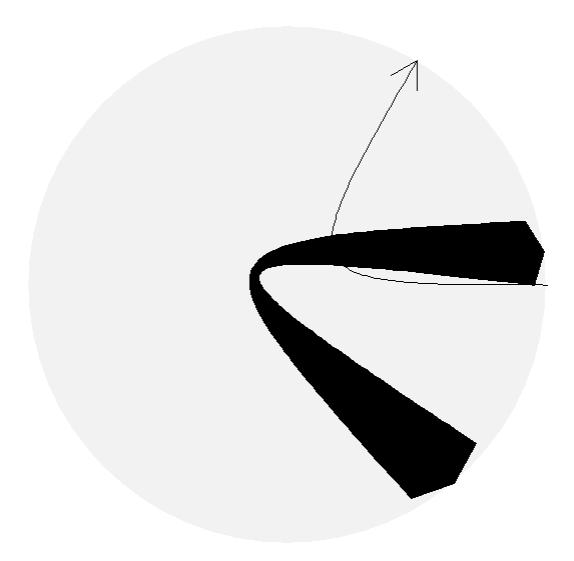

## arcLinks2Grob

**arcLinks2Grob** is almost same as **arcLinksGrob**, besides, it can draw arc links with
two different radius:


```r
newpage()
grid.draw(arcLinks2Grob(start = c(0,15),end = c(300,320),
                        r0 = 0.6,r1 = 1,r = 1,
                        start.arrow = T,end.arrow = T))
```
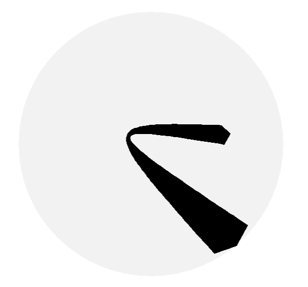

**get_height** can get relative curve height with the degrees(0-180):

```r
newpage()
grid.segments(x0 = 0,x1 = 1,y0 = 0.5,y1 = 0.5)
grid.segments(x0 = 0.5,x1 = 0.5,y0 = 0,y1 = 1)

st <- sample(seq(0,360,10),10,replace = F)
ed <- sample(seq(0,360,10),10,replace = F)
for (th in 1:10) {
  h <- get_height(st[th],ed[th],0.5,1)
  grid.draw(arcLinks2Grob(start = st[th],end = ed[th],
                          curve.height = h,
                          r0 = 1,r1 = 1,r = 1))
}
```
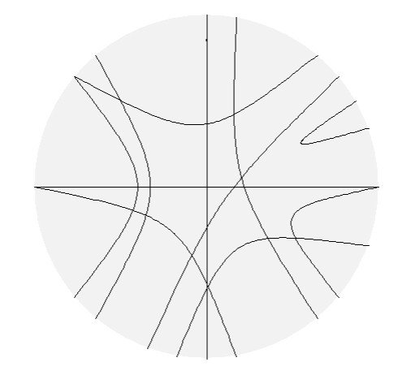

## arcTextGrob

**arcTextGrob** draws curve text in unit circle.

---


```r
newpage()
grid.draw(arcTextGrob(x = 1,y = 1,
                      labels = "This is a nice day today!",
                      start = 0,end = 180,r0 = 0.5,r1 = 1))
```
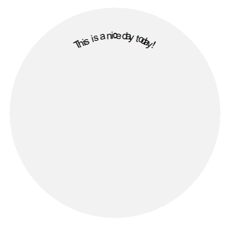


Default **nice.facing==TRUE**:

```r
newpage()
grid.draw(arcTextGrob(x = 1:20,y = rep(1,20),
                      labels = paste0("gene ",1:20),
                      curved.label = F,
                      start = 0,end = 360,r0 = 0.5,r1 = 1))
```
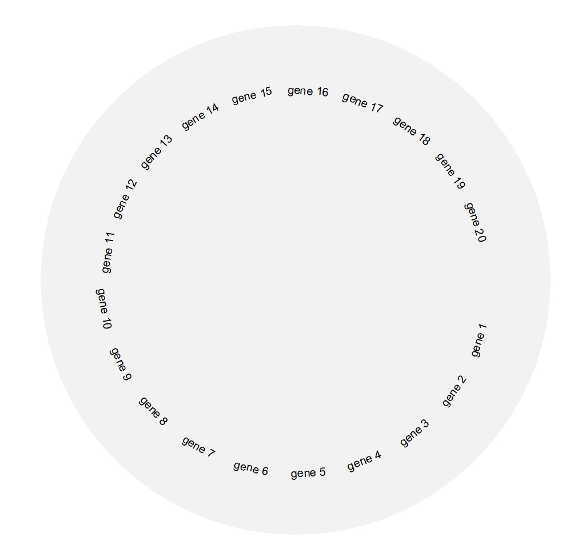

Youcan turn it off:

```r
newpage()
grid.draw(arcTextGrob(x = 1:20,y = rep(1,20),
                      labels = paste0("gene ",1:20),
                      curved.label = F,
                      nice.facing = F,
                      inward = T,
                      start = 0,end = 360,r0 = 1,r1 = 1))
```
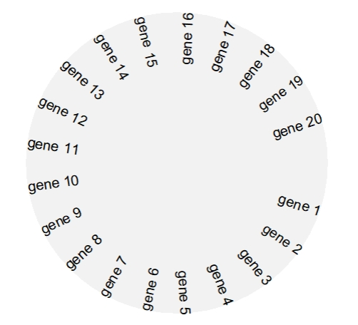


**curved.label** controls the labels whether be drawn in arc format:
```r
newpage()
grid.draw(arcTextGrob(x = 1:20,y = 1:20,
                      labels = rownames(USArrests)[1:20],
                      start = 0,end = 360,
                      r0 = 0.1,r1 = 1,
                      curved.label = F,
                      text.gp = gpar(fontsize = 10)))
```
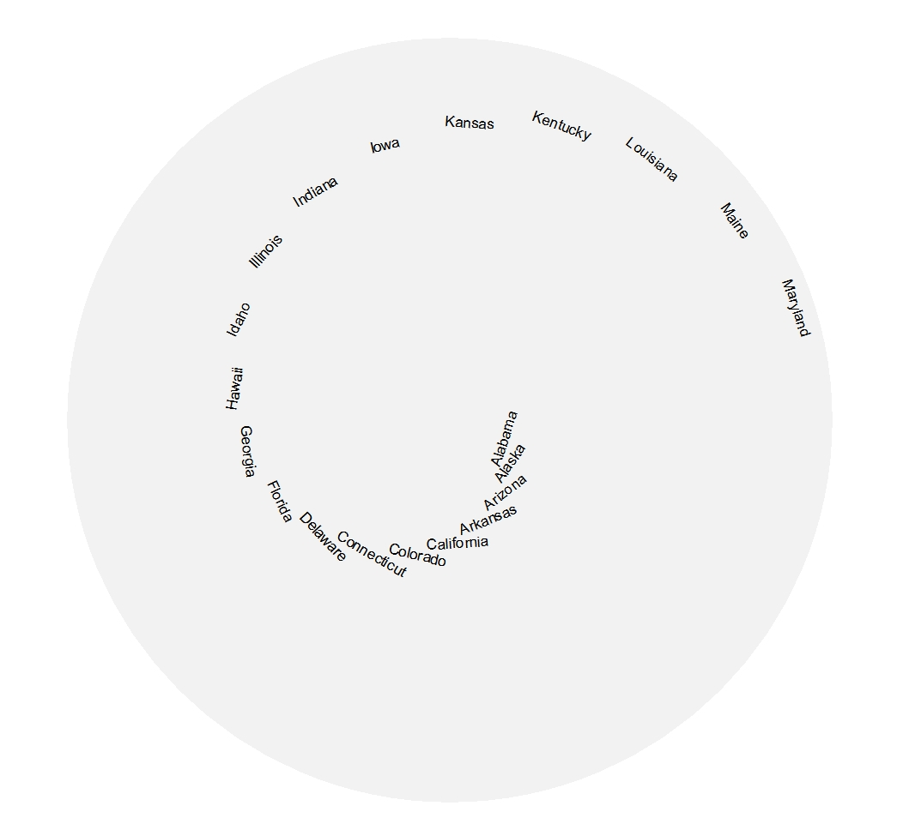

```r
newpage()
grid.draw(arcTextGrob(x = 1:20,y = 1:20,
                      labels = rownames(USArrests)[1:20],
                      start = 0,end = 360,
                      r0 = 0.1,r1 = 1,
                      curved.label = T,
                      text.gp = gpar(fontsize = 10)))
```
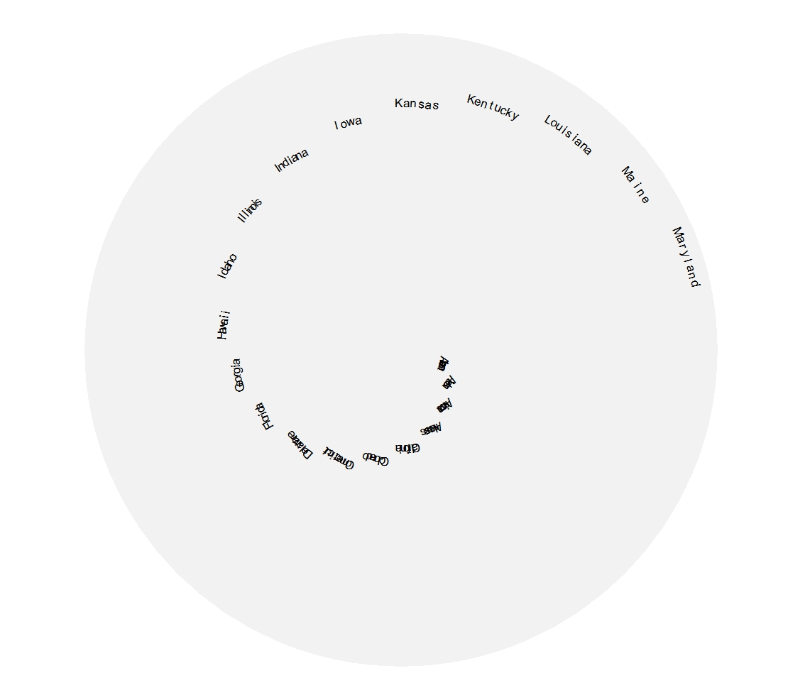

