# Nested zooming

To visualize or highlight some specific regions on genome, a convenient way is to draw a new
track or sector to show the target region. **geom_genomicNestedZoom** can zoom target regions
with different geom layers.

---

## Intro

```r
set.seed(111)
bed = generateRandomBed(nr = 600)

zoom <- generateRandomBed(nr = 20)[,-4]

# check
head(zoom,3)
#    chr     start       end
# 1 chr1  52965429 124887955
# 2 chr1 168604490 233330834
# 3 chr2   2089280   5242329

ggcirclize(bed,aes(end = 360,r0 = 0.8,r1 = 1,
                   chr = chr,gstart = start,gend = end,
                   value = value1,
                   genome = "hg19")) +
  geom_genomicNestedZoom(zoom_data = zoom)
```
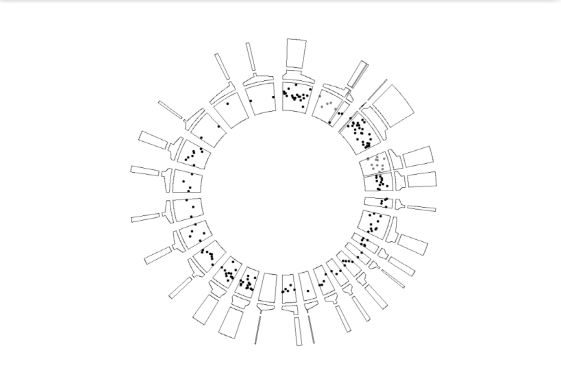

Add origin point layer:

```r
ggcirclize(bed,aes(end = 360,r0 = 0.8,r1 = 1,
                   chr = chr,gstart = start,gend = end,
                   value = value1,
                   genome = "hg19",
                   color = value1)) +
  geom_trackgenomicpoint(add.xaxis = F) +
  geom_genomicNestedZoom(zoom_data = zoom)
```
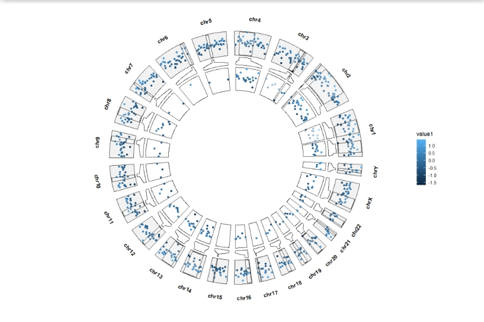

**zoom.free.sec** can free the zoomed sector size rather than fixed size which is restricted by their
origin sector:

```r
ggcirclize(bed,aes(end = 360,r0 = 0.8,r1 = 1,
                   chr = chr,gstart = start,gend = end,
                   value = value1,
                   genome = "hg19",
                   color = value1)) +
  geom_trackgenomicpoint(add.xaxis = F) +
  geom_genomicNestedZoom(zoom_data = zoom,nested_fill = rand_color(24),
                         zoom.free.sec = T)
```
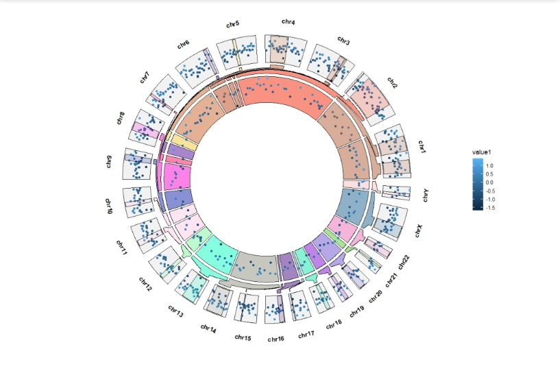

Adjust the zoom sector gap space:

```r
ggcirclize(bed,aes(end = 360,r0 = 0.8,r1 = 1,
                   chr = chr,gstart = start,gend = end,
                   value = value1,
                   genome = "hg19",
                   color = value1)) +
  geom_trackgenomicpoint(add.xaxis = F) +
  geom_genomicNestedZoom(zoom_data = zoom,nested_fill = rand_color(24),
                         zoom.free.sec = T,
                         sub.zoom.gap = 3)
```
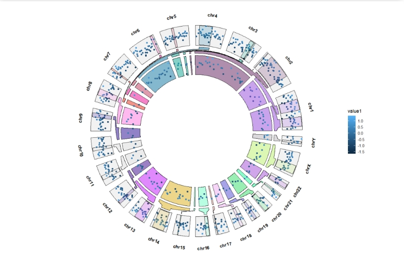

Extend the sector start and end degree:

```r
ggcirclize(bed,aes(end = 360,r0 = 0.8,r1 = 1,
                   chr = chr,gstart = start,gend = end,
                   value = value1,
                   genome = "hg19",
                   color = value1)) +
  geom_trackgenomicpoint(add.xaxis = F,sector.gap = 10) +
  geom_genomicNestedZoom(zoom_data = zoom,
                         sector.gap = 10,
                         extend.start = 5,
                         extend.end = 5)
```
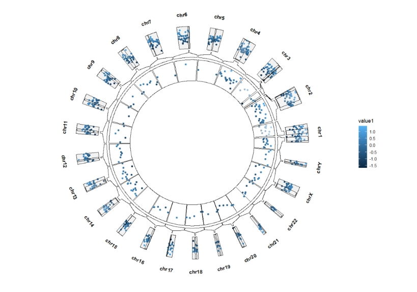

Adjust the zoom track position:

```r
ggcirclize(bed,aes(end = 360,r0 = 0.5,r1 = 0.7,
                   chr = chr,gstart = start,gend = end,
                   value = value1,
                   genome = "hg19",
                   color = value1)) +
  geom_trackgenomicpoint(add.xaxis = F,sector.gap = 5,
                         strip.label.pos = "bottom",strip.label.space = 0.05) +
  geom_genomicNestedZoom(zoom_data = zoom,
                         sector.gap = 5,
                         extend.start = 2.5,
                         extend.end = 2.5,
                         zoom_pos = "top",
                         nested_fill = rand_color(24))
```
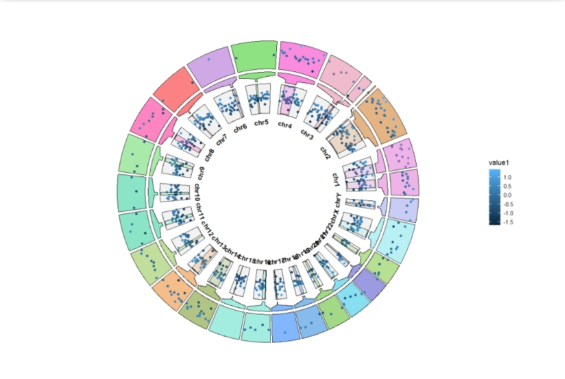


## Zooming with other layers

The default **geom** is **point**:

```r
ggcirclize(bed,aes(end = 360,r0 = 0.8,r1 = 1,
                   chr = chr,gstart = start,gend = end,
                   value = value1,
                   genome = "hg19")) +
  geom_trackgenomicline(add.xaxis = F) +
  geom_genomicNestedZoom(zoom_data = zoom)
```
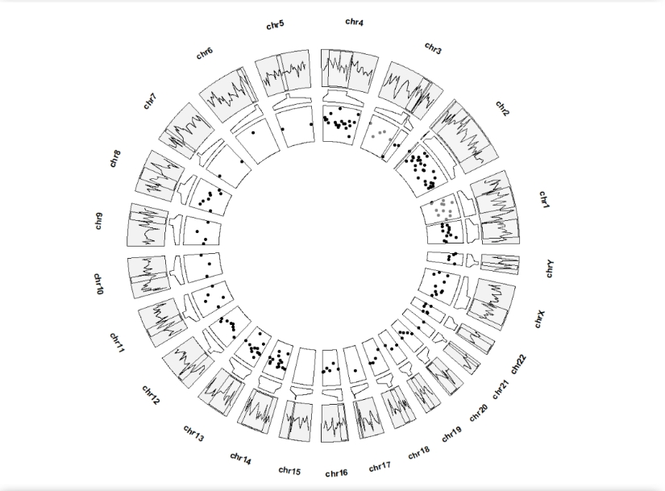


```r
ggcirclize(bed,aes(end = 360,r0 = 0.8,r1 = 1,
                   chr = chr,gstart = start,gend = end,
                   value = value1,color = chr,
                   genome = "hg19")) +
  geom_trackgenomicline(add.xaxis = F,show.legend = F) +
  geom_genomicNestedZoom(zoom_data = zoom,
                         geom = "line",
                         show.legend = F) +
  geom_trackgenomicpoint(aes(r0 = 0.4,r1 = 0.5),
                         add.xaxis = F,show.legend = F,strip.label = F)
```
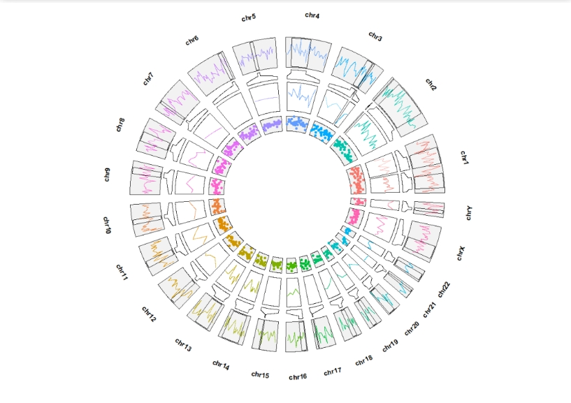

**geom_trackgenomicarea**:

```r
ggcirclize(bed,aes(end = 360,r0 = 0.8,r1 = 1,
                   chr = chr,gstart = start,gend = end,
                   value = value1,fill = chr,
                   genome = "hg19")) +
  geom_trackgenomicarea(add.xaxis = F,show.legend = F) +
  geom_genomicNestedZoom(zoom_data = zoom,color = "black",show.legend = F,
                         geom = "area")
```
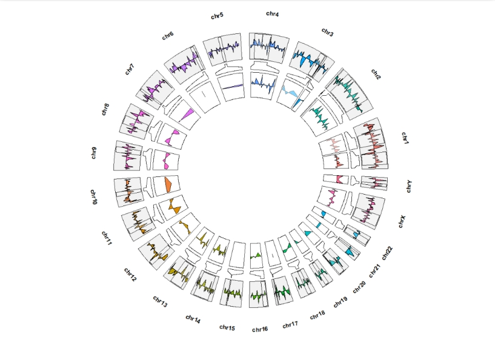

**geom_trackgenomicrect**:

```r
ggcirclize(cytoband_hg19,
           aes(end = 360,r0 = 0.8,r1 = 1,
               chr = chr,gstart = start,gend = end,
               genome = "hg19")) +
  geom_trackgenomicrect(aes(fill = stain,),add.xaxis = F,color = NA) +
  scale_fill_manual(values = c("gneg" = "white","gpos25" = "grey75","gpos50" = "grey50",
                               "gpos100" = "black","gvar" = "black","acen" = "red",
                               "stalk" = "blue")) +
  geom_genomicNestedZoom(zoom_data = zoom,color = "black",
                         geom = "rect")
```
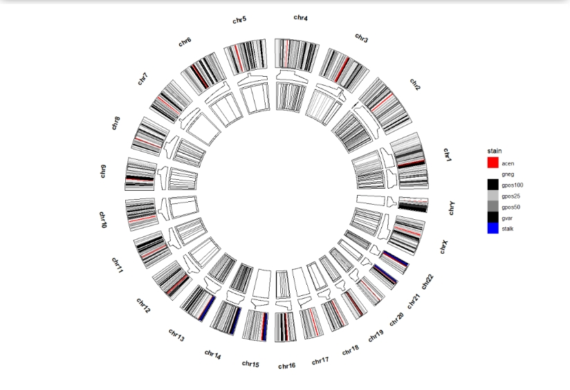

**geom_trackgenomictile**:

```r
bed = generateRandomBed(nr = 500, nc = 4)
bed_long <- bedMatTolong(bed)

ggcirclize(bed_long,aes(end = 360,r0 = 0.6,r1 = 0.8,
                        chr = chr,gstart = start,gend = end,
                        genome = "hg19",
                        x = x,y = y,fill = value)) +
  geom_trackgenomictile(strip.label = T,color = NA) +
  scale_fill_gradient2(low = "green",mid = "white",high = "red",midpoint = 0) +
  geom_genomicNestedZoom(zoom_data = zoom,geom = "tile",color = NA)
```
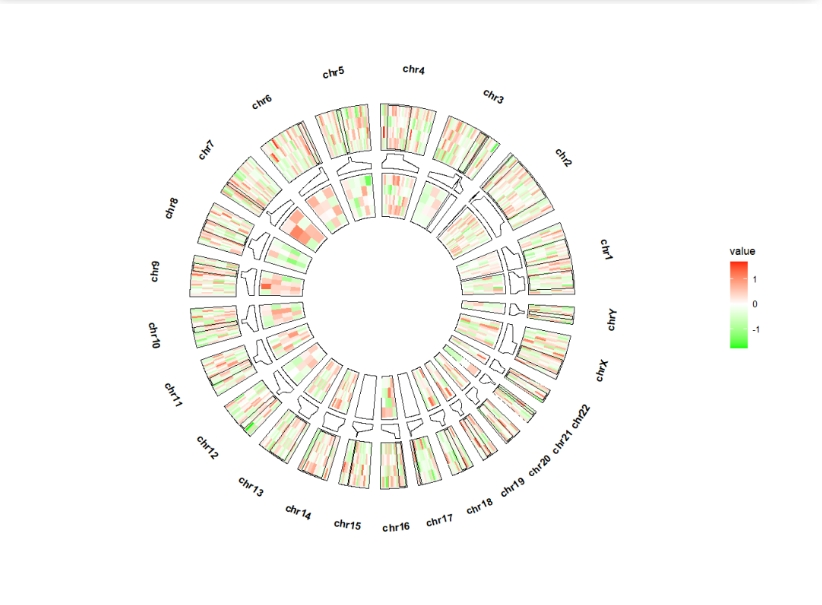
